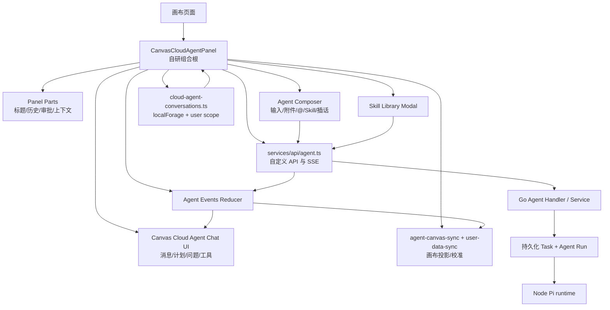

# 影策 Agent UI 框架与自研实现深度调研

> **目的**：回答“当前项目的 Agent 相关 UI 是否采用 assistant-ui、CopilotKit 等第三方 Agent UI 框架”，并为后续前端重写、Vue 迁移或引入通用 Agent UI 组件提供事实依据。
> **状态**：研究草稿；结论基于当前仓库源码、依赖清单、前端测试和已有云端 Agent 调研，不代表未来版本不会替换局部组件。
> **证据范围**：`web/package.json`、`web/bun.lock`、Agent 面板及子组件、Agent API/SSE 客户端、画布同步和本地会话持久化代码、相关前端测试，以及 [`云端 Agent 深度调研报告`](cloud-agent-deep-research.md)。本次未执行真实登录态 Agent 运行、真实模型调用或浏览器端到端验收。

## TL;DR

当前项目的 **云端 Agent 主界面是项目自研的 React UI 和状态机**，没有发现 `assistant-ui`、`CopilotKit`、`@ai-sdk/react`、`useChat` 等第三方 Agent UI/runtime 框架的依赖或导入。

项目确实使用了多个第三方库，但它们承担的是局部职责：

- `antd`：通用按钮、输入框、弹窗、设置控件等基础 UI；
- `@ant-design/x`：只在“AI 提示词优化”抽屉中使用 `Bubble` 和 `Sender`，没有作为云端 Agent 主面板的框架；
- `streamdown`：渲染流式 Markdown 消息；
- `motion`：面板、消息和交互动画；
- `lucide-react`：图标；
- `file-saver`、`nanoid`、Axios/HTTP 封装等：辅助能力；
- `@earendil-works/pi-coding-agent` 和 `@earendil-works/pi-ai`：Node/Pi Agent 执行 runtime，不是浏览器 UI 框架。

云端 Agent UI 自己实现了以下与产品业务强绑定的能力：

- 持久化会话、运行记录和待确认提交；
- `POST /api/agent/runs`、追加消息、插话、取消、审批和 SSE 事件订阅；
- Agent 计划、思考摘要、工具调用、用户问题、审批预览和错误恢复；
- Skill 选择、场景预设、画布节点引用和图片附件；
- 画布 Patch 增量应用、远端刷新、快照冲突和本地编辑保留；
- SSE 游标恢复、事件去重、断线重连和运行仍在后台继续的观察模型；
- 媒体生成审批、模型设置、预算和权限模式。

因此，当前项目不能简单归类为“套了一个聊天组件”。更准确的架构描述是：

```text
React 自研 Agent 工作台
  ├─ 项目自研会话 / 事件 / 审批 / 画布同步状态
  ├─ Ant Design 与少量第三方 UI 原语
  ├─ Streamdown Markdown 渲染
  └─ 自定义 /api/agent/* + SSE 协议
        ↓
Go Agent 控制面与持久化任务
        ↓
Pi Node runtime / 模型 bridge / 工具 bridge
```

如果未来移植到 Vue + Java，第三方框架最多适合替换消息列表、输入框、Markdown 渲染等表现层；Agent 运行合同、审批状态机、事件恢复、画布 Patch 和持久化边界仍需要按当前业务协议重新实现或适配。

## 1. 研究问题和证据分级

### 1.1 本报告要回答的问题

本报告把“使用了第三方东西”拆成四个不同问题：

1. 是否使用第三方 **Agent UI 框架**，例如 assistant-ui、CopilotKit？
2. 是否使用第三方 **通用 UI 组件库**，例如 Ant Design？
3. 是否使用第三方 **局部对话组件或 Markdown 渲染器**？
4. Agent 的执行、状态、审批、恢复和画布写入是否由第三方 runtime 负责，还是由项目自己维护？

不把 `@ant-design/x` 的局部 `Bubble` 组件误写成完整 Agent 框架，也不把 Pi Node runtime 误写成前端 UI 框架。

### 1.2 证据等级

| 等级 | 含义 |
| --- | --- |
| L1 | 当前依赖清单、导入语句、运行代码或测试直接证明。 |
| L2 | 当前代码结构和调用链一致支持，但未通过完整真实运行验证。 |
| L3 | 由组件命名、接口或注释推断出的设计意图。 |
| U | 本次没有验证，不能当成事实。 |

本报告关于“未发现 assistant-ui/CopilotKit”的结论属于 L1 静态扫描结论；关于“未来是否可能引入它们”属于 U，不作预测。

## 2. 直接结论：主 Agent UI 是自研的

### 2.1 依赖扫描结果

当前 Web 依赖包含：

```json
"antd": "^6.5.1",
"@ant-design/x": "^2.9.0",
"streamdown": "^2.5.0",
"motion": "^12.42.2",
"lucide-react": "^1.25.0"
```

但没有发现以下依赖或导入：

```text
assistant-ui
@assistant-ui/*
CopilotKit
@copilotkit/*
@ai-sdk/react
useChat
```

检查范围包括 `web/package.json`、`web/bun.lock` 和 `web/src/` 中的导入。该结论只能说明当前仓库没有这些框架的静态接入，不能替代运行时网络层或构建产物审计。

### 2.2 主面板的证据

主入口是 [`CanvasCloudAgentPanel`](../../web/src/components/canvas/canvas-cloud-agent-panel.tsx)。它直接维护和协调：

- `run`：当前服务端 Agent run；
- `messages`：前端展示消息；
- `prompt`：输入框内容；
- `connectionStatus`：SSE 连接状态；
- `approval`：待审批工具调用；
- `permissionMode`：只读、自动或请求审批；
- `selectedSkillIds`：当前会话技能；
- `conversations`：本地会话列表；
- `pendingSubmission`：待确认的幂等提交；
- `contextUsage`：上下文使用量；
- `planItems` 和 `pendingQuestion`：计划及用户问题；
- 面板设置、场景预设、模型和预算。

这些状态不是通用聊天组件通常能自动提供的状态，而是与当前画布、任务、审批和同步合同耦合的业务状态。

### 2.3 自研组件分工

| 组件 | 责任 | 证据 |
| --- | --- | --- |
| `canvas-cloud-agent-panel.tsx` | Agent 工作台组合根、运行生命周期、会话切换、提交、审批、SSE 和画布同步协调 | [`canvas-cloud-agent-panel.tsx`](../../web/src/components/canvas/canvas-cloud-agent-panel.tsx) |
| `canvas-cloud-agent-chat-ui.tsx` | 消息、计划、问题、工具活动、错误、表单和消息内容展示 | [`canvas-cloud-agent-chat-ui.tsx`](../../web/src/components/canvas/canvas-cloud-agent-chat-ui.tsx) |
| `canvas-cloud-agent-composer.tsx` | Prompt 输入、附件、节点/Skill 引用、发送、插话和停止 | [`canvas-cloud-agent-composer.tsx`](../../web/src/components/canvas/canvas-cloud-agent-composer.tsx) |
| `canvas-cloud-agent-panel-parts.tsx` | 启动按钮、标题栏、上下文环、历史会话、审批卡片、设置控制 | [`canvas-cloud-agent-panel-parts.tsx`](../../web/src/components/canvas/canvas-cloud-agent-panel-parts.tsx) |
| `canvas-cloud-agent-events.ts` | SSE 事件归并、消息去重、工具详情合并、审批和错误状态更新 | [`canvas-cloud-agent-events.ts`](../../web/src/components/canvas/canvas-cloud-agent-events.ts) |
| `canvas-agent-skill-library-modal.tsx` | 技能市场、已加入技能、本轮启用技能和场景筛选 | [`canvas-agent-skill-library-modal.tsx`](../../web/src/components/canvas/canvas-agent-skill-library-modal.tsx) |
| `canvas-cloud-agent-settings.tsx` | 模型、权限、上下文、预算、Skill 和长期偏好设置 | [`canvas-cloud-agent-settings.tsx`](../../web/src/components/canvas/canvas-cloud-agent-settings.tsx) |
| `canvas-cloud-agent.css` | Agent 面板、消息、工具卡、输入区和主题样式 | [`canvas-cloud-agent.css`](../../web/src/components/canvas/canvas-cloud-agent.css) |

主界面由这些项目组件互相组合，而不是从第三方 Agent UI 的 Thread/Runtime/Provider 组件树向外配置。

## 3. 第三方库的真实使用边界

### 3.1 Ant Design：通用 UI 原语

主 Agent 面板和设置页面使用 `antd` 的 `Button`、`Input`、`Checkbox`、弹窗和其他通用组件。它提供的是视觉控件和交互原语，不负责：

- Agent run 生命周期；
- 模型循环；
- SSE 事件协议；
- 工具调用状态；
- 审批恢复；
- 画布写入；
- 幂等和任务重试。

### 3.2 Ant Design X：局部提示词优化聊天界面

`@ant-design/x` 在仓库中可以定位到 [`canvas-prompt-optimizer-drawer.tsx`](../../web/src/components/canvas/canvas-prompt-optimizer-drawer.tsx)。该文件使用：

```tsx
import { Bubble, Sender, type BubbleItemType } from "@ant-design/x";
```

并渲染：

```tsx
<Bubble.List />
<Sender />
```

这个抽屉的用途是“AI 提示词优化”，承担一个局部的对话展示和输入区域。它不是 `CanvasCloudAgentPanel` 的消息状态、运行控制或工具协议基础。

因此应当写成：

> 项目在提示词优化子功能中使用了 Ant Design X 的聊天 UI 组件；云端 Agent 主工作台仍是自研实现。

不能写成：

> 项目采用了 Ant Design X Agent 框架。

### 3.3 Streamdown：消息正文渲染

Agent 消息正文通过 [`ai-message-markdown.tsx`](../../web/src/components/ai/ai-message-markdown.tsx) 的 `AIMessageMarkdown` 渲染，底层使用 `streamdown`。

它解决的是：

- Markdown 结构解析；
- 流式文本显示；
- 代码块和自定义组件渲染。

它不解决：

- 消息数据模型；
- SSE 连接和游标；
- 工具调用状态机；
- 审批卡片；
- 画布引用和 Patch；
- 运行持久化。

### 3.4 Motion、Lucide 和其他辅助库

| 库 | 当前用途 | 是否是 Agent 框架 |
| --- | --- | --- |
| `motion` | 面板出现/退出、消息和场景胶囊动画 | 否 |
| `lucide-react` | 图标 | 否 |
| `nanoid` | 会话、消息和客户端标识 | 否 |
| `file-saver` | Agent 调试导出文件 | 否 |
| `axios`/项目 `http` | 业务 API 请求 | 否 |
| `localforage`/用户 scope 存储 | 会话和待确认提交的浏览器持久化 | 否 |

这些依赖不能替代 Agent 的业务协议。

## 4. Agent UI 的组件和数据流

### 4.1 主工作台组件图



### 4.2 面板不是纯展示组件

`CanvasCloudAgentPanel` 既是 UI 组合根，也是一个前端协调器。它执行：

1. 读取当前用户、画布、模型和 Agent 偏好；
2. 加载本地会话和待确认提交；
3. 监听当前 `run.id` 的事件流；
4. 将事件交给 `applyAgentEvent` 更新消息、运行和审批状态；
5. 将同一事件交给 `createAgentCanvasSync`，把 Agent 变更投影到画布；
6. 处理提交、重试、幂等键和插话；
7. 在切换会话或用户 scope 时重建本地状态；
8. 持久化会话快照和技能选择。

这也是它难以直接替换成通用 Thread 组件的原因：UI 组件和业务状态机并没有完全分离。

### 4.3 输入区是产品特定的 Composer

[`canvas-cloud-agent-composer.tsx`](../../web/src/components/canvas/canvas-cloud-agent-composer.tsx) 支持：

- 普通文本输入；
- 图片附件预览；
- `@` 引用画布节点和资源；
- `/` 或自然语言引用 Skill；
- 场景技能胶囊；
- 运行中插话；
- 停止当前运行；
- 自动调整输入高度；
- 发送前的模型、权限和上下文状态提示。

它不是简单的 `<textarea>` 加发送按钮。输入内容会影响 Agent 请求的 `canvasId`、`focusNodeIds`、`skillIds`、权限模式、预算和幂等键。

## 5. 自定义 Agent API 和事件协议

### 5.1 HTTP API 客户端

Agent 前端调用 [`services/api/agent.ts`](../../web/src/services/api/agent.ts)，而不是调用某个第三方 Agent SDK。当前客户端导出的核心操作包括：

| 操作 | 作用 |
| --- | --- |
| `createAgentRun` | 创建一个新的持久化 Agent run。 |
| `sendAgentMessage` | 以父 run 为上下文创建下一轮不可变消息。 |
| `sendAgentInterjection` | Agent 运行期间发送插话。 |
| `cancelAgentRun` | 请求停止运行。 |
| `decideAgentApproval` | 提交审批或拒绝决定。 |
| `getAgentRun` | 重新读取运行快照。 |
| `getAgentCapabilities` | 读取后端当前权限、工具和能力合同。 |
| `getAgentProfile` / `updateAgentProfile` | 读取和修改用户、项目或画布级 Agent 偏好。 |
| `subscribeAgentEvents` | 连接持久化事件流并负责断线重连。 |

请求体包含 `canvasId`、`prompt`、`model`、`skillIds`、`focusNodeIds`、`permissionMode`、`contextScope`、`budget` 和 `idempotencyKey` 等产品字段。第三方通用聊天框架通常不会知道这些画布和计费边界。

### 5.2 SSE 是观察通道，不是执行引擎

前端通过：

```text
GET /api/agent/runs/:id/events?after=<seq>
Last-Event-ID: <seq>
Accept: text/event-stream
```

订阅运行事件。`subscribeAgentEvents` 负责：

- 持有 `AbortController`；
- 维护服务端事件 `seq` 游标；
- 区分持久化事件和合成快照事件；
- 读取 `run_snapshot` 和 `agent_event`；
- 检查 `runId` 和事件序号；
- 处理 `Retry-After`；
- 对断线执行有上限的指数退避；
- 在连接停滞时触发 watchdog；
- 达到失败次数上限后通知 UI；
- 终止订阅时取消 reader，不把正常退场误报为运行失败。

后端 handler 的注释明确说明 Agent 编排是持久化的，浏览器事件流不会驱动执行。浏览器断开只影响观察，不会自动取消后台运行。

### 5.3 事件归并和业务展示

[`canvas-cloud-agent-events.ts`](../../web/src/components/canvas/canvas-cloud-agent-events.ts) 将不同类型的事件转换为展示消息和前端状态：

- assistant 文本增量；
- reasoning 摘要；
- 工具开始、进行中、完成和失败；
- 工具重试；
- 计划项和计划终态；
- 用户问题和表单；
- 审批等待、批准和拒绝；
- 媒体任务提交与完成；
- 上下文压缩；
- 运行失败、取消和清理状态。

展示层还会把工具名映射为用户可读的类别、标题和错误说明，并区分：

- “提交了媒体任务”；
- “媒体任务完成”；
- “画布已经写入结果”。

这些语义不是通用消息组件自动拥有的，而是当前项目自己的产品解释层。

## 6. 会话、幂等和浏览器持久化

### 6.1 会话快照存储

[`cloud-agent-conversations.ts`](../../web/src/services/cloud-agent-conversations.ts) 使用带用户 scope 的 `localForage` 保存：

- 会话列表；
- 当前会话 ID；
- 消息展示快照；
- 最近一次 Agent run 摘要；
- 模型和权限模式；
- 当前会话 Skill ID；
- 创建和更新时间。

存储键按 `canvasId` 和当前用户 scope 隔离。保存时会清除只属于内存观察状态的 `streaming` 标记，避免刷新后把旧消息误判成仍在实时展开。

### 6.2 待确认提交不是普通聊天草稿

前端另行保存 `CloudAgentPendingSubmission`，包含：

- 请求指纹；
- 幂等键；
- 原始请求体；
- 父 run ID；
- 消息 ID；
- 展示文本和画布引用。

如果 POST 结果在网络层丢失，刷新页面后可以使用同一个请求身份恢复，而不是生成一个新的 Agent turn。损坏的恢复记录会 fail closed，要求用户先核对任务，不会静默丢弃幂等身份。

### 6.3 浏览器状态和服务端事实的边界

浏览器 localForage 保存的是会话展示和提交恢复数据；服务端 Task、CloudAgentExecution、事件 journal、审批和画布快照才是运行事实。前端可以恢复 UI，但不能凭本地消息快照声称 Agent 已经完成或画布已经持久化。

## 7. 画布同步让 Agent UI 具有业务专属性

### 7.1 事件同时进入消息状态和画布同步

在 `CanvasCloudAgentPanel` 的事件订阅回调中，同一个事件会经过两条路径：

```text
Agent event
  ├─ applyAgentEvent -> 消息、计划、审批、错误、运行状态
  └─ canvasSync.receive -> 画布增量投影/校准
```

当事件序号出现间隙时，前端会请求 reconcile，而不是继续假设局部事件完整。事件重放时，消息和画布投影都必须保持幂等。

### 7.2 画布 Patch 不是聊天消息

Agent 可能通过工具创建、更新、连接、排列节点，或提交媒体生成任务。UI 需要展示：

- 影响了哪些节点；
- 预计新增、修改或删除什么；
- 是否需要用户审批；
- 任务是否只是提交，还是已经完成；
- 画布当前本地编辑是否与远端变更冲突。

因此，主 Agent UI 的核心数据不是“消息数组”，而是“消息 + 工具执行 + 审批 + 任务 + 画布同步”的联合视图。

### 7.3 迁移时不能只替换消息列表

如果把现有 UI 简化为第三方聊天线程组件，至少会丢失：

- 工具调用和画布节点的关联；
- 审批预览和审批恢复；
- 媒体任务与画布结果的区别；
- 事件序号和断线重连；
- 本地编辑与 Agent Patch 的合并策略；
- pending submission 的幂等恢复；
- Skill、节点引用和模型能力选择。

第三方 UI 可以承载这些数据，但不会自动提供这些业务语义。

## 8. Agent UI 与 Pi runtime 的关系

### 8.1 前端不直接运行 Pi

前端只调用 Go 后端的 `/api/agent/*` 接口，并通过 SSE 观察 run。它不加载 `@earendil-works/pi-coding-agent`，也不直接持有 Pi 会话。

### 8.2 Go 控制面负责运行合同

Go 后端负责：

- 用户和画布归属；
- 请求校验和幂等；
- 权限模式、预算和工具列表；
- Skill 快照；
- Agent run 和 Task 持久化；
- 工具调用、审批、资源和媒体任务；
- 事件 journal 和恢复。

### 8.3 Pi 是执行 runtime，不是 UI framework

Node/Pi runtime 负责模型循环和 bridge：

```text
Go 控制面
  -> Pi runtime
      -> /model bridge
      -> /tool bridge
      -> /event bridge
```

它提供的是“模型请求、工具调用、工具结果和事件回报”的执行能力。Agent UI 仍然需要自己解释这些事件、提供审批和更新画布。

## 9. 当前 UI 的测试和验证证据

### 9.1 已有前端测试覆盖的主要区域

当前 `web/test/` 中与 Agent 相关的测试包括：

| 测试文件 | 主要覆盖 |
| --- | --- |
| `agent-api-reliability.test.ts` | SSE 恢复、游标重放、Retry-After、连接超时、取消和待确认提交重试。 |
| `cloud-agent-conversations.test.ts` | 会话和待确认提交的持久化、校验与损坏记录处理。 |
| `agent-canvas-sync.test.ts` | Agent 事件到画布同步的边界。 |
| `agent-canvas-refresh.test.ts` | 远端刷新、脏本地编辑、冲突、增量批次、重放和校准。 |
| `agent-canvas-patch.test.ts` | Patch 原子性、删除/新任务绑定、重放幂等和本地编辑保留。 |
| `agent-media-approval.test.ts` | 媒体审批模型、目标节点和设置匹配。 |
| `agent-approval-presentation.test.ts` | 审批预览的字段、资源和风险说明。 |
| `agent-tool-presentation.test.ts` | 工具分类、错误、生成提交与结果完成的区分。 |
| `agent-chat-tool-card.test.tsx` | 工具卡片展示。 |
| `agent-chat-node-links.test.tsx` | 消息中的画布节点引用。 |
| `agent-operation-feed-view.test.tsx` | 操作流展示。 |
| `agent-panel-presentation.test.tsx` | 面板展示逻辑。 |
| `prompt-optimizer-drawer.test.tsx` | 提示词优化抽屉。 |

这些测试说明项目已经为自研状态和协议建立了较多单元/组件级保护，但不能据此声称主 Agent UI 已通过完整真实浏览器端到端验收。

### 9.2 当前没有据此确认的内容

本次没有执行：

- 真实登录态下创建 Agent run；
- 真实模型多轮工具调用；
- 真实审批后媒体任务提交；
- 浏览器断线后跨刷新恢复真实运行；
- 多标签页同时观察同一 run；
- 独立 `yingce-agent` 容器联调；
- 真实画布写入后的人工视觉验收；
- 生产规模下的消息渲染和事件吞吐压测。

## 10. 对 Vue + Java 迁移的架构含义

### 10.1 可以替换的部分

以下内容可以考虑用 Vue 生态或第三方组件替换：

- Message list 的基础布局；
- Prompt Composer 的文本区和附件入口；
- Markdown/代码块渲染；
- 通用按钮、弹窗、下拉菜单和表单；
- 面板动画和图标。

但替换组件时要保留当前业务字段和事件语义，而不是只映射 `role`、`content` 两个字段。

### 10.2 必须先固定的后端合同

Java Spring Boot 迁移前，应将下列合同固定并用黑盒/准端到端测试覆盖：

1. Agent run 创建请求和响应信封；
2. 父 run 与追加消息的关系；
3. 幂等键和请求指纹；
4. run 状态枚举和终态；
5. SSE 事件字段、`seq`、`after` 和 `Last-Event-ID`；
6. `run_snapshot` 与 `agent_event` 的关系；
7. 工具调用、工具结果和错误类别；
8. 审批预览、审批决定和恢复行为；
9. Skill 快照、版本和读取回执；
10. 画布 Patch、快照哈希和冲突回执；
11. 媒体任务提交与完成的边界；
12. 取消、断线、重连和清理状态。

### 10.3 如果采用第三方 Agent UI 框架

建议先建立适配层，而不是让框架类型渗透到业务 API：

```text
Java/Go Agent wire protocol
  -> Agent transport adapter
  -> Domain event reducer
  -> Framework-neutral AgentViewModel
  -> Vue UI / optional third-party components
```

其中：

- `Agent transport adapter` 处理 HTTP、SSE、游标和重连；
- `Domain event reducer` 将服务端事件归并为运行、消息、工具、审批和画布状态；
- `AgentViewModel` 不依赖 assistant-ui、CopilotKit 或具体 Vue 组件库；
- UI 框架只消费已归并的视图模型；
- 画布同步和审批不能藏在某个第三方聊天组件内部。

### 10.4 选型时应检查的能力

如果未来评估 assistant-ui、CopilotKit、Ant Design X 或 Vue 生态组件，至少逐项核对：

| 能力 | 必须确认的问题 |
| --- | --- |
| 自定义消息类型 | 能否展示计划、推理摘要、工具卡、用户问题、审批和媒体状态？ |
| 流式事件 | 能否使用服务端 `seq` 和 `Last-Event-ID`，而不是假设单一文本流？ |
| 断线恢复 | 能否恢复同一 run，而不是创建新的对话请求？ |
| 工具状态 | 能否区分 pending、running、approval、failed、completed 和 retrying？ |
| 画布绑定 | 能否把工具结果绑定到真实节点、任务和快照哈希？ |
| 输入扩展 | 能否支持 `@` 节点、Skill、附件和运行中插话？ |
| 审批 | 能否展示结构化预览并提交产品自己的审批合同？ |
| 持久化 | 是否允许业务方保留自己的会话和 pending submission 存储？ |
| 样式和交互 | 能否适配当前画布浮层、拖拽、缩放和主题 token？ |
| 退出策略 | 如果组件库停止维护，业务协议是否仍可独立运行？ |

### 10.5 当前实现暴露出的设计改进点

当前自研实现已经覆盖了大量业务边界，但 UI 组合根承担的职责较多。后续可以考虑：

- 把 Agent transport 从 React 组件中进一步抽成独立服务；
- 把事件 reducer 和 `AgentViewModel` 做成框架无关模块；
- 把审批预览、工具演进和媒体状态定义为稳定协议；
- 把会话本地持久化和服务端 run 快照分成明确的 repository 接口；
- 为画布同步建立独立的 Agent projection adapter；
- 让 Vue、React 或第三方 UI 只消费相同的中间视图模型。

这些是面向新实现的架构建议，不代表当前代码已经完成了上述拆分。

## 11. 代码与文档导航

### 11.1 前端主链

| 主题 | 入口 |
| --- | --- |
| 云端 Agent 面板 | [`canvas-cloud-agent-panel.tsx`](../../web/src/components/canvas/canvas-cloud-agent-panel.tsx) |
| 消息和工具 UI | [`canvas-cloud-agent-chat-ui.tsx`](../../web/src/components/canvas/canvas-cloud-agent-chat-ui.tsx) |
| 输入、附件、Skill 和场景胶囊 | [`canvas-cloud-agent-composer.tsx`](../../web/src/components/canvas/canvas-cloud-agent-composer.tsx) |
| 标题、历史、审批和控制 | [`canvas-cloud-agent-panel-parts.tsx`](../../web/src/components/canvas/canvas-cloud-agent-panel-parts.tsx) |
| 事件归并 | [`canvas-cloud-agent-events.ts`](../../web/src/components/canvas/canvas-cloud-agent-events.ts) |
| Agent API/SSE | [`web/src/services/api/agent.ts`](../../web/src/services/api/agent.ts) |
| 会话和 pending submission | [`cloud-agent-conversations.ts`](../../web/src/services/cloud-agent-conversations.ts) |
| 画布同步 | [`agent-canvas-sync.ts`](../../web/src/services/agent-canvas-sync.ts)、[`user-data-sync`](../../web/src/services/user-data-sync.ts) |
| Skill 选择 | [`canvas-agent-skill-library-modal.tsx`](../../web/src/components/canvas/canvas-agent-skill-library-modal.tsx)、[`skill-runtime.ts`](../../web/src/services/skill-runtime.ts) |
| 提示词优化局部聊天 UI | [`canvas-prompt-optimizer-drawer.tsx`](../../web/src/components/canvas/canvas-prompt-optimizer-drawer.tsx) |
| Markdown 消息渲染 | [`ai-message-markdown.tsx`](../../web/src/components/ai/ai-message-markdown.tsx) |

### 11.2 后端和 runtime

| 主题 | 入口 |
| --- | --- |
| Agent HTTP handler | [`backend/internal/handler/agent.go`](../../backend/internal/handler/agent.go) |
| Agent run、幂等和准入 | [`backend/internal/app/cloud_agent.go`](../../backend/internal/app/cloud_agent.go) |
| Pi 请求组装 | [`backend/internal/app/cloud_agent_pi_request.go`](../../backend/internal/app/cloud_agent_pi_request.go) |
| 工具注册和合同 | [`backend/internal/app/cloud_agent_tools.go`](../../backend/internal/app/cloud_agent_tools.go)、[`cloud_agent_pi_canvas_tools_registry.go`](../../backend/internal/app/cloud_agent_pi_canvas_tools_registry.go) |
| Agent 系统策略 | [`backend/internal/prompts/agent-system-policy.md`](../../backend/internal/prompts/agent-system-policy.md) |
| Pi runtime 依赖 | [`backend/agent-runtime/pi/package.json`](../../backend/agent-runtime/pi/package.json) |
| Agent 深度调用链 | [`cloud-agent-deep-research.md`](cloud-agent-deep-research.md) |

### 11.3 测试入口

| 主题 | 测试 |
| --- | --- |
| SSE 和请求可靠性 | [`web/test/agent-api-reliability.test.ts`](../../web/test/agent-api-reliability.test.ts) |
| 会话持久化 | [`web/test/cloud-agent-conversations.test.ts`](../../web/test/cloud-agent-conversations.test.ts) |
| 画布 Patch | [`web/test/agent-canvas-patch.test.ts`](../../web/test/agent-canvas-patch.test.ts) |
| 画布刷新和冲突 | [`web/test/agent-canvas-refresh.test.ts`](../../web/test/agent-canvas-refresh.test.ts) |
| 画布事件同步 | [`web/test/agent-canvas-sync.test.ts`](../../web/test/agent-canvas-sync.test.ts) |
| 工具和审批展示 | [`web/test/agent-tool-presentation.test.ts`](../../web/test/agent-tool-presentation.test.ts)、[`web/test/agent-approval-presentation.test.ts`](../../web/test/agent-approval-presentation.test.ts) |
| Agent 面板展示 | [`web/test/agent-panel-presentation.test.tsx`](../../web/test/agent-panel-presentation.test.tsx) |
| 提示词优化抽屉 | [`web/test/prompt-optimizer-drawer.test.ts`](../../web/test/prompt-optimizer-drawer.test.ts) |

## 12. 验证记录和未完成范围

### 12.1 本次完成的静态检查

- 阅读并核对了 `AGENTS.md`、文档索引、云端 Agent 深度调研报告和相关源码入口；
- 检查了 `web/package.json` 和 `web/bun.lock` 中的 Agent/UI 相关依赖；
- 搜索了 `assistant-ui`、`CopilotKit`、`@ai-sdk/react`、`useChat` 等关键词；
- 核对了主 Agent 面板、Composer、消息 UI、事件 reducer、API/SSE、会话持久化和画布同步入口；
- 核对了 `@ant-design/x` 的实际导入位置，确认它只出现在提示词优化抽屉；
- 核对了 Agent 相关前端测试文件和覆盖主题；
- 对本文内部相对链接、代码围栏、表格列数和替换字符进行了静态检查。

### 12.2 未执行的真实验收

本次没有：

- 在真实登录态下打开画布 Agent 并提交模型请求；
- 执行真实工具调用、媒体生成或审批流程；
- 对 `@ant-design/x`、assistant-ui 或 CopilotKit 做运行时性能对比；
- 验证独立 `yingce-agent` 服务下的浏览器联调；
- 执行完整 `bun run build` 或全量前端测试；
- 对多标签页、弱网和跨设备场景进行浏览器验收。

因此，本报告可以作为“当前 Agent UI 是自研业务工作台、第三方库只负责局部 UI/渲染、Pi 是后端执行 runtime”的代码导航和迁移分析入口，但不能被描述为完整生产级 UI 验收报告。

## 13. 导航关系

- [`云端 Agent 深度调研报告`](cloud-agent-deep-research.md)：跨前端、Go 控制面、Pi bridge、Skill、画布工具、媒体审批和恢复机制的完整执行链。
- [`Agent 能力与技术实现全景调研`](agent-capabilities-and-architecture-research.md)：Agent 能力矩阵、工具边界和不同创作入口的执行合同。
- [`画布系统深度调研报告`](canvas-deep-research.md)：画布状态、生成回写、并发、资源和 Agent 写入边界。
- [`技能广场与 Skill 运行机制调研`](skills-usage-and-runtime-research.md)：Skill 选择、注入和工具能力边界。
- [`前后端技术栈与架构总览`](../content/docs/overview/architecture.mdx)：项目正式架构入口。
