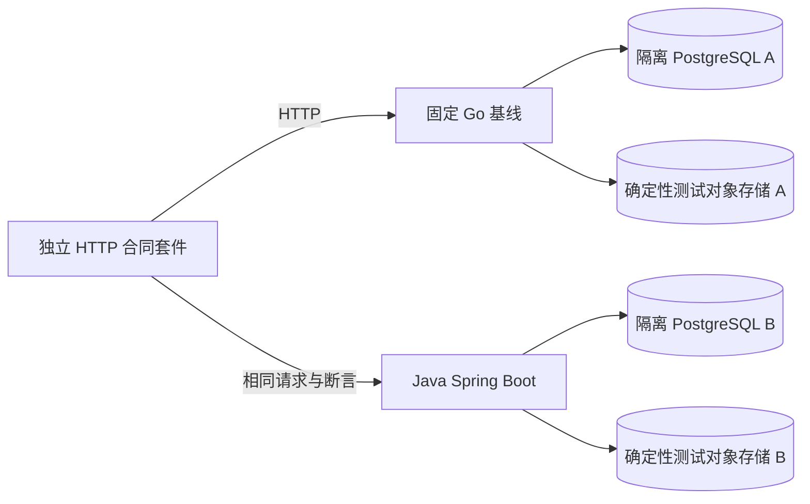

# 画布 Java 迁移前置条件：HTTP 黑盒合同验证方案

> **目的**：在开始实现 Java 画布端点之前，建立一套能先验证 Go 基线、再用同一套请求和断言验证 Java 实现的 HTTP 黑盒合同测试。
> **状态**：方案草稿；本文件不实现测试框架或修改 Go/Java 服务。
> **证据范围**：核对当前 Go handler、OpenAPI、画布域与 repository 测试、Web API 客户端、画布研究报告和 Spring Boot 迁移指引。本文没有启动服务或运行测试。

## 结论与决策

先建立并运行一套独立于后端实现的 HTTP 合同与状态流测试，再开始 Java 画布端点开发，是正确的迁移前置条件。它能把“兼容”从代码结构相似，变成同一组外部请求在 Go 和 Java 上得到等价的状态码、响应结构、响应头、权限结果和持久化结果。

这套测试不应只保存 Go 返回的完整 JSON 快照，也不应把 Go 的每个现存行为自动视为正确。实施前要形成经过评审的合同清单：Go 当前事实、必须兼容的行为、已知缺陷、允许改变的行为分别标注。任何与 Go 基线的差异都必须归类并有决策记录；不能通过悄悄放宽断言让 Java 变绿。

建议把交付物命名为 **画布 HTTP 黑盒一致性套件**，由两类测试组成：

- **Wire 合同测试**：HTTP 方法与路径、Cookie、状态码、headers、JSON envelope、字段类型/缺省、错误码与 reason、分页、压缩和条件请求。
- **HTTP 状态流测试**：经真实网络请求执行创建、读取、并发保存、历史恢复、权限隔离、删除、资源引用等多请求业务序列。

只有当同一个测试版本先在固定的 Go 基线上完整通过，再在 Java 实现和实际切流路由上完整通过，且关键 PostgreSQL/资源依赖检查通过，才能认为画布 API 切片达到迁移验收门槛。它不替代浏览器 UI、真实对象存储或真实模型链路验收。

## 为什么要用黑盒套件

现有 Go 测试已经覆盖许多重要规则，例如画布 revision、历史恢复、ETag 和 repository 并发条件；但它们分散在 handler、canvas domain、repository 和前端测试中。大多数 Go handler 测试通过 Gin 的 `httptest` 直接装配 handler，并不等于启动完整 API 服务器后，以独立 HTTP 客户端验证真实认证中间件、路由、配置、数据库和序列化共同工作的结果。

当前 [OpenAPI 文件](../../backend/internal/handler/openapi.yaml)只描述了部分画布合同：能找到单画布 GET/PUT、历史列表/详情/恢复，但没有完整列出画布集合读取、删除、分享、项目关联和外部导入路径。现有 [路由注册测试](../../backend/internal/handler/user_data_page_test.go)也只断言部分路径存在。因此，OpenAPI 是合同清单的基础，不是完整端点盘点的替代品。

同一套黑盒用例可同时运行在两种实现上：



Go 与 Java 使用逻辑相同、彼此隔离的测试数据和数据库，避免一套测试读到另一套实现的副作用。除显式混合路由验收外，不让两种实现同时写同一个画布记录。

## 先冻结迁移范围

“画布后端 API”不是单一路由文件。实施套件前，应以 `RegisterCanvasAPI` 的组合路由、各 `Register*Routes`、Web API 调用点和 OpenAPI 相互核对，为每个操作分配唯一 ID，并标记 `本批纳入`、`明确延后` 或 `不属于画布服务合同`。迁移未纳入的依赖可继续由 Go 提供，但必须在集成路由配置中明确。

### 核心画布文档 API

以下路径应作为“画布文档与版本 API”核心组的默认范围：

| 操作 | 当前路由 | 需要冻结的合同 |
| --- | --- | --- |
| 画布列表 | `GET /api/canvas-projects` | 无分页摘要模式；含 `page` 时的分页、筛选、排序和空结果 |
| 读取画布 | `GET /api/canvas-projects/{id}` | 用户归属、完整画布 JSON、revision、ETag、304、缓存与 gzip headers |
| 创建/保存画布 | `PUT /api/canvas-projects/{id}` | `project` JSON、revision 0 创建、CAS 更新、路径/正文 ID 一致性、保存摘要 |
| 修复资源后保存 | `PUT /api/canvas-projects/{id}` | `repairMissingResources` 的确认语义、历史备份和失败时不覆盖 |
| 删除画布 | `DELETE /api/canvas-projects/{id}` | 用户归属、删除响应、历史/关联资源引用与重复请求行为 |
| 历史列表 | `GET /api/canvas-projects/{id}/history` | `currentRevision`、最近快照摘要及上限 |
| 历史正文 | `GET /api/canvas-projects/{id}/history/{snapshotId}` | 快照归属、正文 JSON 与过期/不存在行为 |
| 恢复历史 | `POST /api/canvas-projects/{id}/history/{snapshotId}/restore` | 请求 revision、冲突保护、新 revision、恢复前备份和身份关联保留 |

画布创建当前不是独立 `POST`：客户端通过 `PUT` 提交 `revision: 0` 创建；更新时提交读取到的 revision。新测试不应自行发明更 RESTful 的合同。

### 画布相邻 API 与依赖

| 能力 | 当前路径/来源 | 建议处理 |
| --- | --- | --- |
| 项目与画布/章节关联 | `GET /api/projects/{id}/canvases`、`POST /api/projects/{id}/canvas-links`、关联删除；受 `FeatureShortDrama` 路由门控 | 若 Java 首批声称覆盖项目中的画布使用，列入单独 profile；测试开关、归属、重复关联及解除语义 |
| 画布分享 | 私有状态/创建/撤销：`/api/canvas-projects/{id}/share`；公开读取：`/api/public/canvas-shares/{token}` | 列入分享 profile；作为权限敏感端点检查过期、撤销、token 隔离、缓存和 Referrer/Robot headers |
| 分享资源文件 | `/api/public/canvas-shares/{token}/resources/{resourceId}/file` | 另测范围请求、媒体访问边界、响应 headers 和无权资源；不以公开 JSON 可读代替文件交付验收 |
| 素材、资源和文件 | 通用 `/api/resources`、访问授权、文件交付及上传 API | 不是画布命名空间，但可能是画布预览和引用的硬依赖；逐 endpoint 定义 owner、存储和跨用户引用检查 |
| LibTV/TapNow 导入 | `/api/canvas-projects/{id}/import/libtv`、`/import/tapnow` | 上游不确定性较高，默认独立延后；纳入时使用可控上游 stub，并测试超时、错误和重复请求 |
| 生成任务、Agent、模型渠道 | `/api/tasks`、`/api/agent`、`/api/ai` 等不同域路由 | 不混入纯画布文档 API profile；需要时以仍由 Go 承载的依赖做跨域集成测试，后续另立任务/生成迁移合同 |

如果某个 UI 功能依赖的 API 被明确延后，交付应称为“画布文档 API 切片通过”，不能称为“画布功能整体移植完成”。

## 套件边界与运行方式

### 独立 HTTP 客户端

测试进程只能通过配置的 HTTP base URL 与服务通信，不 import Go `internal` 包、Java Controller/Service、JPA Entity 或 repository，也不直接调用 handler。测试断言来自版本化的合同清单与场景，不从被测实现临时生成期望值。

本仓库现阶段可以用独立 Go `net/http` 测试包实现 runner：它能用标准库 CookieJar、multipart、并发请求和原始响应头，且不依赖 Go 后端内部代码。Java CI 仅为执行这套外部客户端安装 Go 测试工具链，不把 Go 加入 Java 产品运行时。若组织明确不接受 Go 出现在 Java CI，可把 runner 写成 Java JUnit/HTTP client 或 Bun，但必须继续保持只走 HTTP，并保证只有一套权威场景定义，不维护两套漂移的断言。

建议的未来目录，仅供方案参考，当前尚不存在：

```text
tests/canvas-contract/
  go.mod                     # 独立 module，避免 runner 依赖 backend 的内部包
  README.md                  # 启动目标服务、隔离数据和运行 profile
  contract/                  # 方法、路径、headers、schema、错误语义
  scenarios/                 # 状态流和权限场景
  runner/                    # 只依赖 HTTP 的执行器
  fixtures/                  # 固定画布 JSON、测试资源和预期规范化结果
```

一个测试报告至少记录 runner 版本、目标实现与 commit、base URL 类型（直连或网关）、数据库版本、profile、测试结果、skip 列表和环境摘要。不得记录 Cookie、密码、提示词全文或签名资源地址。

### 环境、身份和数据隔离

1. **使用隔离环境**：每个目标使用一次性 PostgreSQL database/schema 和独立对象存储前缀；版本与目标生产 PostgreSQL 一致。不得连接开发者数据库或生产数据。
2. **身份通过真实登录建立**：可以由仅在测试环境运行的 fixture 工具预置两个用户账号，但测试客户端应通过 HTTP `/api/auth/login` 获取真实 session Cookie，再用两个独立 CookieJar 分别执行 A/B 用户场景。不要绕过认证中间件直接构造用户上下文。
3. **测试 setup 不等于被测操作**：允许数据库 seed 创建账号或固定前置资源；被测画布创建、读取、修改、删除和历史操作必须通过 HTTP。需要资源字节时，经受控对象存储或资源 API 建立可重复 fixture。
4. **不放宽安全策略**：测试配置可以提供高而固定的写频率上限、测试用户和确定性对象存储；不得禁用 owner check、绕过会话校验或允许任意资源引用。
5. **可重复清理**：使用每用例唯一 canvas/resource ID 和独立前缀；失败后可整库销毁。不要依赖固定共享记录、执行顺序或上一次运行留下的对象。
6. **时钟与限流可控**：业务时间字段用结构断言或固定测试时钟，不对实时 `createdAt` 做字节级快照。一般合同场景不触发限流；限流作为独立确定性测试。

### 两种部署形态都要验证

- **Go 基线直连**：整套测试请求进入固定 Go 版本，用于记录并评审现有合同。
- **Java 直连**：当 Java 实现相应 API 时，用同一场景集验证 Spring Boot 路由、Cookie 解析、事务提交和 PostgreSQL 落盘。
- **混合路由/切流验收**：最终通过真实反向代理或网关访问；例如登录仍转发到 Go，画布文档路径转发到 Java。共享 session/用户事实和资源依赖必须与目标部署一致；画布写入只允许一个 owner。该形态验证 Java 能否接受 Go 签发的 session，并能否使用正确的用户和资源记录。

基线与 Java 运行应在相同逻辑 fixture 上**顺序执行并分别重置数据**。不要让两套服务并发修改同一画布来做“对比测试”。差分响应可作为诊断报告，但有意改变的字段必须经合同决策批准。

## Wire 合同清单

每个 endpoint 的合同至少记录以下字段；只有路径和一份成功 JSON 不足以冻结 API：

| 类别 | 要冻结的内容 |
| --- | --- |
| 路由 | method、path、path/query 参数、版本前缀、feature/认证中间件 |
| 请求 | `Content-Type`、JSON key 大小写、必填/可选/`null`/省略语义、数字边界、文件大小、body 上限 |
| 响应 | HTTP status、`Content-Type`、success/error envelope、字段类型、数组空值语义和稳定字段 |
| 错误 | HTTP status、业务 `code`、`reason`、是否可重试；`msg` 是面向人的文本，不应用作唯一机器判据 |
| 会话 | 登录 Cookie 名称和属性、受保护路径的未认证响应、用户切换与注销后的失效行为 |
| 缓存/压缩 | ETag、`If-None-Match`、304 空 body、Cache-Control、Vary、Content-Encoding/gzip |
| 身份与权限 | user scope、外部 ID 越权、项目归属、资源归属、公开分享例外 |
| 状态转换 | revision 递增、冲突、历史记录、删除/恢复、幂等或明确非幂等语义 |
| 副作用 | DB 写、资源读写、配额、审计和外部调用；失败后哪些状态必须保持不变 |

当前画布保存尤其需要冻结以下 wire 细节：

- 成功响应是项目 JSON envelope，数据在 `data.project`；错误仍需同时核对 HTTP 状态和错误 envelope。
- 创建通过 `PUT`，正文形如 `{"project":{"id":"...","revision":0,...}}`；保存更新基于客户端读到的 revision，成功后服务端 revision 增加。
- 缺少 revision 返回 `428`；过期 revision 返回 `409`；正文 ID 与 URL ID 不同属于坏请求。Java 应兼容这些可观察行为，或通过明确批准的合同版本变更调整。
- `GET` 单画布返回基于 revision 的弱 ETag（`W/"canvas-N"`）；当前 Web 客户端发送不带 `W/` 的 `If-None-Match`，Go handler 允许匹配并返回 304。合同必须测试实际客户端所用的这一对格式，而不是只测试两个相同字符串。
- 大画布响应可能 gzip；测试需分别验证压缩与解压后的 JSON。需要检验 wire bytes 时，HTTP transport 必须关闭自动解压，不能让客户端隐藏了 `Content-Encoding` 差异。
- 画布文档含有开放扩展字段。测试要放入未知节点类型、metadata 和嵌套扩展字段，验证不会因为 Java DTO/Jackson 忽略未知字段而静默丢数据。
- 当前保存会由服务端生成时间与 revision，并对 `viewport`、`remoteContentHash` 采用特定处理；其边界见 Go 保存实现和 [画布深度研究](canvas-deep-research.md)。测试要比对最终 GET 结果，不可只断言 PUT 返回 200。
- revision 的数据库/model 类型是 `int64`，但当前 Go 保存入口另有 JavaScript 安全整数范围校验：拒绝负数及 `revision >= 9007199254740991`。OpenAPI 目前只声明 `int64`/最小值 0，前端也使用 `Number.isSafeInteger`，三处描述并不完全一致。边界还有一个需要裁决的行为：输入 `9007199254740990` 可通过校验，成功递增后可能返回 `9007199254740991`，而这个返回值再作为下次写入 revision 会被拒绝。Gate 0 必须把它归类为 `MUST_KEEP`、`KNOWN_BUG` 或 `APPROVED_CHANGE`；用隔离 fixture 覆盖 `-1`、`9007199254740990`、`9007199254740991` 和超出 `int64` 的输入，并按决策断言状态码及内容未变。不能把“存储字段是 int64”表述为 wire 合同支持全部 int64。

完整当前请求/响应以[前端 API 客户端](../../web/src/services/api/user-data.ts)、[分享 API 客户端](../../web/src/services/api/canvas-share.ts)、[handler 实现](../../backend/internal/handler/user_data.go)和测试环境实际运行结果交叉核对。若这些事实与 OpenAPI 不一致，应先登记冲突并决定更新 OpenAPI/合同，不能默默选择某一来源。

## 必须实现的 HTTP 场景

以下是迁移前的必需场景清单。每个场景要明确 setup、请求序列、逐请求期望和最终状态检查；必要时可拆成更小用例，但不能整体删除。

### A. 登录、用户隔离与路由

- 无 Cookie 访问受保护的列表、读、写、历史、分享管理端点；锁定准确状态与错误信封。
- 用户 A 登录后创建画布，列表与详情可读；用户 B 登录后不能读取、保存、删改 A 的画布或访问 A 的历史快照。
- 对不存在 ID 和外部用户 ID 验证不会泄露正文或资源 URL；404/403 采用哪一种必须从基线合同记录。
- 注销后同一 Cookie 不再能继续操作；A/B 的 HTTP CookieJar 绝不共享。
- 项目关联 profile 还需测试 feature gate 关闭/开启的行为；认证成功不能绕过能力门控。

### B. 列表和 JSON wire format

- 空用户、单条、多条列表；分页第一页/末页/越界页，筛选 projectId、搜索词、排序和默认 pageSize。
- `GET /canvas-projects` 不带 `page` 与带 `page` 是不同兼容模式，分别锁定外层 envelope 和条目字段。
- 检查空集合是 `[]` 还是 `null`，缺字段、显式 `null` 和默认值如何表示；验证 UTC 时间、64 位 revision 与 JSON number 精度。
- 读写包含未知扩展字段的文档，验证节点/连线顺序、嵌套 metadata、节点类型、chat/previs/timeline 等第一批承诺字段不丢失。
- 覆盖最小合法 JSON、坏 JSON、缺 ID、ID 不一致、缺 revision、负 revision、超安全整数 revision、超过 body 限制，以及保存时服务端生成字段。

### C. 创建、读取、CAS 保存和条件 GET

1. `PUT` 新画布 `revision: 0`，断言得到 revision 1；随后 GET 读回可观察文档。
2. 使用 revision 1 改动标题、节点和连线，断言得到 revision 2；再次 GET，确认内容持久化且 server-owned 字段正确。
3. 重放已成功的旧 revision 写请求，预期冲突，不得静默覆盖 revision 2 的内容。
4. 两个客户端读取相同 revision 后并发 PUT 两份不同内容；恰有一个写入成功，另一个得到合同定义的冲突，最终 GET 只包含胜者内容且 revision 只推进一次。
5. 读取后用当前 ETag 发条件 GET，应返回 304、空正文和正确缓存头；修改一次后旧 ETag 不得命中 304。
6. 对大响应分别请求 gzip 与不请求 gzip，验证 `Content-Encoding`、`Vary`、解压 JSON 和错误时不会返回半截成功文档。
7. 经过服务重启或第二个服务实例读取先前成功的 PUT，确认不是只写入 JVM/进程内存。

当前 Go 已有 revision 和 repository CAS 测试，但 Java 验收仍需从实际 HTTP 并发请求验证 handler 到 PostgreSQL 的完整路径。

### D. 历史、恢复和删除

- 内容变化产生的历史摘要含稳定字段；列表上限、排序、`currentRevision` 和正文按需读取语义一致。
- 恢复提交当前 revision 成功后生成**新 revision**，保留画布 ID、owner、项目关联；当前内容进入恢复前快照，能继续查看和再次恢复。
- 历史 ID 与其他画布/用户的 ID 混用必须拒绝；缺 revision 和 stale revision 不执行恢复。
- 不变内容或仅有视口/服务器元数据变化时，历史是否新增按已批准的内容身份合同锁定，不能简单 snapshot 每次 PUT 的响应。
- 删除后验证详情、列表、历史、项目链接和引用资源的行为；若删除策略存在例外，写成显式测试而不是仅测 DELETE 成功响应。

### E. 资源完整性

- 建立同用户有效图片/视频等资源引用，保存后重读；验证 `assetId`、`storageKey`、URL/preview 等身份不混用。
- 使用不存在、已删除、跨用户的资源 ID 保存；预期请求失败且旧画布、revision、历史保持原状。若合同要求配额也不变化，通过 `GET /api/resources/storage-usage` 做前后对照；核心黑盒套件不直接查询数据库，无法从 HTTP 观察的内部不变量放到 PostgreSQL 集成测试层。
- 显式 `repairMissingResources` 路径单独测试：确认这是用户触发的修复操作，历史备份和现有可用资源不会被普通保存路径绕过。
- 物理资源读取要通过资源访问 API/文件 route 检查授权、签名过期或范围读取；只验证画布 JSON 存在不能证明视频可播放。
- 若首批不迁移对象存储，测试环境可以让 Go 资源服务继续处理这些路径，但 route profile 必须说明由谁提供资源业务事实，且同一资源 ID 在切换前后可读。

### F. 分享、项目关联和导入 profiles

- 分享 profile：创建/旋转/撤销分享；验证 token 只读范围、过期和撤销立即失效、错误 token 不可枚举资源、缓存/Referrer/Robot headers 以及资源文件请求权限。
- 项目 profile：在功能开关开启时关联和解除画布/章节；验证项目、画布、单元跨用户时拒绝，不能因重复请求产生重复关联。
- 导入 profile：使用可控 LibTV/TapNow stub；验证有效/无效输入、上游非 2xx、慢响应/超时和重复提交，不真实抓取生产平台，也不把未实现上游验证算作通过。
- 每个 profile 独立报告，不得因核心 CRUD profile 通过就推断这些附属能力已通过。

## Go 基线建立流程

套件是 Java 开发前置条件，按以下顺序实施：

1. **固定基线**：记录 Go commit、`VERSION`、Go/PG 版本、配置、迁移版本和测试 runner commit。迁移开始前若 Go 有新提交影响合同，应明确是否重建基线。
2. **补全端点清单**：从真实路由、Web API 调用和 OpenAPI 交叉提取；每个目标 path/method 都有唯一 ID、鉴权、功能门控、请求/响应和用例映射。OpenAPI 当前缺少的 endpoint 要补全，或把独立行为合同文件设为权威源并说明分工。
3. **先写规范再捕获结果**：由预期兼容合同定义断言，再请求 Go 获取证据。不要用测试运行输出自动生成全响应快照并当成预期。
4. **调查差异**：逐项将 Go 结果标注 `MUST_KEEP`、`KNOWN_BUG`、`APPROVED_CHANGE` 或 `UNKNOWN`。`UNKNOWN` 不进入 Java 验收，先找到源码/测试依据并决策。
5. **反复干净运行**：在两次全新数据库/对象前缀上运行完整必需 profiles；没有网络不稳定、时间偶发、共享数据残留或 skip。修复 Go 基线测试时固定新 commit，并保留差异记录。
6. **基线冻结**：保存套件版本、Go commit、规范化报告、失败差异/豁免记录和环境定义。之后不允许为适配 Java 而修改 Go 基线期望；合同变化要经审批后同时更新规范和 Go/Java 两边结果。

差分工具可以比较 Go 和 Java 的 HTTP transcript，但只能用于发现差异。动态 ID、createdAt、expiresAt、ETag revision 和签名 URL 按合同做语义归一化；用户可见字段、错误 code/reason、权限结果和持久化内容不能被归一化吞掉。

## Java 实现验收标准

### 必须通过的门槛

- 每个迁移范围内的 method/path 都有自动化场景映射，无 `TODO`、无意外 `skip`、无只检查路由存在却不发送请求的空覆盖。
- 同一 runner、同一测试数据规范、同一 PostgreSQL 主版本运行；Java 输出满足冻结的 wire 合同和用户可观察状态流。
- 权限矩阵至少覆盖未登录、owner、foreign user、被撤销会话；项目/公开分享按 profile 覆盖相应角色。
- 并发 CAS、错误状态回滚、历史恢复、未知字段保留和资源引用保护均有 HTTP 级结果与后置 GET 证据。
- 写入后经重启/另一个 Java 实例可读；Java 所需 schema/migration 在空库和代表性旧数据升级上通过独立数据库迁移测试。
- Java 直连 profile 通过后，再经真实混合网关 profile 通过；确认 Go 登录 Cookie、Java 身份解析、feature flags、资源访问和唯一 writer 路由互通。
- CI 将核心合同 profile 设为 required check。失败、服务未启动、依赖缺失和 suite 未运行都必须使 job 失败，而不是转成警告。

### 不可接受的“通过”方式

- 只检查 HTTP 200、路由已注册或 OpenAPI schema 能解析。
- 只 mock Controller、Repository 或 Service；只测 `MockMvc` 而未通过 TCP HTTP 和真实 PostgreSQL。
- Go 与 Java 共用一套脏数据库，或通过同时双写比较响应。
- 对完整 JSON 做脆弱的字节级快照，或宽松忽略所有额外/缺失字段。
- 为让 Java 通过而在合同测试加入实现专属分支、跳过失败用例、把 `409` 放宽成任意 4xx。
- 把静态源码审查、unit tests、OpenAPI 校验或健康检查表述成真实模型/对象存储/浏览器验收。

## 还需要的分层测试

HTTP 套件证明外部行为，不负责证明所有内部性质。Java 迁移仍需要配套测试：

| 测试层 | 补充证明什么 |
| --- | --- |
| Domain/application 单测 | schema 校验、字段归属、revision/历史规则、冲突分类、资源修复策略 |
| PostgreSQL repository 集成 | 真实 dialect 下 unique/CAS、事务回滚、并发胜者、删除顺序和历史资源引用约束（当前模型为资源外键 `RESTRICT`） |
| Flyway 迁移 | 空库安装、Go 数据升级、重复执行/forward-only、安全回滚策略及数据核对 |
| 对象存储集成 | 字节写入、checksum、URL 访问、物理删除失败及重试；使用隔离 S3-compatible store |
| 浏览器回归 | 真实 Cookie/CORS、画布编辑/保存/重开、local cache/rebase、键盘和可见错误状态 |
| 跨域生成 E2E | 任务 admission、长时间视频等待、SSE/轮询、取消/重试和异步结果最小增量回写；独立于文档 API suite |

真实模型调用不是每次 PR 的必需条件。稳定回归优先使用 provider stub；少量隔离环境 smoke 与生产容量验收另行报告和授权。

## CI 接入与迁移门禁

### Java 开发开始前的 Gate 0

以下交付全部完成并 Review 通过，才开始实现 Java 画布端点：

- endpoint catalog 完整，迁移范围和延后列表经过确认；
- wire 合同含请求/响应/headers/errors、用户 scope、revision 与资源不变量；
- 独立 runner 仅依赖 HTTP，可执行完整状态流且能报告 server implementation；
- PostgreSQL 与资源测试依赖隔离、自动启动、故障时非零退出；
- 固定 Go 基线连续两次干净运行通过，全部目标场景无 skip；
- CI 对 Go 基线启用 required check，修改合同文件或 runner 时也会运行；
- Go/Java 有意不同的行为和当前未知点已从基线里分离，不用测试期望悄悄认可。

### 迁移中的 Gate 1/2

- Java 每增加一个 endpoint family，就运行该 profile 和关联的核心回归 profile；全部既有 profile 仍应绿色。
- 合并候选运行全量 Go 基线和 Java conformance；混合路由以公开 gateway URL 验证真实路径。
- 测试数据库、测试账号和对象存储都隔离；每个测试 run 只存在一个画布写入 owner。
- 在前端完整浏览器验收完成前，只报告“HTTP 合同兼容”，不报告“画布功能完成”。

### 命令形状示例

下方仅表示未来独立套件的接口设计，仓库目前没有这些命令，不能当作已验证的现存命令：

```bash
(
  cd tests/canvas-contract
  CANVAS_CONTRACT_BASE_URL=http://127.0.0.1:18080 \
  CANVAS_CONTRACT_PROFILE=core \
  go test ./... -count=1
)
```

CI 启动被测服务和依赖后执行同一 runner；Go 和 Java 通过不同的启动 target 选择。建议保留 JSON/JUnit 结果、结构化差异和数据库迁移日志作为可审计 artifact，但不得在 artifact 中放账号密钥、Cookie 或用户画布正文。

## 已知风险与决策点

1. **Go 不是无条件的正确性 oracle。** 当前 OpenAPI、handler、前端类型和测试可能不完全一致。需由迁移负责人批准最终的外部合同和已知行为变化。
2. **边界不止 `/canvas-projects`。** 分享、项目挂接、文件交付、上传、导入和任务生成属于不同责任域。迁移范围应按真实用户工作流划分，明确 Go 保留的 API 与依赖。
3. **资源模型跨对象存储。** 只对 PG 查询返回 200 不能证明资源字节可达。按 profile 选择隔离对象存储验收，并另外测试存储失败后的恢复。
4. **Go Cookie 与 Java 认证桥接是切流阻塞项。** 只在 Java 自己登录成功不能证明浏览器原 Go session 能访问 Java 端点。必须有混合网关路径验收。
5. **OpenAPI 完整度不足。** 先修复描述缺口或声明 contract manifest 的唯一权威性，并用覆盖率检查防止未来路由新增而测试清单未变。
6. **黑盒接口无法观察每种数据库不变量。** 配套 repository/Flyway 测试仍必要，但它们不替代黑盒套件；两层证据分别报告。
7. **首批目标需防止范围膨胀。** 先证明画布文档存取、版本与资源引用，再分 profile 迁移分享、项目集成和导入。生成、Agent、计费不可因为画布能发起操作就被默认为本批完成。

## 源码与研究入口

- [Spring Boot 迁移总指引](go-to-spring-boot-migration-guide.md)：总体迁移决策、operation catalog、数据 owner、阶段和通用测试层次。
- [画布系统深度研究](canvas-deep-research.md)：revision/ETag、内容模型、历史资源引用、前后端状态与同步风险。
- [画布 handler](../../backend/internal/handler/user_data.go)：列表、条件 GET、历史、恢复、PUT 保存和删除。
- [Canvas share handler](../../backend/internal/handler/canvas_share.go)：分享管理、公开读取与分享资源文件。
- [Project handler](../../backend/internal/handler/project_unit_routes.go)：项目画布关联，含功能门控上下文。
- [画布 API 客户端](../../web/src/services/api/user-data.ts)：列表、读写、ETag、历史 API 的 Web wire 行为。
- [画布分享 API 客户端](../../web/src/services/api/canvas-share.ts)：分享端点请求合同。
- [OpenAPI](../../backend/internal/handler/openapi.yaml)：现有但不完整的机器可读合同入口。
- [现有 handler 路由/ETag 测试](../../backend/internal/handler/user_data_page_test.go)、[revision 测试](../../backend/internal/canvas/canvas_revision_test.go)和[历史测试](../../backend/internal/canvas/canvas_history_test.go)：当前 Go 行为的局部证据，不等于独立 HTTP suite。

## 验证记录

- 已完成静态核对：Go 路由注册、画布保存/历史实现、OpenAPI 已描述的画布路径、Web API 调用点和当前 Go 测试入口。
- 已确认当前 OpenAPI 只覆盖部分画布合同；路由与 Web 调用还包含集合、删除、分享、项目关联及导入等路径。
- 本次没有运行 Go 测试、浏览器、服务启动或 HTTP 请求；没有创建测试 runner、OpenAPI 更新或数据库 fixture。
- 新增测试方案本身需经迁移团队评审并执行 Gate 0；不能把本文档的编写完成当作 Gate 0 已通过。
