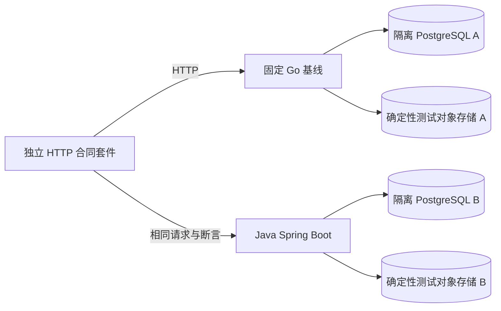

# 画布 Java 迁移前置条件：HTTP 黑盒合同验证方案

> **目的**：在开始实现 Java 画布端点之前，建立一套能先验证 Go 基线、再用同一套请求和断言验证 Java 实现的 HTTP 黑盒合同测试。
> **状态**：持续实施；当前 manifest 登记 163 个 operation / 143 个唯一 method/path、91 个 Required operation / 118 个 HTTP 场景，另有 6 个独立统计的真实浏览器场景。当前 118 场景全量双轮证据为 `20261013-122339-53249`：两轮均执行全部 11 个 HTTP profile、91 个 Required operation；第一/第二轮分别记录 `14197/14196` 与 `14193/14192` 个清单内 observed/wire 请求，均为 71 条映射并执行路由、72 条实际触达路由、71 条返回过非错误响应的路由，6 条受控故障（其中 4 条为提交后响应丢失）、4 条 incomplete、0 条未分类中断。浏览器两轮均为 6 个场景，页面响应头分别为 171/170，阻断装饰均为 9/9。115 场景双轮证据 `20261013-073513-51126` 只保留为历史，不与当前结果拼接；旧 114/112/111/108/107/104/102/100 场景版本也只保留为历史。Required 剩余路径和 Java/远端门禁未闭合；当前 clean-review 为 `3/3`，本文件不修改 Go/Java 产品服务。
> **证据范围**：核对当前 Go handler、OpenAPI、画布域与 repository 测试、Web API 客户端、画布研究报告和 Spring Boot 迁移指引；HTTP runner 可脱离仓库独立编译，浏览器 runner 只需已运行的真实前端与同源 API。证据涵盖隔离 PostgreSQL 18 + Go HTTP、真实 React/Vite 部分路径、崩溃/优雅重启、提交成功但丢失响应、固定 HTTPS 导入和资源替身；不代表 Java、生产混合网关、真实对象存储/CDN 或全部浏览器能力已经验收。
> **文档关系**：本文件是[迁移总指引](go-to-spring-boot-migration-guide.md)中 M1/Gate 0 的画布专项计划；当前 API 事实以[画布开发导航](../content/docs/canvas/canvas-development.mdx)和[HTTP API 合同](../content/docs/backend/http-api.mdx)为入口，现有测试能力见[自动化回归测试调研](test-regression-and-ci-research.md)，可执行套件见[`tests/canvas-contract`](../../tests/canvas-contract/README.md)；Java 类型、DTO、H2、seed/mock 和 OpenAPI 参考桩的实施方案见[实施规划](canvas-java-type-reference-stub-plan.md)，实际实现、profile 证据和运行边界见[实施进度](canvas-java-type-reference-stub-progress.md)及[`java/canvas-contract-reference/README.md`](../../java/canvas-contract-reference/README.md)。

## 本轮实施目标与任务清单

> 这是本轮工作的持久化执行清单，避免把一个小的 `core` 结果误报为完整画布 API 覆盖。进度只在完成对应证据后更新。

### Goal

实施完整的画布黑盒合同套件：盘点画布直接端点及其项目/资源/分享依赖，分层登记执行路径，用真实请求固化 Go 基线，并补齐各 Required profile 的适用权限、重放、失败、并发和重启路径。不能将“已有可审计基线”替代整个实施目标，或因测试容易通过而收缩范围。

本轮必须继续完成 B 阶段的 Required 适用路径、真实 Go 前后端浏览器链路、wire/行为差异登记和 CI 套件交付，不能只交付 A 阶段的选定 Go HTTP 基线。C 阶段是未来 Java 实现可用后的直连、混合路由及相同真实前端的验收；保留其门禁和运行合同，但不将“创建未来可用的套件”偷换成“已经存在并验收 Java 后端”。三个阶段共用本文件和 manifest；A 的绿色不代表 B 完成，更不代表 C 已通过。观测 Go 现状不等待未来合同获批，也不修改产品迎合套件；31 项行为裁决属于未来 Java 兼容/切流门禁，不应伪装成本轮黑盒实现阻塞项。

### 任务项

1. **事实盘点**
   - 读取[画布开发导航审计](canvas-development-navigation-audit.md)、[画布系统深度调研](canvas-deep-research.md)、handler 路由、Web API 调用点和现有测试。
   - 建立 `method/path/operationId/owner/角色/副作用/依赖` 的权威 catalog。
2. **覆盖分层**
   - 将端点拆成 `core-document`、`resource-integrity`、`share-public`、`project-integration`、`generation-writeback` 等 profile。
   - 对每个 profile 标记 `REQUIRED`、`DEFERRED` 或 `OUT_OF_SCOPE`，写明原因、阻断条件和覆盖率口径。
3. **执行路径设计**
   - 每个 `REQUIRED` profile 至少覆盖未认证、owner、foreign user、重复请求、失败回滚、并发/重启或跨域依赖中的适用路径。
   - 明确黑盒 HTTP、PostgreSQL 集成、对象存储、浏览器/任务 E2E 各自负责的断言，不把一个层次的绿色外推到全部画布能力。
4. **套件与文档同步**
   - 修正 `tests/canvas-contract` 的 manifest、scenario 索引、README 和已实现 runner 的声明。
   - 将审计文档、深度研究、迁移总指引、HTTP API/画布导航互链，并修正“已覆盖/未验证”的事实漂移。
5. **最小充分实现与验证**
   - 完成已登记为 Required 的适用路径，而非只保留 `core` 或选定成功路径；其他已发现依赖显式列出 owner、延期理由和跨套件门禁。
   - 运行独立编译、全部 Required profile 的真实服务回归及 manifest/链接/格式检查；失败直接修改，报告与实际证据一致后继续完整三轮 review。

### 当前进度

**HTTP 合同套件的完整扩展目标仍在进行，暂估 91%（工程工作量估算，不是覆盖率）**。可审计的 11-profile 基线已完成，但 manifest 中的 deferred、separate-suite 和远端/生产门禁仍不是 Java reference stub 的交付分母。当前登记 163 个 operation / 143 个唯一 method/path、91 个 Required operation、118 个 HTTP 场景，另有 6 个独立统计的浏览器场景。历史 115 场景双轮证据为 `20261013-073513-51126`；当前 118 场景新版全量双轮为 `20261013-122339-53249`：第一/第二轮分别为 `14197/14196` 与 `14193/14192` 清单内 observed/wire 请求，均为 `71/72/71` 映射/实际触达/非错误响应路由、6 条受控故障、4 条声明中的 incomplete、0 条未分类中断；浏览器两轮均为 6 个场景，页面响应头分别为 171/170，阻断装饰均为 9/9。31 项行为裁决仍未批准。与本计划的 Go/套件进度分开记账，Java H2 类型参考桩已在当前构建上完成 11/11 HTTP profile、118/118 HTTP scenario 和 6/6 浏览器登记场景；浏览器页面另观测到 101 个辅助 API 5xx，不能据此宣称完整 Web API 兼容。具体命令、日志和报告边界见[Java 实施进度账本](canvas-java-type-reference-stub-progress.md)与[Java 项目运行手册](../../java/canvas-contract-reference/README.md)。真实 Java 业务迁移、生产数据库/远端依赖和扩展套件仍未闭合。

当前 HTTP 场景包括固定 HTTPS 真 PNG/WAV/MP4、转换计数/过滤/拓扑/参数、1000/1001 节点和 5000/5001 连接边界、资源导入/幂等、部分下载失败后的显式恢复、素材登记、保存重开、CAS 与跨用户隔离，以及 `canvas.recovery.response-loss-and-restart`。该恢复场景现在还覆盖资源 URL 导入提交后的丢 ACK、崩溃和同幂等键重放，以及持久化 upload reservation 过期后由新进程重新准入；legacy-assets 另覆盖六次画布引用/显式 purge 竞态及本地 object-store DELETE 失败后的逻辑删除/物理对象保留。`generation-writeback` 已加入 provider-free text replay 与 SSE 游标重放，但不覆盖 Provider 或 live-disconnect SSE reconnect。它们仍是本地受控 fixture，不等于远端对象存储恢复或生产 outbox 重试时序。转换/资源 HTTP 串联不是浏览器导入验收。此前 review 曾发现并修正浏览器 selector、fixture 完整字段、真实媒体路由、SSRF profile 配置、断言过度收紧和 YAML 解析问题；历史 90/115 双轮及其 `3/3` clean-review 不延续到本轮。当前 118 场景全量双轮已通过，连续 clean-review 已完成 `3/3`；每次新发现或实现变动后仍须从 `0/3` 重新累计，不以运行轮数替代 clean-review。

| 任务项 | 状态 | 可追溯结果 |
| --- | --- | --- |
| 事实盘点 | 完成并持续校验 | 163 个 operation / 143 个唯一 method/path；直接画布 14 个端点；新增资源导入恢复、legacy purge 竞态和 durable upload reservation 恢复 operation 不重复计 endpoint |
| 覆盖分层 | 完成并持续扩充 | 91 个 Required operation 映射 118 个 HTTP 场景；当前 118 场景版本已完成 11-profile 双轮，35 个 deferred、37 个 out-of-scope；6 个浏览器场景分开统计 |
| 执行路径设计与实现 | 继续实施 | 新增 updated-at 并列稳定排序、过期 reservation 的提交拒绝/额度释放/同目标重试、跨进程 durable reservation admission、非空 trailing JSON 的 Go 事实证据；后台 reconciler、受控在途交错、远端 CDN/TTL/条件缓存、完整 task/Agent 写回及 UI 缓存/冲突继续登记 |
| 套件与文档同步 | 已完成本轮实现 | 独立编译、专项 race、36 项 HTTP/9 项浏览器审计单测、数据库 fixture adapter 单测和 118 场景完整双轮/浏览器回归通过；Required 剩余路径和远端/Java 门禁仍独立保留 |
| 重复基线与完整复审 | 完成当前复审轮次 | `20261013-122339-53249` 已完成 118 场景全量双轮；当前连续 clean-review 为 `3/3`。后续 fixture、scenario、manifest、runner 或文档发生实质变更后必须从 `0/3` 重新累计 |

### Java 类型参考桩交付状态

这是 HTTP 套件为未来 Java 移植提供的**可运行类型参考桩**，不是本文件更广义的生产迁移完成标志：

- `java/canvas-contract-reference/` 已用 Spring Boot 3.4 + Spring WebMVC + H2 file + Flyway + Springdoc OpenAPI 创建并可启动。
- 11 个 Required profile、91 个 Required operation、118 个 HTTP scenario 已通过 Java jar；真实 React/Vite + Playwright + Chromium companion 的 6/6 登记场景也已运行。该浏览器报告含 101 个未列为必需 UI 路径的辅助 API 5xx，不代表全页面 API 兼容；profile 子场景、浏览器命令和边界由[实施进度](canvas-java-type-reference-stub-progress.md)及[Java 项目 README](../../java/canvas-contract-reference/README.md)记录。
- OpenAPI 静态审计得到 87 个唯一 operationId；91 个 Required operation 归并为 71 个 Required 唯一路由，71/71 均可映射到 Java OpenAPI。核心画布 Controller/DTO 使用领域类型；`JsonNode` 只在内部 codec 或命名 `OpaqueJsonValue` 扩展边界出现。
- 这套 HTTP 主套件不需要真实 Web 或浏览器。浏览器 companion 仍是独立的真实前端消费链验收；它不增加 HTTP 覆盖分母。Java 只迁移画布时，登录、资源、页面辅助 API 和 fixture 仍必须由 Java 或混合网关明确提供。
- 参见 [`java/canvas-contract-reference/README.md`](../../java/canvas-contract-reference/README.md) 的启动、reset、profile 命令和 reference-only 限制；不要把 H2/mock/单进程绿色外推为 PostgreSQL、生产对象存储、Provider、Agent 或切流证明。

### 连续 clean-review 记录

这里的 clean-review 只表示对应轮次没有发现需要修改的新缺口，不表示 Required `remaining_paths`、Java 实现、远端依赖或行为决策已经关闭。每轮必须在前一轮记录之后重新运行最小充分门禁；若发现问题，先修改、验证并将计数归零。

| 轮次 | 复核面 | 结果 |
| --- | --- | --- |
| Round 1 | manifest/catalog ↔ 真实注册路由、scenario 双向映射、wire binding、当前全量报告 | 已完成；`118/118` scenario、`91/91` Required operation、两轮 `71/72/71` 路由口径、`remaining_paths`、31 项未决行为和最终 run-id 已与报告/manifest 对齐；修正了文首及迁移总指引中的旧 run-id/请求数 |
| Round 2 | HTTP runner、fixture、故障/响应丢失、generation-boundary、race/browser 专项 | 已完成；runner/harness/contract 单测及 race、36 项 catalog、9 项 browser、脚本语法、gofmt、`git diff --check` 通过；两轮报告字段和 suite 输入 hash 与最终证据一致 |
| Round 3 | 文档互链、Java/混合网关边界、浏览器 companion 口径、当前结果与历史结果隔离 | 已完成；317 条相对链接/anchor 无断链，当前/历史 run 口径无残留混用，HTTP 与浏览器分母保持分离，Spring Boot fixture adapter、事实 owner、outbox/reconciler、CAS/fencing 和远端/Java 未验收边界均与迁移指引一致 |

本轮接续任务与验收条件：

**已完成：按用户要求整合 HTTP/浏览器运行边界与 Web–Java 配合条件。** 保留 README 的详细执行说明，通过迁移总指引、两级索引和正式画布导航形成可发现的阅读链；本轮聚焦检查 9 份文档/282 个相对链接与 heading anchor，0 条断链。此项只补文档，不扩大运行覆盖，不修改 Go/Java 产品服务；当前运行证据和 clean-review 仍按下方唯一账本维护。具体范围见本文件“文档落点与维护责任”和“当前续跑”。

**已完成：并发关联补强版、资源导入恢复和 legacy purge 竞态的专项及合并全量复核。** 并发专项 `20261012-190445-42455` 每轮首次同 key 的 6 次竞争均得到 `200 + 500/internal`，canvas revision +2/project revision +1，登记 D-28；已有 link 与不同 unit 各 6 次竞争均两次成功。跨项目 6 次竞争两次成功但两份 full-detail link 残留，扩充 D-03/D-26；当前项目解除、拒绝后完整正文核验和显式旧链接恢复均已在旧版 `20261013-063740-64558` 全量中复核。新增资源导入丢 ACK/重启同 key 恢复、legacy 六次画布引用/purge 竞态及本地 object-store DELETE 故障保留路径已进入 D-31/恢复矩阵；起跑屏障不控制数据库内部交错，purge 是否允许断链仍待 Java 合同裁决。新版 `20261013-073513-51126` 已完成 90/115 全量双轮，随后三轮 clean-review 也已完成；Required 剩余路径仍未闭合。

**当前复审已完成：连续三轮 clean-review 为 `3/3`。** 本轮已用私有 loopback PostgreSQL fixture adapter 完成 `core` 的 updated-at 并列稳定排序、`resource-integrity` 的 reservation 到期提交拒绝/额度释放/重试、`restart-recovery` 的 durable reservation 跨进程重新准入，并在 `project-workbench-core` 固化 Go 对非空 trailing JSON 的现状；专项证据分别见 `20261013-083113-40959`、`20261013-083520-47237`、`20261013-084158-57728`，最终完整双轮见 `20261013-122339-53249`。这些场景仍只代表当前 Go 行为，Java 目标必须提供等价隔离 fixture 并明确 trailing-data 政策，不能把 fixture 变成 runner 直接写目标表。下一优先级仍是项目关联的受控 persistence/revision failure injection、后台 reservation reconciler、多实例上传会话，以及远端 CDN/TTL/条件缓存和真实 Provider/SSE/Agent 写回。每项必须先登记可复现 fixture、明确 Java 目标语义与安全默认，再加入 manifest/scenario 并重新跑完整双轮；不能把已有成功路径或 Go 当前缺陷当作这些路径的证明。分享资源对象存储场景已闭合本地 CDN redirect 与 fixture 成功/GET 故障/恢复路径，但不等同于生产远端门禁。`3/3` 只表示连续复核未发现新的需要修改的缺口，不表示 Required `remaining_paths` 已清零。

1. **已完成：纠正进度口径**。撤回虚假的 clean-review `3/3`，区分清单内请求和全部 trace；纳入真实浏览器链路后重新估算工程进度为 91%，不把测试数或请求数充当覆盖率。
2. **已完成：实现并专项验证导入链路**。新增三个场景；真媒体下载、素材登记、拒绝未登记/跨用户引用、重开全文/边、幂等计费和 stale CAS 均有 HTTP 后置状态。首次三次失败分别来自漏掉 Asset 登记、按 JSON 键顺序比较 struct/map、将标准库 `audio/wave` 误当后端 MIME；逐项定位并改 runner，不改产品或放宽为任意成功。
3. **已完成：冻结新版后跑全部 11 个 Required profile 和真实浏览器两轮**。当前 `20261013-122339-53249` 完成 91/118 版本完整双轮；第一/第二轮分别为 `14197/14196` 与 `14193/14192` 个清单内 observed/wire 请求，均为 71 条映射并执行路由、72 条实际触达路由、71 条至少返回过非错误响应的路由，6 条受控故障、4 条响应丢失、4 条声明中的 incomplete、0 条未分类中断；浏览器两轮均为 6 个场景，页面响应头分别为 171/170，阻断装饰均为 9/9。旧 `20261013-073513-51126`、`20261013-063740-64558` 及更早场景全量、分享到期专项和并发初版专项均保留为历史或专项证据，不拼接新版本。后续可执行输入变动仍需重新验证。
4. **继续实施：审计与补齐 Required 剩余路径**。响应丢失/重启已专项执行，但不代表 crash-during-write；分享资源已补入本地 CDN/object-store redirect、成功读取、GET 故障与恢复，仍需区分实际缺口、跨套件依赖和未来切流审批，优先远端对象存储 Range/交付矩阵、生产 CDN/TTL/条件缓存、项目事务交错、真实 task/Agent fixture 和 UI 缓存/冲突，不暗中改成 deferred。
5. **当前三轮 clean-review 已完成 `3/3`，但迁移门禁仍 active**。新版双轮通过不等于 Required `remaining_paths` 清零，也不关闭 Java/远端门禁或 31 项行为裁决。Required 当前适用缺口未闭合时仍不宣布 Java 迁移完成；批准未来目标合同与实现当前 Go 观测基线是两项不同工作。

### 真实浏览器伴随套件

**目的与地位**：HTTP 黑盒 runner 是后端合同的主验收层，不依赖真实浏览器。浏览器探索用于确认调用点并帮助设计 HTTP 场景；可执行 companion 则另行检验真实前端的请求组装、响应消费、登录态/缓存隔离与用户可见结果，不只是为编写 runner 做探索。HTTP 正确不保证前端消费正确，两层证据不能相互替代。浏览器的页面请求、fixture 请求及 UI 场景不加入 HTTP 覆盖分子或分母。

实现与独立 Java/混合目标运行方式见[套件 README](../../tests/canvas-contract/README.md#real-browser-companion)和[浏览器场景清单](../../tests/canvas-contract/browser/scenarios.json)。浏览器只与已运行的真实 Web/HTTP 交互；复制目录后无需编译或运行当前 Go 后端。Go 基线使用隔离真实 React/Vite、两位普通用户、同源 `/api` 和完整 Resource/Asset/Canvas fixture，不模拟 UI、不注入 store。

最新双轮证据为 `20261013-073513-51126/1-core/browser-report.json` 和 `20261013-073513-51126/2-core/browser-report.json`；两轮均执行 6 个场景、页面响应头分别为 170/171 条，阻断装饰均为 9 条。`evidence.txt` 保存可复核的 suite 输入 hash 和清理前临时 binary 的运行身份 hash；文档说明不宣称当前整个目录逐字等于运行时版本。媒体实际走 `POST /api/resources/access` → `GET /api/public/resources/{id}/file`，不是预设的私有 file GET。浏览器报告只将页面响应头记为网络观测，不计入 HTTP runner 的完整 body/wire 覆盖；API fixture 请求不能冒充页面触达。账号切换后的 owner 持久化不变性由独立重新认证的 owner audit API 会话核验，不能由 foreign/unauthenticated 的拒绝响应替代。

首轮 review 保留以下发现：

| 发现 | 处理与边界 |
| --- | --- |
| Go 浏览器启动器先引用未初始化的 profile 集合 | 调整前置条件顺序；端口占用时仍拒绝，不接管其他进程 |
| 登录 selector 根据旧印象；错误密码响应没有显式等待 | 使用真实表单 label，等待真实 POST 401，不放宽状态码 |
| 默认登录背景尝试访问外网 | 精确登记两个固定装饰 URL 并阻断，不允许跨 origin API 或任何上游转发；报告只存静态 decoration ID |
| HTTP Asset fixture 缺少 UI 强校验字段 | 补齐真实 `createdAt/updatedAt/dataUrl`；不修改产品或删除 UI 断言 |
| 文本编辑按钮的 pointer 被正文层拦截 | 原失败报告 `20261012-151853-41079` 保留；当前明确测试 focus/Enter 键盘路径，pointer 验收仍未通过，不 force-click |
| 页面响应头被误当完整 HTTP/wire；媒体路由预设错误 | 明确 evidence source；按真实页面请求修正路由；静态审计拒绝仅负例、假网络来源、重复/缺失场景、漏拒绝证据、未脱敏路径和隐藏 remaining_paths |

当前验证冷 context 媒体编辑/重开、同浏览器账号切换和另一页重载隔离；live cross-tab 通知/并发本地写入、CAS/本地保存失败、历史/导入/项目关联 UI、task/Agent SSE 与最小增量写回仍在浏览器清单内，不由六场景绿色覆盖。

导入媒体 fixture 的宿主策略说明：仅隔离 Go 容器将 `files.tapnow.media` 映射到文档保留地址 `203.0.113.10`，实际 TLS 连接由固定、非转发 CONNECT 替身终止。当前通用资源 URL 策略接受该地址，不等于推荐 Java 接受保留地址；Java 如采用更严格策略，应先完成可审计的隔离 DNS/出站 fixture 适配，不改生产 SSRF/TLS 安全默认。详见[runner 的隔离环境说明](../../tests/canvas-contract/README.md)。

新增导入断言的审批边界：1000 节点的接受、1001 节点的 `500/internal` 拒绝、5001 连接仅返回前 5000 条并给 warning，以及 failed/stale/style 转换计数均是 observed Go 分支，不是已批准的 Java 配额、错误或丢弃策略。D-08/D-09 的裁决必须包含这些场景；若调整预算或由截断改为整体拒绝，先记录批准的合同版本，再同时更新各实现共用的场景与断言，不能仅对 Java 放宽。

本次接续发现启动器 PostgreSQL 就绪探测可命中初始化临时 Unix socket，随后数据库进入启动重启窗口（`20261012-072629-24907`，尚未进入 profile 测试）。已改为探测容器内 `127.0.0.1` TCP，就绪后才创建测试数据库；保留失败事实，不计作合同通过。真实 TTL 专项重跑和随后 11-profile 全量基线均已通过。

### 成果用途与维护责任

各成果的“为什么需要、起什么作用、能证明什么、不能外推什么”集中在[套件成果职责表](../../tests/canvas-contract/README.md#成果用途与证据职责)。该表覆盖 catalog、HTTP runner、wire schema、fixture/故障控制、审计、隔离启动器、浏览器 companion 和 CI；本文件是唯一执行进度账本，不另设竞争的状态表。

新增成果必须补上目的、源码/运行证据入口和维护触发器；修正缺口则记录发现、修改与验证，不能只写“通过”。代码/合同变动更新对应场景并重新验证；仅文档说明变动保留原运行 hash 与历史，明确当前说明和运行版本的差别。页面探索、可重复 UI 验收及 HTTP 合同三者始终分开记账。

### 已完成的基线子任务（不代表整个目标完成）

1. [x] 记录脱敏 method/path/status、响应体是否完整及 transport failure，并绑定到发出请求的 scenario；不记录查询串、headers 或正文。并发 CAS 已改用携带 trace 的测试上下文，不再漏记两个实际 PUT。
2. [x] 审计收紧为**每一条 operation/scenario 映射都必须各有对应的真实请求**；不再仅要求多个映射场景中的任意一个有请求。续跑发现并修正五处缺失/错误映射；setup 触达不冒充业务场景覆盖。
3. [x] 提供隔离 Go/PostgreSQL/Redis 启动器，每个 profile/轮次用全新数据库、资源目录和两个普通用户；失败非零退出，仅清理自身资源。
4. [x] 既有 9 个 profile 的历史重复基线及新增 `generation-boundary`、`generation-writeback` 的 11-profile 全量基线均保留 source/binary hash、数据库版本、脱敏注册日志、测试 JSON 和执行报告。
5. [x] 原基线子范围的文档/安全/交付检查已执行；这些不是完整目标的连续无缺口 review。新增发现会使完整自审计数归零，不能沿用子阶段 clean-review 结论。

### 历史：96 场景版接续任务记录

> 此节保留当时的实施顺序与发现；其中“当前/最新/随后”只指 96 场景版本，不能作为本轮状态。最新任务与证据以本文件“当前进度”“真实浏览器伴随套件”和“当前续跑”为准。

10-profile 全量 CI 已在 `20261012-123147-59864` 两轮通过，运行期间冻结 suite/manifest，未混用源码。每轮 81 个 operation、96 个场景、11354/11349 个清单内完整请求/wire、66 条映射触达路由、2 条精确受控故障、0 incomplete；`generation-boundary` 的只读任务/creation-run/Agent 安全边界已与既有 9 个 profile 一起验证。该结果仍只证明当时已登记场景和 wire/HTTP 证据，不证明 Required `remaining_paths`、Java、远端对象存储、真实 Agent/Provider 或浏览器链路完成。

补充 D-22 后的 90 场景版、D-23 版和 D-24 既有 9-profile 版全量 CI 证据均保留为历史；最新 10-profile 证据以 `20261012-123147-59864` 为准。新增 `generation-boundary` 只读 profile 只覆盖未认证、owner 查询、missing-ID 和 foreign creation-run read；任务写入/恢复、SSE、Agent event/approval/undo、外部生成与 durable writeback 仍由独立 suite 或后续集成 profile 阻断 Java cutover。项目/任务引用、物理删除失败及并发引用仍是独立缺口，不以权限矩阵冒充全部素材生命周期完成。

接续只读复审发现并已修正 `check-catalog.ts` 对 REQUIRED `remaining_paths` 的错误门槛：现在要求显式、唯一、非空字符串数组，允许 profile 真正闭合时写 `[]`，缺字段仍失败，且不因空数组自动批准行为或把静态审计升级为业务完整验收。新增 2 项审计变异回归；92 场景版全量仍按修正前源码冻结完成，修正后的静态套件已单独通过。随后优先分享首次创建并发（区别于已有分享的 rotate/revoke）、普通五分钟自动历史采集、远端存储和其他 Required 缺口。

本次接续已修正资源复合响应 wire 缺口：四条 file 路由的 `?access=1` 根据请求表示选择 typed JSON schema，不按 Content-Type 猜测；普通 JSON 文件仍按原始字节处理。307 单测要求空 body、单一安全 Location、隐私 headers 与不自动跟随，不能替代受控远端存储运行证据。owner/foreign/anonymous、签名/named/share/revocation 专项通过；32 MiB 真实正文和解码边界专项通过，两个新发现登记 D-18/D-19。该 10-profile 版本化基线当时的 clean-review 为 0/3；后续旧版 114 场景曾完成三轮复核，但不代表当前 90/115 版本的 review 状态。

相反首单元排序与成员写竞争的强化版完整 CI 三轮已通过，但起跑同步不控制数据库交错，不据此声称已证明死锁或全部失败路径。资源分片与完成竞争、短/长无效覆盖恢复也有两轮专项证据：失败覆盖会移除先前已确认分片，补片后才能完成，登记 D-22 缺陷提案。下一优先项包括受控网络中断、事务间隙/失败注入及隔离对象存储 fixture；保持现有鉴权/TLS/SSRF，不请求真实上游。

1. 完成独立版本化响应 wire schema 的重复 Go 复测：当前 `v1-observed` 已显式绑定 66 条 Required 路由，嵌入离线编译，校验原始 JSON 的字段/类型/时间/安全 revision/分页与错误信封；generation/Agent boundary 使用独立的未批准 DTO payload schema，仍强制 envelope/error wire。运行审计拒绝缺失或错版本的 wire 证据，也拒绝未分类的不完整请求。后续有意网络故障必须登记受控故障、匹配请求和强后置状态，不允许重新放宽成统一跳过。二进制、304 与 416 不伪称 JSON 校验；schema 不是请求/业务完整规范、OpenAPI 替代或 Java 架构。提交 25 项行为提案供负责人裁决，不能由测试绿色自动批准 Go 行为。
2. 工作台重复创建/导入、跨项目单元、失败回滚、相同/相反首单元排序及创建/删除/导入竞争已有选定重复证据；最大批量/Unicode 和真实正文/解码预算也已专项验证。列表与导入 ACK 不代替逐单元全文。继续补初始化/事务间隙失败和成员变更的受控交错、请求体尾部策略审批、有活动任务或填充 workflow/shot/素材的级联；不把选定竞争、空工作流或 HTTP 不可访问当作全部并发/级联完成。
3. 完善 `public-resource` 的对象存储/CDN 故障、远端真实 TTL 和条件缓存；本地真实过期/304/续签已有专项证据，不冒充远端验收。配额/存储预留/会话槽位/并发准入、不同与相同分片并发及重复合并已专项通过；分片与合并的选定竞争和错误覆盖恢复已专项两轮通过；请求体半关闭恢复已实测两轮；仍需连接重置/响应丢失、后台 reservation reconciler、多实例和物理删除失败路径。
4. 导入媒体/拓扑转换、节点/连接数量边界及后续资源/素材/画布保存的选定 HTTP 路径已有两轮专项证据；继续补响应丢失/重启和远端对象存储 fixture，不向生产平台发测试请求，不把 HTTP 映射当浏览器验收。资源 URL 真实 90 秒下载超时已有专项证据（专用 runner 期限至少 110 秒），不能与文本转换的 20 秒超时或客户端提前取消混用。
5. 持续按 Required 剩余路径审计并运行完整 profiles；核验可用的远端 CI/required check 证据。当前版本尚未完成 clean-review；发现新缺口或改变 catalog、manifest、wire 或范围后，必须从第一轮重新累计。
6. **未来 C 阶段门禁**：Java 实现可用后，在相同合同版本和数据库配置上验证 Java 直连、混合网关单 writer、浏览器及必要的资源/任务链路；不将此列作已执行或当前已有 Java 目标。

此前续跑顺序已完成：先扩充核心分页/筛选/坏输入和资源分片的失败/重放/跨用户矩阵；随后建立只管理自身进程的黑盒重启 fixture，验证文档/历史/分享/资源/项目的持久化与上传会话失效；再扩充项目/分享等路径并同步全套统计。任何仍未执行项保持 active，不以该顺序中的单个子任务通过宣称完整完成。

资源 URL fixture 已通过精确放行的 loopback HTTP 替身验证成功/重放/立即故障/SSRF。固定 HTTPS 导入也已落地：同一份 Go 源码交叉编译为 Linux，产品和 CONNECT/TLS 替身仅接入独占 internal Docker 网络，目标用临时 CA 正常校验 TLS；仅固定目标的 API gateway 发布 loopback 端口。替身不转发真实上游，不修改宿主信任库、不关闭 TLS/SSRF、不放行全部私网。macOS 原生 Go 不读取该 Unix `SSL_CERT_FILE` 路径，因此不把 Linux 证据冒充 macOS 注入证据。项目功能开关/跨项目关联及选定配额/限流已补实测，后续按上述清单继续；详见验证记录和 manifest。

### 上轮 review 记录与计数纠正

| 轮次 | 检查范围 | 发现与处理 | 结果 |
| --- | --- | --- | --- |
| 第一轮：事实与范围 | 10-profile 全量报告、manifest、wire bindings、README、迁移指引、深度研究和导航审计 | 修正旧版执行状态、旧 binding 数字、只读 `generation-boundary` 与写回边界的事实漂移；保留旧证据为历史 | 有发现并修改，不计 clean |
| 第二轮：失败、安全与架构 | owner/foreign、UNKNOWN、receipt、幂等、单 writer、outbox/reconciler、对象存储、Spring/JPA 事务边界 | 在计划中补齐 Spring 目标架构约束，并要求 Gate 0 的 Required `remaining_paths` 为空或有正式 residual waiver；未把 Go 错误码或内部锁实现自动升级为 Java 合同 | 有发现并修改，不计 clean |
| 第三轮：链接、术语与交付 | 文档互链/anchor、catalog 静态审计、套件编译、diff 格式和当前事实残留扫描 | 179 个相对 Markdown 链接/anchor、33 项 catalog 单测、独立 Go module 编译和 diff 检查属于当时版本的验证；后续发现 clean-review 计数和 trace 口径错误 | 不满足连续完整 clean |

上轮写成 `3/3` 的结论已撤回并作为历史保留；历史 90/115 基线 `20261013-073513-51126` 曾完成专项门禁和三轮复核，但不延续到当前输入。当前 118 场景 clean-review 已完成 `3/3`；这只表示三轮复核未发现新的需要修改的缺口，不能证明 Required `remaining_paths` 已清零或 Java、混合网关、远端对象存储、真实 Agent/Provider、浏览器全部验收已完成。

## 结论与决策

先建立并运行一套独立于后端实现的 HTTP 合同与状态流测试，再开始 Java 画布端点开发，是正确的迁移前置条件。它能把“兼容”从代码结构相似，变成同一组外部请求在 Go 和 Java 上得到等价的状态码、响应结构、响应头、权限结果和持久化结果。

这套测试不应只保存 Go 返回的完整 JSON 快照，也不应把 Go 的每个现存行为自动视为正确。实施前要形成经过评审的合同清单：Go 当前事实、必须兼容的行为、已知缺陷、允许改变的行为分别标注。任何与 Go 基线的差异都必须归类并有决策记录；不能通过悄悄放宽断言让 Java 变绿。

建议把交付物命名为 **画布 HTTP 黑盒一致性套件**，由两类测试组成：

- **Wire 合同测试**：HTTP 方法与路径、Cookie、状态码、headers、JSON envelope、字段类型/缺省、错误码与 reason、分页、压缩和条件请求。
- **HTTP 状态流测试**：经真实网络请求执行创建、读取、并发保存、历史恢复、权限隔离、删除、资源引用等多请求业务序列。

只有当同一个测试版本先在固定的 Go 基线上完整通过，再在 Java 实现和实际切流路由上完整通过，且关键 PostgreSQL/资源依赖检查通过，才能认为画布 API 切片达到迁移验收门槛。它不替代浏览器 UI、真实对象存储或真实模型链路验收。

## 为什么要用黑盒套件

现有 Go 测试已经覆盖许多重要规则，例如画布 revision、历史恢复、ETag 和 repository 并发条件；但它们分散在 handler、canvas domain、repository 和前端测试中。大多数 Go handler 测试通过 Gin 的 `httptest` 直接装配 handler，并不等于启动完整 API 服务器后，以独立 HTTP 客户端验证真实认证中间件、路由、配置、数据库和序列化共同工作的结果。

当前 [OpenAPI 文件](../../backend/internal/handler/openapi.yaml)只描述了部分画布合同：能找到单画布 GET/PUT、历史列表/详情/恢复，但没有完整列出画布集合读取、删除、分享、项目关联和外部导入路径。现有 [路由注册测试](../../backend/internal/handler/user_data_page_test.go)也只断言部分路径存在。因此，OpenAPI 是合同清单的基础，不是完整端点盘点的替代品。

同一套黑盒用例可同时运行在两种实现上：



Go 与 Java 使用逻辑相同、彼此隔离的测试数据和数据库，避免一套测试读到另一套实现的副作用。除显式混合路由验收外，不让两种实现同时写同一个画布记录。

## 先冻结迁移范围

“画布后端 API”不是单一路由文件。实施套件前，应以 `RegisterCanvasAPI` 的组合路由、各 `Register*Routes`、Web API 调用点和 OpenAPI 相互核对，为每个操作分配稳定的 `operationId`，并标记 `本批纳入`、`明确延后` 或 `不属于画布服务合同`。迁移未纳入的依赖可继续由 Go 提供，但必须在集成路由配置中明确；不能因为某个 UI 页面能打开，就把它依赖的所有 API 默认为本批已覆盖。

### 合同清单的最低字段

合同清单不是路径列表，而是迁移总指引中 operation catalog 的 HTTP 视图。每个条目至少包含：

| 字段 | 要求 |
| --- | --- |
| `operationId` | 稳定、唯一、与 method/path 解耦；测试、差异报告、切流记录都引用它，不用测试函数名充当身份 |
| 事实与 owner | 写明画布正文、revision、历史快照、分享状态、项目关联或资源字节分别由谁作为 durable fact owner；ETag、列表摘要和缓存不得冒充事实源 |
| profile 与状态 | 标记 `core`、`share`、`project`、`import` 等 profile，以及 `REQUIRED`、`DEFERRED`、`OUT_OF_SCOPE`；延后项不能被核心 profile 的绿色结果隐式覆盖 |
| Go 证据 | 路由注册、handler、Web API、OpenAPI、域/repository 测试和必要的运行结果；冲突证据要单独登记，不由测试快照自动裁决 |
| 兼容分类 | `MUST_KEEP`、`KNOWN_BUG`、`APPROVED_CHANGE` 或 `UNKNOWN`；`UNKNOWN` 不得直接进入 Java 通过标准 |
| writer 与依赖 | 当前 writer、目标 writer、混合路由时的唯一写入 owner，以及项目/资源/对象存储等跨域依赖 |
| 重放与歧义 | 是否幂等、稳定请求身份、重复提交/超时后的处理、可重试边界和 `UNKNOWN` 处置；不能把“HTTP 客户端重试”默认为安全 |
| 测试映射 | setup、请求序列、逐请求断言、最终状态检查、所需 PostgreSQL/对象存储 fixture 和报告 artifact |

这张清单应成为唯一的迁移覆盖索引；OpenAPI 负责机器可读的请求/响应 schema，但不能独自承担 profile、owner、已知缺陷和切流状态。

### 当前覆盖率口径

覆盖率按**具体 method/path、分支和状态流**计算，不按测试函数数量或 HTTP 200
数量计算。当前真实盘点结果如下：

| surface | catalog 范围 | 本轮目标 | 当前可执行证据 |
| --- | ---: | --- | --- |
| 文档与版本 | 7 个唯一 method/path + `repairMissingResources` 分支 | `core` 必须补齐分支/状态流矩阵 | 13 个 catalog operation 有场景映射；修复检查有效 preimage、失败、foreign 和 stale；purge 导致的断链 preimage 由 `resource-integrity` 联验 |
| 分享与公开读取 | 5 个 method/path operation | `share-public` 必须 100% | 5 个 operation 已执行，含公开 JSON、资源文件、撤销和安全 headers |
| 外部导入 | 2 个 method/path operation | `import` 必须覆盖受控上游成功/失败/超时/重放 | 真 PNG/WAV/MP4、选定拓扑/参数/过滤与数量边界、资源→素材→画布保存/CAS/隔离已执行；浏览器导入、全部转换组合及远端故障仍未闭合 |
| 项目画布关联 | 4 个 method/path operation | `project-integration` 必须 100% | 4 个 operation 已执行；Go foreign list 的当前 `500/internal` 已记录为待合同评审事实 |
| 资源完整性依赖 | 11 个 catalog operation | `resource-integrity` 按依赖清单逐项达标 | 11 个 operation 已执行；URL 成功/重放/故障/SSRF/真实慢超时、配额预留/槽位/并发、分片/合并并发及本地 TTL/条件缓存已有专项；仍缺存储故障、网络中断、多实例和远端 TTL/条件缓存 |
| 旧素材/文件夹兼容 | 12 个 method/path operation | `legacy-assets` 必须 100% | 12 个 operation 已执行，含批量读删、文件夹移动/删除和用户数据快照 |
| 独立公开资源交付 | 2 个 method/path operation | `public-resource` 需签名链接与对象存储矩阵 | 2 个 operation 已执行；本地真实 TTL/条件缓存在资源伴随 profile 实测，远端对象存储/CDN 故障、TTL/缓存仍是 Required 未执行路径，不能由 share-token 文件替代 |
| 项目工作台及角色库 | 50 个 method/path operation | `project-workbench-core` 先覆盖项目/单元核心；其余工作台/角色库另列 | 15 个核心 operation 已执行；其余 35 个 operation deferred，项目/单元 setup 不再冒充完整生命周期 |
| 重启恢复 | 12 个状态流 operation（不新增 endpoint） | `restart-recovery` 使用只管理自身进程和数据库 fixture 的私有 fixture | SIGKILL/优雅重启持久化，以及文档写、资源创建、上传完成提交后丢失 ACK 的 crash/CAS/幂等重放/用量；另验证过期 durable upload reservation 在新进程 admission 时被清理；不证明在途事务被杀、后台 reconciler 或多实例 session；Go 内存上传会话失效事实仍待 Java 决策 |
| 任务/Agent/Provider 资源依赖 | 51 个 catalog operation | 只读安全边界由 `generation-boundary` 验收，provider-free text replay + SSE 游标重放由 `generation-writeback` 验收，Provider/Agent/creation-run 外部副作用由独立 suite 或集成 profile 验收 | 9 个只读 operation + 5 个 provider-free replay/SSE operation 已进入 Required；其余 37 个仍 out-of-scope，包括会产生外部副作用的 Ark 私有素材同步，不计入画布 CRUD 通过率 |

直接画布端点共 **14 个唯一 method/path（文档 7 + 分享 5 + 导入 2）**；创建与更新共用 `PUT /api/canvas-projects/{id}`，不能计为两个端点。本次删除 4 条实际未注册的假路由（独立分镜 GET、工作流 retry/skip/rollback），补入 13 条角色库路由和 1 条 Ark 同步路由，修复失效测试证据链接和漏挂的 profile/scenario。

catalog 当前共 **163 个 operation / 143 个唯一 method/path**。11 个 runner profile 映射 **91 个 operation / 118 个 HTTP scenario**；另有 **35 个 deferred** 和 **37 个 out-of-scope**。operation 可区分同一路由的创建/更新、协议或恢复分支，endpoint 分母去重。6 个真实浏览器场景独立登记，不相加伪造 HTTP 覆盖。当前 118 场景全量双轮报告为 `20261013-122339-53249`，实测为 71 条映射、72 条实际触达及 71 条至少一次非错误响应路由；115 场景报告 `20261013-073513-51126` 仅作历史。额外路由 `POST /api/creation-runs` 是准备只读 fixture，不是写入 operation 验收，亦不在 Required wire bindings 内。manifest 仍保留三个 `partial-*` operation，不能因场景有绿色就称全部适用路径闭合；其中损坏 preimage 已由资源 profile 联验，操作映射/partial 标签仍需专项复审，不能沿用旧“完全没测试”描述。

任何报告都必须同时输出 `catalog_total`、`unique_method_path_total`、`operation_implemented/executed`、`scenario_implemented/executed`、`deferred`、`out_of_scope` 和 `remaining_paths`。没有运行结果时 `executed` 必须为空，不把静态映射当运行证据。黑盒套件不测服务内部代码分支覆盖率；没有批准且完整的状态流分母时，也不提供一个伪精确的“路径覆盖率”。

### 核心画布文档 API

以下路径应作为“画布文档与版本 API”核心组的默认范围：

| 操作 | 当前路由 | 需要冻结的合同 |
| --- | --- | --- |
| 画布列表 | `GET /api/canvas-projects` | 无分页摘要模式；含 `page` 时的分页、筛选、排序和空结果 |
| 读取画布 | `GET /api/canvas-projects/{id}` | 用户归属、完整画布 JSON、revision、ETag、304、缓存与 gzip headers |
| 创建/保存画布 | `PUT /api/canvas-projects/{id}` | `project` JSON、revision 0 创建、CAS 更新、路径/正文 ID 一致性、保存摘要 |
| 修复资源后保存 | `PUT /api/canvas-projects/{id}` | `repairMissingResources` 的确认语义、历史备份和失败时不覆盖 |
| 删除画布 | `DELETE /api/canvas-projects/{id}` | 用户归属、删除响应、历史/关联资源引用与重复请求行为 |
| 历史列表 | `GET /api/canvas-projects/{id}/history` | `currentRevision`、最近快照摘要及上限 |
| 历史正文 | `GET /api/canvas-projects/{id}/history/{snapshotId}` | 快照归属、正文 JSON 与过期/不存在行为 |
| 恢复历史 | `POST /api/canvas-projects/{id}/history/{snapshotId}/restore` | 请求 revision、冲突保护、新 revision、恢复前备份和身份关联保留 |

画布创建当前不是独立 `POST`：客户端通过 `PUT` 提交 `revision: 0` 创建；更新时提交读取到的 revision。新测试不应自行发明更 RESTful 的合同。

### 画布相邻 API 与依赖

| 能力 | 当前路径/来源 | 建议处理 |
| --- | --- | --- |
| 项目与画布/章节关联 | `GET /api/projects/{id}/canvases`、`POST /api/projects/{id}/canvas-links`、`DELETE /api/projects/{id}/canvas-links/{canvasId}/units/{unitId}`、`DELETE /api/projects/{id}/canvases/{canvasId}`；受 `FeatureShortDrama` 路由门控 | 作为 `project-integration` Required profile；测试开关、归属、重复关联及解除语义 |
| 画布分享 | 私有状态/创建/撤销：`/api/canvas-projects/{id}/share`；公开读取：`/api/public/canvas-shares/{token}` | 作为 `share-public` Required profile；作为权限敏感端点检查过期、撤销、token 隔离、缓存和 Referrer/Robot headers |
| 分享资源文件 | `/api/public/canvas-shares/{token}/resources/{resourceId}/file` | 另测范围请求、媒体访问边界、响应 headers 和无权资源；不以公开 JSON 可读代替文件交付验收 |
| 素材、资源和文件 | 通用 `/api/resources`、访问授权、文件交付及上传 API | 作为 `resource-integrity` Required dependency profile；逐 endpoint 定义 owner、存储、跨用户引用、对象存储失败和历史保护 |
| LibTV/TapNow 导入 | `/api/canvas-projects/{id}/import/libtv`、`/import/tapnow` | 作为 `import` Required profile，但必须使用可控上游 stub；测试超时、错误和重复请求；没有 stub 时明确阻断，不以未执行代替通过 |
| 生成任务、Agent、模型渠道 | `/api/tasks`、`/api/agent`、`/api/ai` 等不同域路由 | 不混入纯画布文档 API profile；需要时以仍由 Go 承载的依赖做跨域集成测试，后续另立任务/生成迁移合同 |

如果某个 UI 功能依赖的 API 被明确延后，交付应称为“画布文档 API 切片通过”，不能称为“画布功能整体移植完成”。

## 套件边界与运行方式

### 独立 HTTP 客户端

测试进程只能通过配置的 HTTP base URL 与服务通信，不 import Go `internal` 包、Java Controller/Service、JPA Entity 或 repository，也不直接调用 handler。测试断言来自版本化的合同清单与场景，不从被测实现临时生成期望值。

本仓库现阶段可以用独立 Go `net/http` 测试包实现 runner：它能用标准库 CookieJar、multipart、并发请求和原始响应头，且不依赖 Go 后端内部代码。Java CI 仅为执行这套外部客户端安装 Go 测试工具链，不把 Go 加入 Java 产品运行时。若组织明确不接受 Go 出现在 Java CI，可把 runner 写成 Java JUnit/HTTP client 或 Bun，但必须继续保持只走 HTTP，并保证只有一套权威场景定义，不维护两套漂移的断言。

当前已建立的最小目录如下；后续 profile 可继续在同一套件中扩展：

```text
tests/canvas-contract/
  go.mod                     # 独立 module，避免 runner 依赖 backend 的内部包
  README.md                  # 启动目标服务、隔离数据和运行 profile
  run-go-baseline.sh          # 可选隔离 Go/PG/Redis 启动器，不是 Java 产品运行时
  check-catalog.ts            # 注册/场景/脱敏 HTTP 请求的审计与报告
  contract/manifest.yaml     # operation/profile/owner/决策索引
  contract/schemas/           # v1-observed 响应形状和 66 条 Required route bindings
  contract/wire.go            # 嵌入、离线编译和安全校验；不加载外部 schema
  scenarios/README.md        # 稳定场景索引；实现位于套件根目录的 *_contract_test.go
  runner/                    # 只依赖 HTTP 的执行器
  browser/                   # Python/Playwright 真实前端 companion，非 Go module 的一部分
  harness/                   # 私有进程控制协议与自身子进程 lifecycle；不依赖 backend internal
  cmd/target-control/        # 可配置 Go binary 或 Java/Jar 的重启 fixture
  ci.sh                      # 脱离工作区编译/单测，再执行隔离 Go 基线
```

其中 `contract/manifest.yaml` 是覆盖、owner、兼容分类和切流状态的唯一索引。合法图片 fixture 在 `fixtures/`，URL/TLS/进程 fixture 在 `harness/` 与 `cmd/`，文档/账号 fixture 在 `runner/fixtures.go`。独立响应 schema 已在 [`contract/schemas`](../../tests/canvas-contract/contract/schemas) 建立并接入 HTTP 原始响应校验；版本为 observed、批准仍 pending，Gate 0 前需裁决后再与 OpenAPI/断言映射，不能为 Go、Java 维护两份场景或从 Go Entity 推导 Java 模块。manifest 以稳定 operation ID 关联顶层 scenario；新增场景必须同步索引。`behavior_decisions` 登记 28 项观测、提案、operation、代码/测试依据和审批状态，分类仍为 `UNKNOWN`。D-11 的分页 `revision: 0` 不是 authoritative CAS revision；D-12 是无请求身份的 POST 重放。D-13 把本地签名/条件缓存与远端交付分开；D-14 的 90 秒下载超时/500 和 D-15 的同分片内容覆盖均待显式裁决，不默认成为 Java 的预算、错误或幂等规则。D-16/D-17 的历史保留、最大批量/Unicode 预算独立裁决。D-18 的派生签名撤权范围与 D-19 的传输体/解码预算仍待批准；黑盒观测不要求 Java 复制 Go 签名或解析机制。

一个测试报告至少记录 runner 版本、目标实现与 commit、base URL 类型（直连或网关）、数据库版本、profile、测试结果、skip 列表和环境摘要。不得记录 Cookie、密码、提示词全文或签名资源地址。

### HTTP 与浏览器的独立运行边界

独立的 Go module 只指 HTTP 主套件，不意味着整个目录由 `go test` 自动运行所有层次。HTTP runner 对 Java 直连只需目标 HTTP 服务和对应隔离 fixture，不需要 Web；浏览器 companion 则由 Python/Playwright 运行，需要真实 Web、同源 API 和 fixture。其用户操作经真实组件触发请求，准备媒体/用户/拓扑与持久化 audit 仍通过直接 HTTP；不把 setup 拓扑误报为 UI 拖线创建。

当前 Web 的 `dev/build` 不编译或启动 Go 产品后端，开发代理可由 `VITE_API_PROXY_TARGET` 指向 Java；但前端依赖现有路径、wire、Cookie/session、CAS/ETag、Resource/Asset 和任务/Agent 等业务合同。只完成 Java 画布端点不能推定整个 Web 可用：未迁移依赖须明确由混合网关提供；Java-only 目标还须满足浏览器 setup 的 admin/user/资源/素材接口。只有保持批准合同才可能仅改连接配置；有意变更合同则需要 adapter 或前端/测试同步改造。详细边界、现有代码依据和 Java 连接示例见[套件独立运行说明](../../tests/canvas-contract/README.md#独立运行边界)与[前端配合条件](../../tests/canvas-contract/README.md#web-前端与-java-的配合条件)。这些是可配置性与源码证据，不是 Java 已运行验证。

### 文档落点与维护责任

运行边界是未来 Java 开发者的前置条件，不只是一段历史答疑。按以下分工维护，避免多份文档竞争成为事实源：

| 读者问题 / 维护对象 | 权威落点 | 变更时必须核对什么 |
| --- | --- | --- |
| 为什么有两类执行器，各需什么服务；Web 怎样连接 Java | [套件用途](../../tests/canvas-contract/README.md#成果用途与证据职责)、[运行矩阵](../../tests/canvas-contract/README.md#独立运行边界)、[Web 配合条件](../../tests/canvas-contract/README.md#web-前端与-java-的配合条件) | runner/fixture、前端请求入口、Vite/Nginx、Cookie/同源策略变化后核对说明与命令；探索取证不冒充可重复验收，API setup 不冒充 UI 覆盖 |
| 覆盖了哪些操作/路径，证据与缺口是什么 | 本计划的[当前进度](#当前进度)、[验证记录](#验证记录)，HTTP [manifest](../../tests/canvas-contract/contract/manifest.yaml)及[浏览器目录](../../tests/canvas-contract/browser/scenarios.json) | API/场景/schema/fixture 变化后同步双向映射并重建对应基线；两层分别计数，不用旧 hash 或配置可用性证明 Java 通过 |
| 保留前端还是改造合同，部分迁移由谁提供依赖 | [迁移总指引的运行入口](go-to-spring-boot-migration-guide.md#迁移验收运行边界与阅读入口)及 [M1](go-to-spring-boot-migration-guide.md#132-m1java-基础壳和合同测试) | 每条目标路由及认证/资源事实有明确提供者和单 writer；合同变更先批准，再同步 adapter/前端/套件，不把 profile 依赖当作 Java 模块依赖图 |
| 新开发者从哪里找到以上结论 | [文档索引](../index.md)、[草稿索引](README.md)、[正式画布开发导航](../content/docs/canvas/canvas-development.mdx) | 运行小节改名/移动后更新入口和反向链接；索引只做摘要导航，不复制运行清单或另建进度表 |

维护者是修改上述实现或配置的开发者；审查者需核对目标模式（Go 基线 / Java 直连 / 混合网关）、fixture 与代理是否真实满足条件。README 负责如何执行，本计划负责证据与缺口，迁移总指引负责架构及切流决策。只改说明时保留冻结证据，记录文档前移；当前 checkout 无文档站应用时只报告静态链接检查，不宣称 build/types 或 Java 兼容性通过。

### 环境、身份和数据隔离

1. **使用隔离环境**：每个目标使用一次性 PostgreSQL database/schema 和独立对象存储前缀；版本与目标生产 PostgreSQL 一致。不得连接开发者数据库或生产数据。
2. **身份通过真实登录建立**：可以由仅在测试环境运行的 fixture 工具预置两个用户账号，但测试客户端应通过 HTTP `/api/auth/login` 获取真实 session Cookie，再用两个独立 CookieJar 分别执行 A/B 用户场景。不要绕过认证中间件直接构造用户上下文。
3. **测试 setup 不等于被测操作**：允许数据库 seed 创建账号或固定前置资源；被测画布创建、读取、修改、删除和历史操作必须通过 HTTP。需要资源字节时，经受控对象存储或资源 API 建立可重复 fixture。
4. **不放宽安全策略**：测试配置可以提供高而固定的写频率上限、测试用户和确定性对象存储；不得禁用 owner check、绕过会话校验或允许任意资源引用。
5. **可重复清理**：使用每用例唯一 canvas/resource ID 和独立前缀；失败后可整库销毁。不要依赖固定共享记录、执行顺序或上一次运行留下的对象。
6. **时钟与限流可控**：业务时间字段用结构断言或固定测试时钟，不对实时 `createdAt` 做字节级快照。一般合同场景不触发限流；限流作为独立确定性测试。

Go 基线和 Java 直连 profile 必须使用相同的 PostgreSQL 主版本与关键扩展/排序配置；如果 Go 只在默认 SQLite 配置上运行，只能作为本地 smoke，不能作为 Java PostgreSQL 兼容性的基线。方言差异应单独建 profile，不得混入同一份差分结论。

### 两种部署形态都要验证

- **Go 基线直连**：整套测试请求进入固定 Go 版本，用于记录并评审现有合同。
- **Java 直连**：当 Java 实现相应 API 时，用同一场景集验证 Spring Boot 路由、Cookie 解析、事务提交和 PostgreSQL 落盘。
- **混合路由/切流验收**：最终通过真实反向代理或网关访问；例如登录仍转发到 Go，画布文档路径转发到 Java。共享 session/用户事实和资源依赖必须与目标部署一致；画布写入只允许一个 owner。该形态验证 Java 能否接受 Go 签发的 session，并能否使用正确的用户和资源记录。

基线与 Java 运行应在相同逻辑 fixture 上**顺序执行并分别重置数据**。不要让两套服务并发修改同一画布来做“对比测试”。差分响应可作为诊断报告，但有意改变的字段必须经合同决策批准。混合网关 profile 不是 Go/Java 并发对比实验，而是单 writer、共享身份事实和真实路由组合的切流验收。

### 与 Spring Boot 目标架构的关系

这套 HTTP 套件冻结的是外部行为，不规定 Java 必须复制 Go 的 package、ORM 或锁实现；但它必须成为 Spring Boot 目标架构的可验证边界：

- 默认采用可部署的模块化单体，以 PostgreSQL 作为 durable fact source；每个事实族只有一个明确 owner。`tests/canvas-contract` 的 profile 依赖表示 fixture/跨套件门禁，不是 Java module import 图。
- 对任务、资源上传、导入、Agent 和其他可能产生付费或非幂等副作用的 operation，Java 设计必须另外登记 `operationId`、public idempotency key、request fingerprint、local task/attempt ID、Provider receipt、durable fence 和 ambiguity policy。HTTP 重放通过不等于可以自动再次调用外部 Provider。
- prepare/apply/settle 的数据库事实在短事务内提交；可靠的后续动作写 transactional outbox，由 dispatcher/reconciler 唤醒、认领和收敛。outbox、Redis、Spring Event、SSE 和 cache 都不是画布或生成事实源，外部 HTTP/对象存储/Provider 调用不得持有数据库事务。
- `UNKNOWN` 默认只能查询、对账、人工 resolution 或应用已验证结果；只有同一稳定幂等 key、相同 fingerprint 和 Provider query/replay 合同均已验证，才允许按原 key 有界恢复。`generation-boundary` 只覆盖认证和只读隔离；任务写入、SSE、Agent approval/event/undo 和 durable canvas writeback 仍是独立 suite 的切换门禁。
- Java 验收必须以 `spring.jpa.open-in-view=false`、真实 PostgreSQL、CAS/原生更新后 reload、单 writer 和可回滚切流为前提；不得用 `MockMvc`、H2、双写比较或健康检查替代 TCP HTTP、数据库恢复和混合网关验证。具体模块边界与迁移阶段见[Go 到 Spring Boot 迁移指引](go-to-spring-boot-migration-guide.md)的事实 owner、失败协议和 Coding Agent guardrails。

## Wire 合同清单

每个 endpoint 的合同至少记录以下字段；只有路径和一份成功 JSON 不足以冻结 API：

| 类别 | 要冻结的内容 |
| --- | --- |
| 路由 | method、path、path/query 参数、版本前缀、feature/认证中间件 |
| 请求 | `Content-Type`、JSON key 大小写、必填/可选/`null`/省略语义、数字边界、文件大小、body 上限 |
| 响应 | HTTP status、`Content-Type`、success/error envelope、字段类型、数组空值语义和稳定字段 |
| 错误 | HTTP status、业务 `code`、`reason`、是否可重试；`msg` 是面向人的文本，不应用作唯一机器判据 |
| 会话 | 登录 Cookie 名称和属性、受保护路径的未认证响应、用户切换与注销后的失效行为 |
| 缓存/压缩 | ETag、`If-None-Match`、304 空 body、Cache-Control、Vary、Content-Encoding/gzip |
| 身份与权限 | user scope、外部 ID 越权、项目归属、资源归属、公开分享例外 |
| 状态转换 | revision 递增、冲突、历史记录、删除/恢复、幂等或明确非幂等语义 |
| 副作用 | DB 写、资源读写、配额、审计和外部调用；失败后哪些状态必须保持不变 |

当前画布保存尤其需要冻结以下 wire 细节：

- 成功响应是项目 JSON envelope，数据在 `data.project`；错误仍需同时核对 HTTP 状态和错误 envelope。
- 创建通过 `PUT`，正文形如 `{"project":{"id":"...","revision":0,...}}`；保存更新基于客户端读到的 revision，成功后服务端 revision 增加。
- 缺少 revision 返回 `428`；过期 revision 返回 `409`；正文 ID 与 URL ID 不同属于坏请求。Java 应兼容这些可观察行为，或通过明确批准的合同版本变更调整。
- `GET` 单画布返回基于 revision 的弱 ETag（`W/"canvas-N"`）；当前 Web 客户端发送不带 `W/` 的 `If-None-Match`，Go handler 允许匹配并返回 304。合同必须测试实际客户端所用的这一对格式，而不是只测试两个相同字符串。
- 大画布响应可能 gzip；测试需分别验证压缩与解压后的 JSON。需要检验 wire bytes 时，HTTP transport 必须关闭自动解压，不能让客户端隐藏了 `Content-Encoding` 差异。
- 画布文档含有开放扩展字段。测试要放入未知节点类型、metadata 和嵌套扩展字段，验证不会因为 Java DTO/Jackson 忽略未知字段而静默丢数据。
- 当前保存会由服务端生成时间与 revision，并对 `viewport`、`remoteContentHash` 采用特定处理；其边界见 Go 保存实现和 [画布深度研究](canvas-deep-research.md)。测试要比对最终 GET 结果，不可只断言 PUT 返回 200。
- revision 的数据库/model 类型是 `int64`，但当前 Go 保存入口另有 JavaScript 安全整数范围校验：拒绝负数及 `revision >= 9007199254740991`。OpenAPI 目前只声明 `int64`/最小值 0，前端也使用 `Number.isSafeInteger`，三处描述并不完全一致。边界还有一个需要裁决的行为：输入 `9007199254740990` 可通过校验，成功递增后可能返回 `9007199254740991`，而这个返回值再作为下次写入 revision 会被拒绝。Gate 0 必须把它归类为 `MUST_KEEP`、`KNOWN_BUG` 或 `APPROVED_CHANGE`；用隔离 fixture 覆盖 `-1`、`9007199254740990`、`9007199254740991` 和超出 `int64` 的输入，并按决策断言状态码及内容未变。不能把“存储字段是 int64”表述为 wire 合同支持全部 int64。

完整当前请求/响应以[前端 API 客户端](../../web/src/services/api/user-data.ts)、[分享 API 客户端](../../web/src/services/api/canvas-share.ts)、[handler 实现](../../backend/internal/handler/user_data.go)和测试环境实际运行结果交叉核对。若这些事实与 OpenAPI 不一致，应先登记冲突并决定更新 OpenAPI/合同，不能默默选择某一来源。

每个场景的断言分三层：第一层是 HTTP wire（状态、headers、envelope 和错误）；第二层是用户可观察的状态转换（revision、历史、归属和资源引用）；第三层是需要数据库/对象存储才能证明的 durable fact 与副作用。第三层不能用 HTTP `200` 代替，应转交 PostgreSQL、迁移或对象存储集成测试，并在报告中保留证据层级。

## 必须实现的 HTTP 场景

以下是迁移前的必需场景清单。每个场景要明确 setup、请求序列、逐请求期望和最终状态检查；必要时可拆成更小用例，但不能整体删除。

### A. 登录、用户隔离与路由

- 无 Cookie 访问受保护的列表、读、写、历史、分享管理端点；锁定准确状态与错误信封。
- 用户 A 登录后创建画布，列表与详情可读；用户 B 登录后不能读取、保存或改写 A 的画布，也不能访问 A 的历史快照。当前 Go 对 B 的 `DELETE /api/canvas-projects/{id}` 是 `200` 空操作，owner 仍能读取原画布；这与 `DELETE /api/projects/{id}` 对 foreign project 返回 `404` 不是同一条合同，必须分别记录，不能误写成 Java 目标原则。
- 对不存在 ID 和外部用户 ID 验证不会泄露正文或资源 URL；404/403 采用哪一种必须从基线合同记录。
- 注销后同一 Cookie 不再能继续操作；A/B 的 HTTP CookieJar 绝不共享。
- 项目关联 profile 还需测试 feature gate 关闭/开启的行为；认证成功不能绕过能力门控。

### B. 列表和 JSON wire format

- 空用户、单条、多条列表；分页第一页/末页/越界页，筛选 projectId、搜索词、排序和默认 pageSize。
- `GET /canvas-projects` 不带 `page` 与带 `page` 是不同兼容模式，分别锁定外层 envelope 和条目字段。
- 检查空集合是 `[]` 还是 `null`，缺字段、显式 `null` 和默认值如何表示；验证 UTC 时间、64 位 revision 与 JSON number 精度。
- 读写包含未知扩展字段的文档，验证节点/连线顺序、嵌套 metadata、节点类型、chat/previs/timeline 等第一批承诺字段不丢失。
- 覆盖最小合法 JSON、坏 JSON、缺 ID、ID 不一致、缺 revision、负 revision、超安全整数 revision、超过 body 限制，以及保存时服务端生成字段。

### C. 创建、读取、CAS 保存和条件 GET

1. `PUT` 新画布 `revision: 0`，断言得到 revision 1；随后 GET 读回可观察文档。
2. 使用 revision 1 改动标题、节点和连线，断言得到 revision 2；再次 GET，确认内容持久化且 server-owned 字段正确。
3. 重放已成功的旧 revision 写请求，预期冲突，不得静默覆盖 revision 2 的内容。
4. 两个客户端读取相同 revision 后并发 PUT 两份不同内容；恰有一个写入成功，另一个得到合同定义的冲突，最终 GET 只包含胜者内容且 revision 只推进一次。
5. 读取后用当前 ETag 发条件 GET，应返回 304、空正文和正确缓存头；修改一次后旧 ETag 不得命中 304。
6. 对大响应分别请求 gzip 与不请求 gzip，验证 `Content-Encoding`、`Vary`、解压 JSON 和错误时不会返回半截成功文档。
7. 经过服务重启或第二个服务实例读取先前成功的 PUT，确认不是只写入 JVM/进程内存。

当前 Go 已有 revision 和 repository CAS 测试，但 Java 验收仍需从实际 HTTP 并发请求验证 handler 到 PostgreSQL 的完整路径。

### D. 历史、恢复和删除

- 内容变化产生的历史摘要含稳定字段；列表上限、排序、`currentRevision` 和正文按需读取语义一致。
- 恢复提交当前 revision 成功后生成**新 revision**，保留画布 ID、owner、项目关联；当前内容进入恢复前快照，能继续查看和再次恢复。
- 历史 ID 与其他画布/用户的 ID 混用必须拒绝；缺 revision 和 stale revision 不执行恢复。
- 不变内容或仅有视口/服务器元数据变化时，历史是否新增按已批准的内容身份合同锁定，不能简单 snapshot 每次 PUT 的响应。
- 删除后验证详情、列表、历史、项目链接和引用资源的行为；若删除策略存在例外，写成显式测试而不是仅测 DELETE 成功响应。
- 当前 Go 基线已显式验证外部用户 `DELETE /api/canvas-projects/{id}` 的 `200` 空操作语义，并确认 owner 仍能读取原画布；`project-workbench-core` 另验证 `DELETE /api/projects/{id}` 的 foreign `404`。在合同决策前，Java 不得通过放宽断言或自行选择 `404/403` 来掩盖差异。

### E. 资源完整性

- 建立同用户有效图片/视频等资源引用，保存后重读；验证 `assetId`、`storageKey`、URL/preview 等身份不混用。
- 使用不存在、已删除、跨用户的资源 ID 保存；预期请求失败且旧画布、revision、历史保持原状。若合同要求配额也不变化，通过 `GET /api/resources/storage-usage` 做前后对照；核心黑盒套件不直接查询数据库，无法从 HTTP 观察的内部不变量放到 PostgreSQL 集成测试层。
- 显式 `repairMissingResources` 路径单独测试：确认这是用户触发的修复操作，历史备份和现有可用资源不会被普通保存路径绕过。
- 将素材替换、普通删除和明确 purge 区分：当前 Go HTTP DELETE/批量删除调用 purge，允许引用断链，并非“有历史引用就拒绝”。基线必须验证资源缺失后的普通保存失败、修复保留损坏 preimage、旧快照恢复仍失败且不推进当前 revision。Java 默认引用保护与 purge 例外需按迁移总指引明确选择 KEEP/OVERTURN；不能因基线通过而悄悄批准例外。
- 物理资源读取要通过资源访问 API/文件 route 检查授权、签名过期或范围读取；只验证画布 JSON 存在不能证明视频可播放。
- 若首批不迁移对象存储，测试环境可以让 Go 资源服务继续处理这些路径，但 route profile 必须说明由谁提供资源业务事实，且同一资源 ID 在切换前后可读。

### F. 分享、项目关联和导入 profiles

- 分享 profile：创建/旋转/撤销分享；验证 token 只读范围、过期和撤销立即失效、错误 token 不可枚举资源、缓存/Referrer/Robot headers 以及资源文件请求权限。
- 项目 profile：在功能开关开启时关联和解除画布/章节；验证项目、画布、单元跨用户时拒绝，不能因重复请求产生重复关联。
- 导入 profile：使用可控 LibTV/TapNow stub；验证有效/无效输入、上游非 2xx、慢响应/超时和重复提交，不真实抓取生产平台，也不把未实现上游验证算作通过。
- 每个 profile 独立报告，不得因核心 CRUD profile 通过就推断这些附属能力已通过。

## Go 基线建立流程

套件是 Java 开发前置条件，按以下顺序实施：

1. **固定基线**：记录 Go commit、`VERSION`、Go/PG 版本、配置、迁移版本和测试 runner commit。迁移开始前若 Go 有新提交影响合同，应明确是否重建基线。
2. **补全端点清单**：从真实路由、Web API 调用和 OpenAPI 交叉提取；每个目标 path/method 都有唯一 ID、鉴权、功能门控、请求/响应和用例映射。OpenAPI 当前缺少的 endpoint 要补全，或把独立行为合同文件设为权威源并说明分工。
3. **先写规范再捕获结果**：由预期兼容合同定义断言，再请求 Go 获取证据。不要用测试运行输出自动生成全响应快照并当成预期。
4. **调查差异**：逐项将 Go 结果标注 `MUST_KEEP`、`KNOWN_BUG`、`APPROVED_CHANGE` 或 `UNKNOWN`。`UNKNOWN` 不进入 Java 验收，先找到源码/测试依据并决策。
5. **反复干净运行**：在两次全新数据库/对象前缀上运行完整必需 profiles；没有网络不稳定、时间偶发、共享数据残留或 skip。修复 Go 基线测试时固定新 commit，并保留差异记录。
6. **基线冻结**：保存套件版本、Go commit、规范化报告、失败差异/豁免记录和环境定义。之后不允许为适配 Java 而修改 Go 基线期望；合同变化要经审批后同时更新规范和 Go/Java 两边结果。

差分工具可以比较 Go 和 Java 的 HTTP transcript，但只能用于发现差异。动态 ID、createdAt、expiresAt、ETag revision 和签名 URL 按合同做语义归一化；用户可见字段、错误 code/reason、权限结果和持久化内容不能被归一化吞掉。

## Java 实现验收标准

### 必须通过的门槛

- 每个迁移范围内的 method/path 都有自动化场景映射，无 `TODO`、无意外 `skip`、无只检查路由存在却不发送请求的空覆盖。
- 同一 runner、同一测试数据规范、同一 PostgreSQL 主版本运行；Java 输出满足冻结的 wire 合同和用户可观察状态流。
- 权限矩阵至少覆盖未登录、owner、foreign user、被撤销会话；项目/公开分享按 profile 覆盖相应角色。
- 并发 CAS、错误状态回滚、历史恢复、未知字段保留和资源引用保护均有 HTTP 级结果与后置 GET 证据。
- 写入后经重启/另一个 Java 实例可读；Java 所需 schema/migration 在空库和代表性旧数据升级上通过独立数据库迁移测试。
- Java 直连 profile 通过后，再经真实混合网关 profile 通过；确认 Go 登录 Cookie、Java 身份解析、feature flags、资源访问和唯一 writer 路由互通。
- CI 将核心合同 profile 设为 required check。失败、服务未启动、依赖缺失和 suite 未运行都必须使 job 失败，而不是转成警告。

### 不可接受的“通过”方式

- 只检查 HTTP 200、路由已注册或 OpenAPI schema 能解析。
- 只 mock Controller、Repository 或 Service；只测 `MockMvc` 而未通过 TCP HTTP 和真实 PostgreSQL。
- Go 与 Java 共用一套脏数据库，或通过同时双写比较响应。
- 对完整 JSON 做脆弱的字节级快照，或宽松忽略所有额外/缺失字段。
- 为让 Java 通过而在合同测试加入实现专属分支、跳过失败用例、把 `409` 放宽成任意 4xx。
- 把静态源码审查、unit tests、OpenAPI 校验或健康检查表述成真实模型/对象存储/浏览器验收。

## 还需要的分层测试

HTTP 套件证明外部行为，不负责证明所有内部性质。Java 迁移仍需要配套测试：

| 测试层 | 补充证明什么 |
| --- | --- |
| Domain/application 单测 | schema 校验、字段归属、revision/历史规则、冲突分类、资源修复策略 |
| PostgreSQL repository 集成 | 真实 dialect 下 unique/CAS、事务回滚、并发胜者、删除顺序和历史资源引用约束（当前模型为资源外键 `RESTRICT`） |
| Flyway 迁移 | 空库安装、Go 数据升级、重复执行/forward-only、安全回滚策略及数据核对 |
| 对象存储集成 | 字节写入、checksum、URL 访问、物理删除失败及重试；使用隔离 S3-compatible store |
| 浏览器回归 | 真实 Cookie/CORS、画布编辑/保存/重开、local cache/rebase、键盘和可见错误状态 |
| 跨域生成 E2E | 任务 admission、长时间视频等待、SSE/轮询、取消/重试和异步结果最小增量回写；独立于文档 API suite |

真实模型调用不是每次 PR 的必需条件。稳定回归优先使用 provider stub；少量隔离环境 smoke 与生产容量验收另行报告和授权。

## CI 接入与迁移门禁

### Java 开发开始前的 Gate 0

以下交付全部完成并 Review 通过，才开始实现 Java 画布端点：

- endpoint catalog 完整，迁移范围和延后列表经过确认；
- wire 合同含请求/响应/headers/errors、用户 scope、revision 与资源不变量；
- 独立 runner 仅依赖 HTTP，可执行完整状态流且能报告 server implementation；
- PostgreSQL 与资源测试依赖隔离、自动启动、故障时非零退出；
- 固定 Go 基线连续两次干净运行通过，所有 `REQUIRED` profile 无意外 skip；`DEFERRED`/`OUT_OF_SCOPE` 必须在报告中显式列出；
- 所有 `REQUIRED` profile 的 `remaining_paths` 必须为空；若确需带缺口开始 Java 开发，必须先登记逐项批准的 residual waiver（owner、截止日期、安全默认、补偿测试和阻断的切流阶段），不能用绿色已执行场景或静态 `remaining_paths: []` 代替批准；
- CI 对 Go 基线启用 required check，修改合同文件或 runner 时也会运行；
- Go/Java 有意不同的行为和当前未知点已从基线里分离，不用测试期望悄悄认可。

### 迁移中的 Gate 1/2

- Java 每增加一个 endpoint family，就运行该 profile 和关联的核心回归 profile；全部既有 profile 仍应绿色。
- 合并候选运行全量 Go 基线和 Java conformance；混合路由以公开 gateway URL 验证真实路径。
- 测试数据库、测试账号和对象存储都隔离；每个测试 run 只存在一个画布写入 owner。
- 在前端完整浏览器验收完成前，只报告“HTTP 合同兼容”，不报告“画布功能完成”。

### 命令形状示例

可重复的 Go 基线从仓库根目录执行：

```bash
bash tests/canvas-contract/run-go-baseline.sh --rounds=3
```

启动器构建当前 Go binary，使用自身 PostgreSQL 18/Redis 容器，每个 profile/轮次重置数据库、资源目录及普通用户，并自动审计结果。需要 Go、Bun、Docker、curl、lsof、openssl、shasum；默认 Go 端口 `18183`，已占用则失败，可用 `--backend-port=` 指定其他空闲端口。镜像版本和 source/binary hash 写入证据；不使用 dev 数据、不杀其他进程、不关闭权限/SSRF 防护、不触达付费 Provider。清理边界和参数见[套件 README](../../tests/canvas-contract/README.md#reproduce-an-isolated-go-baseline)。

当前 runner 的 profile 命令形状如下；它只连接已启动的被测服务，不负责启动服务或数据库。以下注册模式只适用于**全新空数据库**：bootstrap 管理员通过 HTTP 创建两个普通测试用户。非空数据库应提前为每个 profile 准备独立普通账号，使用显式凭据模式；不要重复注册首个管理员，也不要复用账号造成上传/写入限流污染。

```bash
(
  cd tests/canvas-contract
  CANVAS_CONTRACT_BASE_URL=http://127.0.0.1:18080 \
  CANVAS_CONTRACT_REGISTER_USERS=true \
  CANVAS_CONTRACT_IMPLEMENTATION=go \
  CANVAS_CONTRACT_DB_PROFILE=postgres-18 \
  CANVAS_CONTRACT_PROFILE=share-public \
  go test ./... -count=1 -v
)
```

可执行 profile：`core`、`share-public`、`project-integration`、
`project-workbench-core`、`resource-integrity`、`import`、`legacy-assets`、
`public-resource`、`restart-recovery`、`generation-boundary`、
`generation-writeback`。`import` 必须建立受控 TLS fixture 并显式声明隔离测试环境；缺失前置条件直接失败、不 skip。完整
`project-workbench`、`generation-runtime` 和 `agent-canvas` 仍由 manifest
明确列为 deferred 或 separate-suite；`generation-writeback` 仅执行 provider-free text replay 子集。

离线覆盖审计（从仓库根目录执行）：

```bash
bun tests/canvas-contract/check-catalog.ts
bun test tests/canvas-contract/check-catalog.test.ts
```

该检查验证 operation 唯一性、双向 profile/scenario 索引、路由、证据文件和端点去重；用 `--routes-log=<Go 注册日志>` 对照真实 Gin 注册、多个 `--results=<go test -json 输出>` 生成执行报告。每个映射操作必须在其场景内发出对应 method/path 请求；setup、仅有绿色 subtest 或旧的无请求证据结果不能冒充业务场景覆盖。不得混合 Go/Java 或不同数据库 profile 生成一个基线。静态扫描只支持当前 Go 注册形状；真实基线应同时提供注册日志。Java 仍用同一 HTTP runner，不依赖 Go handler。

已新增 [`ci.sh`](../../tests/canvas-contract/ci.sh) 和独立 [Canvas HTTP contract workflow](../../.github/workflows/canvas-contract.yml)：脱离工作区编译、race 单测、静态/执行审计及两轮 Go 基线。工作流远端结果和分支保护 required check 尚未核验，不能称为门禁已生效。Java/混合网关仍用同一 HTTP runner；重启 fixture 通过私有 loopback 控制 API 驱动自身进程，缺少它直接失败，不 skip。artifact 只允许脱敏证据白名单，不保存 private 目录、账号密钥、Cookie 或画布正文。

## 已知风险与决策点

1. **Go 不是无条件的正确性 oracle。** 当前 OpenAPI、handler、前端类型和测试可能不完全一致。需由迁移负责人批准最终的外部合同和已知行为变化。
2. **边界不止 `/canvas-projects`。** 分享、项目挂接、文件交付、上传、导入和任务生成属于不同责任域。迁移范围应按真实用户工作流划分，明确 Go 保留的 API 与依赖。
3. **资源模型跨对象存储。** 只对 PG 查询返回 200 不能证明资源字节可达。按 profile 选择隔离对象存储验收，并另外测试存储失败后的恢复。
4. **Go Cookie 与 Java 认证桥接是切流阻塞项。** 只在 Java 自己登录成功不能证明浏览器原 Go session 能访问 Java 端点。必须有混合网关路径验收。
5. **OpenAPI 完整度不足。** 先修复描述缺口或声明 contract manifest 的唯一权威性，并用覆盖率检查防止未来路由新增而测试清单未变。
6. **黑盒接口无法观察每种数据库不变量。** 配套 repository/Flyway 测试仍必要，但它们不替代黑盒套件；两层证据分别报告。
7. **首批目标需防止范围膨胀。** 先证明画布文档存取、版本与资源引用，再分 profile 迁移分享、项目集成和导入。生成、Agent、计费不可因为画布能发起操作就被默认为本批完成。

### Deferred 决策与安全默认

以下均为 `DEFERRED`，目标语义尚未批准，证据等级为 `UNKNOWN`；现有 Go 返回值已实测不等于这些目标已决策。与迁移总指引一致，profile 的依赖是 fixture/验收依赖，不是 Java 模块依赖图。外部 HTTP 合同可以保留，Java 内部仍按业务能力与事实 owner 设计模块化单体，不复制 Go handler/app/repository 结构。

| ID / 决策 | 触发器与最小实验 | 最迟决策点 | 答案前的安全默认 / 停止点 |
| --- | --- | --- | --- |
| DF-C01：foreign DELETE 与 `500/internal` 是否收紧 | 冻结画布/分享/项目 schema 时，复跑 owner/foreign/撤权矩阵，核对前端错误处理及 owner 状态不变 | Gate 0 合同批准前 | 保留 Go owner；Java 实现放行阻断，不扩大断言允许的状态码 |
| DF-C02：素材 purge 与引用保护如何分离 | 准备迁移素材 owner 时，登记所有引用来源，验证引用建立与删除竞争、物理删除失败及历史恢复 | Gate 0 资源合同批准前，且早于素材 owner 切换 | 不自动执行破坏性 purge；维持 Go 服务归属；无法证明引用安全时不切流 |
| DF-C03：导入替身与目标语义如何放行 | Go 基本矩阵已通过 Linux/临时 CA/不转发上游的替身；下一步补媒体/拓扑与后续保存，并验证 Java HTTP client 的 fixture 配置及失败分类 | Gate 0 的 import Required 放行前 | 缺 fixture 直接失败；不访问生产导入平台，不禁用 TLS/SSRF，不全量放行私网，不自动批准 Go 的新批次/500 语义 |
| DF-C04：公开资源、TTL 与故障恢复 | 公共资源切片实现前，以隔离对象存储、受控时钟和故障代理验证签名、真实过期、缓存、Range 与部分失败 | 对应 Required 路径闭合前，且早于资源 owner 切换 | 文件仍由 Go 交付；本地签名 HTTP fixture 不充当对象存储/CDN 证明 |
| DF-C05：Go Cookie / Java 身份与单 writer | Java 直连候选通过后，用真实混合网关验证旧 session、撤权、对象隔离与持久 owner marker | Gate 1/2 切流批准前 | 所有写路径留给 Go；不双写、不复制付费副作用；失败停止切流 |

## 源码与文档入口

- [Spring Boot 迁移总指引](go-to-spring-boot-migration-guide.md)：总体迁移决策、operation catalog、数据 owner、阶段和通用测试层次。
- [画布系统深度研究](canvas-deep-research.md)：revision/ETag、内容模型、历史资源引用、前后端状态与同步风险。
- [画布开发导航](../content/docs/canvas/canvas-development.mdx)：当前画布前后端调用链、远端 API 和现有验证入口。
- [HTTP API 合同](../content/docs/backend/http-api.mdx)：当前响应信封、错误码、画布 revision/ETag/压缩行为和安全边界。
- [代码功能地图](../content/docs/backend/code-map.mdx)：从画布能力定位 handler、域包、repository 和数据库入口。
- [自动化回归测试调研](test-regression-and-ci-research.md)：现有测试层次、CI 依赖和真实页面验收边界。
- [当前数据模型综述与导航](data-model-overview-and-navigation.md)：画布、项目、资源、任务和物理对象的事实边界。
- [API 组合路由](../../backend/internal/handler/api.go)：`RegisterCanvasAPI`、项目功能门控和路由组合入口。
- [画布 handler](../../backend/internal/handler/user_data.go)：列表、条件 GET、历史、恢复、PUT 保存和删除。
- [Canvas share handler](../../backend/internal/handler/canvas_share.go)：分享管理、公开读取与分享资源文件。
- [Project handler](../../backend/internal/handler/project_unit_routes.go)：项目画布关联，含功能门控上下文。
- [画布 API 客户端](../../web/src/services/api/user-data.ts)：列表、读写、ETag、历史 API 的 Web wire 行为。
- [画布分享 API 客户端](../../web/src/services/api/canvas-share.ts)：分享端点请求合同。
- [项目 API 客户端](../../web/src/services/api/projects.ts)：项目画布分页、章节关联和解除关联的 Web wire 行为。
- [LibTV/TapNow API 客户端](../../web/src/services/api/libtv.ts)、[TapNow API 客户端](../../web/src/services/api/tapnow.ts)：导入 profile 的请求入口。
- [OpenAPI](../../backend/internal/handler/openapi.yaml)：现有但不完整的机器可读合同入口。
- [现有 handler 路由/ETag 测试](../../backend/internal/handler/user_data_page_test.go)、[revision 测试](../../backend/internal/canvas/canvas_revision_test.go)和[历史测试](../../backend/internal/canvas/canvas_history_test.go)：当前 Go 行为的局部证据，不等于独立 HTTP suite。

## 验证记录

统计口径：trace 中 `body_complete` 表示**收到的响应体完整**，不证明客户端发送了完整或合法的请求体。选定半关闭故障声明 13 字节、只发送 6 字节，仍要求收到完整的 400/error wire；作为响应完整请求计入 `requests_observed` / `wire_validated_requests`，另外用 `controlled_fault_requests` 计数。提交成功后丢失 ACK 的三条故障计入 `incomplete_requests` / `controlled_response_loss_requests`，只接受精确声明和目标完整响应/crash/恢复 witness；不计入客户端完整请求/wire。`unclassified_incomplete_requests` 必须为 0。setup/非目录请求单独留在 trace 中，不冒充业务映射覆盖。浏览器仅记录页面响应头和 UI/持久化后置断言，另存报告，不与此口径混用。

### 当前续跑

为避免 suite 输入 hash 与 README 后置回写相互失配，`tests/canvas-contract/README.md` 只固定统计口径；最新 run-id、每轮请求/wire 数和浏览器观测数唯一维护于本计划及其版本化证据目录。基线完成后先核对证据，再只更新 `docs/`，不能手工改写证据目录或让 README 追逐动态计数。

**当前最新 run**：`20261013-122339-53249`。两轮均为 91 个 operation、118 个 HTTP 场景；第一/第二轮分别为 `14197/14196` 与 `14193/14192` 个 observed/wire 请求，均为 `71/72/71` 条映射/实际触达/非错误路由，6 条受控故障、4 条响应丢失、4 条声明中的 incomplete、0 条未分类中断；浏览器两轮均为 6 个场景，页面响应头分别为 171/170，阻断装饰均为 9/9。运行目录记录 suite 输入、数据库/工具版本和运行身份；此后不再修改证据目录，只更新文档复核结论。历史 `20261013-073513-51126` 不与当前报告拼接。

#### 此前续跑证据（历史）

- `20261013-040944-41307` 已用 `bash tests/canvas-contract/run-go-baseline.sh --rounds=2 --browser --backend-port=18189 --frontend-port=18190` 完成当前 112 场景/30 决策版全量双轮。第一轮 88 个 operation/112 个 HTTP 场景，完整请求/wire 为 `14108/14107`；第二轮为 `14109/14108`；两轮同为 70 条映射触达、71 条实际触达、70 条至少一次非错误响应路由、5 条受控故障（含 3 条响应丢失）、3 incomplete 和 0 未分类中断。浏览器第一/二轮分别为 6 场景/170、171 页面响应头观测，阻断装饰各 9 条，单独统计。该运行完成 88 项 suite 输入 hash 和 5 项 runtime binary 身份 hash 的记录；分享资源的本地 CDN/object-store redirect、成功读取、GET 故障与恢复以及 `generation-writeback` provider-free text replay 子集包含在该版本；不是 Java、生产远端存储/CDN 或完整 UI/Provider/SSE/Agent 写回验收。
- 随后仅收紧 `manifest.yaml` 的 `remaining_paths` 语义，未改测试实现或产品代码；用新隔离 run `20261013-044857-96646` 重跑 HTTP 双轮（未重复启动浏览器 companion）。第一轮 observed/wire 为 `14113/14112`，第二轮为 `14108/14107`；两轮均为 88/88 operation、112/112 scenario、70/71/70 路由、5 条受控故障、3 条响应丢失、3 条 incomplete、0 条未分类中断。该重验确认“本地 fixture/并发 HTTP 结果不等于远端 CDN、数据库交错或回滚证明”的新口径可被当前报告接受；浏览器证据仍以同一版本的前一条完整双轮为准。
- 此后新增 `resource-import-response-loss` 受控 fault 与 `canvas.recovery.resource-import` operation：资源 URL 导入现在与文档、普通资源创建、分片合并一样纳入提交后丢 ACK/崩溃/同 key 恢复矩阵。该变更尚未形成新的全量证据；旧 `20261013-044857-96646` 报告不覆盖新 operation，必须在本轮专项和全量重跑后重新审计。
- 新版每轮在两位用户方向执行 18 次同项目竞争（首次同 key/已有 link/不同 unit 各 6 次）与 6 次跨项目竞争。首次同 key 全部为 200+500/internal；其他三种形态全部两次成功。D-28 冻结失败也推进 canvas revision 的部分提交，D-03/D-26 补入残留关系、持久身份及显式恢复证据；不要求 Java 复制缺陷。所有拒绝后的完整 unit 正文、canvas/history 与两项目投影均重新核验，旧链接显式恢复/清理也执行。原有两个角色场景仍在新版全量运行；不能将并发起跑当作受控数据库交错，未出现的两次成功首次同 key 分支仍不宣称已执行。
- 全量结束后，88 项可复核 suite 输入 hash 全部匹配，另记录 5 项退出时删除的临时 runtime binary hash。对两轮全部 22 份注册路由日志和 result trace 重新运行 catalog 审计，报告与当前输入一致；分享 fixture、HTTP gateway、import upstream、target control、容器/网络/private 目录和 18189/18190 监听均已清理并复核。新增测试保持在 `tests/canvas-contract`，同步 manifest、scenario 索引、用途说明、迁移/导航/研究文档；静态 catalog 36 项单测、Go 编译预检、合同/runner/harness race、9 项 browser 审计、shell/gofmt、316 条相对链接/anchor 和 `git diff --check` 均通过。链接检查排除外部 URL、站内绝对路由和代码围栏，并解析现有无扩展名 MDX；不宣称文档站构建通过。该历史证据目录为 Git 忽略的 `.local/project-workbench-debug/canvas-contract-review/20261013-040944-41307/`；不改 Go/Java 产品实现，不运行真实付费 Provider；该历史版本曾记录 clean-review `3/3`，但不代表当前 90/115 场景版本的 review 状态，Required `remaining_paths`、Java/远端门禁仍未闭合。

- 并发关联初版专项 `bash tests/canvas-contract/run-go-baseline.sh --profiles=project-integration --rounds=2`（`20261012-190015-35778`）双轮通过。新增两个顶层场景，覆盖三种同项目竞争及跨项目争用，双方用户交换方向、每形态三次；逐 ACK 对应持久身份/角色和 revision，不按请求完成顺序推断最终项目。每轮首次同 key 的 6 次竞争均为成功加完整 internal，已有 link/不同 unit 共 12 次竞争都两次成功，跨项目 6 次竞争都两次成功；当前项目 detach 后旧关联仍保留，显式重新关联/解除可恢复。首次同 key 的两次成功结局由源码支持但该专项未出现，不能把允许的分支当作执行证据。随后补强拒绝后完整 unit 正文检查并登记 D-28，旧专项不替代当前输入的全量；36 项 catalog/9 项 browser 审计单测通过。独立编译初检纠正了 runner `Response` 字段名与漏登 scenario 索引，不改产品实现或宽泛放行错误。
- 运行边界的文档整合完成：两级索引新增直达运行小节的入口；迁移总指引在阅读入口/M1 明确 HTTP runner、浏览器 companion、Java-only/混合网关依赖和合同变更策略；正式画布导航纠正“可直接测试 Java”缺少前端/fixture 前置条件的表述；套件 README 与本计划双向链接，新增文档维护责任和变更触发器。源码核对包括 `web/package.json` 的 dev/build、`request.ts` 的 Cookie/信封、`vite.config.ts` 的代理、`nginx.conf` 的部署绑定和 `browser/run.py` 的 UI/setup/audit。仅对既有正式导航/索引做聚焦增量，不复制整份 FAQ、不新增另一份进度表。
- 本次只改说明：相关文档的内联相对链接/heading anchor、静态 catalog 和 `git diff --check` 已在该历史复核中复跑；`20261013-040944-41307` 的 88 项可复核 suite 输入 hash、5 项 runtime binary 身份 hash、22 份 route/result trace 和两轮浏览器报告逐字段核对已记录在历史证据目录。最终文档检查覆盖 9 份文档、316 个相对链接/heading anchor，排除代码围栏、外部 URL 和站内绝对路由，并解析现有无扩展名 MDX；不代表这些外部链接或文档站构建通过。未启动 Java 或验证混合网关兼容性；该历史版本的 112 个 HTTP 场景、6 个浏览器场景、95% 工程估算和 clean-review `3/3` 均不因此被误报为 Java 或完整画布功能已完成。

- 历史 102 场景/27 决策版 `20261012-181917-80203` 完整双轮通过：每轮 84 个 operation/102 个 HTTP 场景、12081 个清单内完整请求/12080 个 wire、66 条映射/67 条实际触达/65 条非错误路由，3 条受控响应丢失、3 条 incomplete 和 0 条未分类中断。两轮浏览器均为 6 场景/170 页面 API 观测/9 条阻断装饰记录。脱离仓库编译、Go race、36 项 catalog 单测、9 项浏览器审计单测均通过；自身容器/网络/private 目录与 18183/18184 端口已清理。项目多角色、32/33 字符失败/恢复、错误后 stale CAS 及双方隔离全部在该版本执行，不证明后续并发场景/104 场景版；这不关闭其余 Required 缺口或 Java/远端门禁。

- 新版完成后核对除更新 README 外的 78 项 suite 输入 hash，全部匹配；基于两轮全部 trace/路由日志重新生成报告，均与原报告逐字段相等。复跑 36 项 catalog 单测、9 项 browser 审计单测、`git diff --check` 及 9 份文档的 276 个相对链接/anchor，均通过。文档检查解析现有无扩展名 MDX，不验证外部 URL 或站内绝对路由，不宣称文档站构建已通过。复审纠正了历史段落“当前 92/99 场景”的用词和被误改为 27 的旧 25 项 pending 计数；历史证据不得套用最新数字。最新 hash/链接审计摘要在 Git 忽略的 `.local/cache/canvas-contract-102-*`，不修改已冻结的基线证据。

- 修改前 100 场景版本 `20261012-172638-20463` 已完成两轮完整 HTTP + 浏览器基线：每轮 84 个 operation / 100 个 HTTP 场景与 6 个浏览器场景；独立编译、Go race、36 项 catalog 审计和 9 项浏览器审计/脱敏单测均通过。证据已清理私有凭据、容器、网络和端口；它不证明当前 102 场景版或 Java、混合网关、远端对象存储/CDN、在途事务 crash、完整 UI 已通过。

- 项目角色专项 `20261012-181500-74358` 已两轮通过：每轮 4 个 operation/7 个场景、655 个完整请求/wire、14 条实际触达/非错误路由和 0 不完整请求；两个新场景均在 owner/foreign 交换方向执行。该版本尚未加强错误后的 stale CAS 断言、登记 D-26/D-27；其后已完成新版完整双轮，输入和报告不与旧版拼接。

- 在 100 场景版用途与独立运行边界说明更新后，再运行 36 项 catalog 单测、9 项 browser 审计单测、静态 catalog 和 `git diff --check`；均通过。对其两轮的全部 `result.jsonl`/`routes.log` 重新运行 catalog 审计，生成报告与原报告逐字段相等。当时 `evidence.txt` 中除已更新 README 外的 77 项 suite 输入 hash 全部匹配；这是角色场景加入前的历史审计，不能证明当前 manifest/测试仍等于旧版。README 的说明变动不覆盖原运行 hash。

- 对本轮关联的 9 份文档检查 274 个内联相对链接与标题 anchor，全部解析通过；排除 fenced 示例、站内绝对路由和外部 URL。首次检查将文档站已有的无扩展名 `./skill-curation` 误当不存在，已按实际 `.mdx` 文件修正检查器，不修改有效文档来迁就检查器。该检查不等于文档站 build 或 Java/浏览器运行。报告保存在 Git 忽略的 `.local/cache/canvas-contract-document-link-review.json`。

- 响应丢失版本专项 `20261012-145210-26573` 两轮通过：每轮 11 个 operation、7 个恢复场景、78 个完整请求/wire、25 条实际触达路由、24 条至少一次非错误响应路由；3 条精确受控丢失、0 未分类中断。专项不替代其他 9 个 profile 的新版验证。

- 此前 99 场景版完整 CI `20261012-141056-3518` 两轮通过：每轮 10 个 Required profile、81 个 operation、99 个场景；清单内完整请求为 11587/11596，wire 为 11586/11595；映射触达路由 66、实际触达路由 67、至少一次非错误响应路由 65；每轮 2 条受控半关闭故障、0 incomplete。全部 trace 为 11726/11735，合计 23461；67 个非 README 套件文件 hash、隔离资源和 18183 端口清理核对通过。fixture 另已通过独立 race 检查。这是历史版本，不累计为新版完整 clean-review。

- 该历史轮次互链增量后重新检查了上述 10 个文档的 242 条相对路径/anchor，均通过；MDX 无后缀路由按现有源文件核对，不声称文档站 build 已执行。diff 格式检查通过。由于当时发现新的证据口径和 runner 漏项，该历史轮次的连续完整 clean-review 为 `0/3`；不覆盖当前最终 `3/3`。

- 导入强化版 `20261012-140833-1753` 完整 CI 专项两轮通过：脱离工作区构建、schema/runner/harness race、33 项审计单测和 shell/格式检查通过；每轮 8 个 import 场景、2 个 operation 映射、381 个清单内完整请求/wire、387 条 trace、11 条实际触达路由、10 条至少一次非错误响应路由、0 incomplete。67 个非 README 套件源文件 hash 与本次版本一致，私有目录/自有容器已清理。前置 `20261012-135550-94829`、`20261012-140008-96809`、`20261012-140438-98428` 三次失败已分别按 Asset guard、JSON 语义比较、WAV MIME 探测定位修正；不是通过证据。后端使用 `audio/wav`，fixture HTTP header 和标准库探测为 `audio/wave`；严格断言 observed MIME，不要求 Java 复用 Go 的 MIME 库。相对链接检查覆盖本次 10 个文档、240 条路径/anchor，MDX 无后缀链接只确认源文件，不冒充文档站路由构建。

- 历史 96 场景版 10-profile 全量基线 `20261012-123147-59864` 两轮通过：每轮 10 个 Required profile、96 个场景、81 个 operation，清单内完整请求为 11354/11349，`method_paths_mapped_executed` 为 66、`method_paths_exercised` 为 67、`method_paths_successful` 为 65，`wire_validated_requests` 为 11353/11348，`incomplete_requests` 为 0，均含 2 条精确受控请求体故障。两轮合计 22703 条清单内请求、22981 条全部 trace；evidence 实际登记 63 个非 README 套件文件（原文 61 已纠正）。该报告不证明后续 99 场景版通过，也不关闭 manifest 中的 `remaining_paths`、行为决策或 Java/混合网关/远端对象存储/浏览器门禁。

- 登记 D-23 后的 92 场景版完整 CI `20261012-101144-8154` 两轮通过：全部 9 个 profile、每轮 92 场景/72 个 operation 映射/57 条触达路由，响应完整请求/wire 均 11320，0 incomplete、2 条受控半关闭故障、23 项行为决策仍 unresolved；两轮共 22908 条 trace、46 条描述请求、4 条精确故障、0 条远端 307，61 个非 README 源文件 hash 按该版本核对。新增的 `remaining_paths: []` 静态审计回归也通过：允许显式闭合路径，但不改变 `contract_approval: pending` 或把静态映射当作运行覆盖。自身隔离资源已清理。该版本仍不是 clean-review：Required 的业务剩余路径、D-23/D-22 等行为审批、远端对象存储/Java/浏览器门禁都未闭合。

- 92 场景 legacy 权限/混合身份回滚专项 `20261012-100957-7257` 两轮通过：每轮执行 7 场景、12 个 operation 映射、1060 个响应完整请求/wire、1065 条 trace、17 条触达/非错误路由、0 incomplete；61 个非 README 源文件 hash 已按该版本核对。匿名七种对象写入均 401；双方 foreign folder/move 400、foreign upsert 500/internal、foreign purge 404，mixed own/foreign/missing ID 在两种排列、root/owned-folder 目标均拒绝且双方列表/逐素材完整 DTO/folder/resource metadata/配额/字节不变。静态审计先拦住未引用字符串的映射生成错误，已改为按 operation ID 锚定完整映射，失败未启动服务。随后登记 D-23 并更新 remaining paths，新 manifest 完整 CI 两轮已启动，专项报告不能代替新 manifest 全量基线。自身隔离资源已清理。
- 93 场景 share-public 首次创建竞争专项 `20261012-103807-19080` 两轮通过：每轮 8 场景、5 个 operation 映射、107 个响应完整请求/wire、14 条触达/非错误路由、0 incomplete；两个 owner POST 从无分享记录开始，稳定为一个 200、一个 500/internal，管理读取只有一个 enabled token，旧候选 token 公开读取 404，foreign 管理读取 404，随后 DELETE 显式撤销并再次验证公开 token 失效。D-24 记录唯一约束竞争的现状；不要求 Java 复制 Go ORM 时序、数据库错误文本或内存同步方式。登记 D-24 后 manifest 已改变，不能将专项报告当作新版本全量基线。

- 90 场景/D-22 补充版完整 CI `20261012-095745-450` 两轮通过：每轮全部 9 个 profile、90 场景、72 个 operation 映射、57 条触达/非错误路由、0 incomplete、2 条精确半关闭故障，响应完整请求/wire 10288 / 10284；两轮 20840 条 trace、46 条描述请求、4 条精确故障、0 条远端 307，60 个非 README 源文件 hash 在第 91/92 场景改动前核对。脱离仓库独立构建/test binary、schema/runner/harness race 单测、31 项审计单测及格式/依赖/脚本检查通过，自身 private/容器/网络/监听已清理。随后新增 legacy 两个权限/回滚场景，全量报告不能证明第 91/92 场景通过。

- 90 场景请求体中断资源专项 `20261012-094947-97760` 两轮通过：每轮执行 24 场景、11 个 operation 映射，响应完整请求/wire 610 / 616、trace 681 / 687，18 条触达路由、16 条非错误路由、每轮 2 条精确受控故障、0 incomplete、60 个非 README 源文件 hash 在后续 D-22 修改前核对。两轮缺片与已确认片覆盖均发送 6/声明 13 字节后半关闭写端，收到完整 400/error wire，complete 400，补片后精确字节、metadata、配额一次、foreign 状态和关闭会话重放均通过。TLS/HTTP runner 单测、31 项审计单测和 schema/runner/harness race 单测通过；首次 stub 缺少 `reason` 导致真实 wire 拒绝，已修 stub，不放宽规范。自身隔离资源已清理；不能据此声称突然断电、响应丢失或远端存储恢复。

- 89 场景/D-22 版完整 CI `20261012-093415-90291` 两轮通过：全部 9 个 profile，每轮 89 场景、72 个 operation 映射、57 条触达/非错误路由、0 incomplete；完整请求/wire 10227 / 10232，三项部分实现和 22 项待裁决行为仍显式保留。两轮 20715 条 trace、46 条描述请求、0 条远端 307，57 个非 README 源文件 hash 在后续改动前核对。独立编译、race 单测、26 项审计单测及脚本/格式/无 backend 导入检查通过；自身隔离资源已清理。随后第 90 场景及故障审计修改了源码，旧全量报告不能证明新版本通过。

- 87 场景强化版完整 CI `20261012-085506-72220` 三轮通过：脱离仓库构建/test binary、schema/runner/harness race 单测、26 项审计单测、格式/依赖/脚本检查，以及全部 9 个 profile。清单内请求/wire 分别 10119 / 10119 / 10120；每轮 57 条触达/非错误路由、0 incomplete、21 项未批准行为，三轮共 30706 条 trace、69 条描述请求、56 个非 README 源文件 hash 按该版本核对，0 条远端 307 运行证据。自身 private/容器/网络/监听已清理；三轮运行不是三轮 review。
- 89 场景上传竞争/恢复资源专项 `20261012-092309-85072` 两轮通过：每轮执行 23 场景、11 个 operation 映射，完整请求/wire 549 / 548、trace 614 / 613、18 条触达路由、16 条非错误路由、0 incomplete，57 个非 README 源文件 hash 已按该版本核对。每轮缺片竞争均 chunk 200 / complete 400；已有效片的合法及无效覆盖竞争均 chunk 404 / complete 200。顺序短/长错误覆盖均 400，随后 complete 400，重新补片后完成，最终字节/metadata/owner 用量/foreign 状态及关闭会话重放完整核对。新增 D-22 待裁决后 manifest hash 已改变，不能把本专项当作新 manifest 的全量基线。自身隔离资源已清理。

- 隐私 header 复审修正：`private, no-store` 的指令集合是安全合同，Go 的字符串输出顺序不是 Java 架构/兼容要求。新增正/负变异单测接受等价排序/大小写/拆分 header，仍拒绝缺指令、`no-cache` 替代或矛盾 `public`。该收紧/去序列化耦合版已在 87 场景完整三轮验证，未降低隐私要求。
### 历史：场景扩充与版本化证据

以下保留各版本当时的实施记录。其中“当前”“本轮”“仍未覆盖”仅指该条记录所对应的版本，不是最新状态；不能合并旧轮次来证明新源码通过。最新结果以本文件的当前进度、当前续跑和 manifest 的剩余路径为准。

- 84 场景版相反首单元排序工作台专项 `20261012-084614-68371` 两轮通过：每轮 12 场景、15 个 operation 映射、8473 个清单内完整请求/wire、28 条触达路由、0 incomplete、8486 条 trace。每轮六次竞争都一成功/一 500/internal，最终完整 DTO 只匹配成功排列，revision 只按提交数推进，foreign 不变；用时 6.40/6.32 秒。这不是数据库死锁的确定性证明，登记 D-20。此前映射尚未完成的启动器 `20261012-084520-67640` 已中止并清理，不作为有效基线。
- 87 场景初步版的工作台专项 `20261012-085056-70239` 两轮通过：每轮 15 场景、8812 个完整请求/wire、28 条触达路由、0 incomplete、8825 条 trace。创建/删除/导入分别三组竞争，两轮每组都两请求成功；正文/成员/位置/项目 revision 与两次确认提交一致，没有据此声称已运行所有拒绝分支。随后增加旧成员完整集合的 400/状态不变检查和新单元 wordCount/status 校验，登记 D-21；强化版随后在 `20261012-085506-72220` 完成全量 CI 三轮，初步专项不替代新源码报告。
- 83 场景版完整 CI 两轮 `20261012-083449-61789` 已通过：独立构建/test binary、schema/runner/harness race 单测、26 项审计单测、格式/依赖/脚本检查，以及全部 9 个 profile。每轮 9510 个清单内完整请求/wire、57 条触达/非错误路由、0 incomplete、9626 条 trace，19 个行为提案仍未批准；两轮 19252 条 trace、46 条描述请求、54 个非 README 源文件 hash 已核对，0 条远端 307 运行证据。自身 private/容器/网络/监听已清理。随后才开始新增相反锁序场景，不能把 83 版报告当作新版全量通过。
- 82 场景版资源描述/撤权三 profile 专项 `20261012-082817-58248` 通过：35 场景、18 个 operation 映射、567 个清单内完整请求及 wire、25 条触达路由、0 incomplete，实际 630 条 trace，其中 23 条描述请求。owner/foreign/anonymous、签名/named/share 的描述仍校验权限；无存储/用量/正文副作用，Range/条件头不把描述变成 206/304。分享撤销后分享路径拒绝，但此前描述签发的独立资源链接仍可读，登记 D-18 缺陷提案。307 仅有离线/runner 不跟随单测，运行未触发，不冒充受控远端交付证据。
- 83 场景版工作台专项 `20261012-083302-60064` 通过：11 场景、15 个 operation 映射、8308 个清单内完整请求/wire、28 条触达路由、0 incomplete，8321 条 trace；新字节边界场景用时 2.50 秒。32 MiB 的四章真实正文精确编码并逐章全文核对；超出一字节的 JSON 文档返回 400，失败前后全部正文/归属/顺序/项目 revision 不变。然而小完整 JSON 后追加空白至 32 MiB + 1 仍被接受，不能将解码预算说成全传输体限制，登记 D-19。83 场景完整 CI 正在执行，不能借用前两个专项或旧版本报告。
- 79 场景版 `bash tests/canvas-contract/ci.sh` 完整两轮通过，证据 `20261012-080234-44305`：独立构建/test binary、schema/runner/harness race、22 项审计单测、gofmt/无 backend 导入和 shell 检查，以及全部 9 个 profile。每轮 9375 个清单内完整请求与 wire、9491 条 trace、57 条触达/非错误路由、0 incomplete；两轮 18982 条 trace、50 个非 README 套件文件 hash 已核对。没有该版本的第三轮，也没有据此推进 clean-review。
- 79 场景/严格不完整请求审计版的 core + project-workbench-core 专项 `20261012-080103-43307` 通过：26 场景、28 个 operation 映射、8457 个清单内完整请求/wire、32 条触达路由、0 incomplete，实际 8479 条 trace。最大批量场景用时 6.63 秒；全部 2500 个导入单元逐一 GET 完整 DTO，在成功后与两次失败回滚后核对全文、身份、顺序、单元 wordCount 和项目 revision，不靠空正文的列表/ACK。首次批量专项 `20261012-075818-42051` 因误把 ACK 当完整正文而失败；核对 handler 的显式清空后分开检查“摘要 ACK”和“持久化全文”，没有放宽状态码或正文存储要求。
- 历史保留首次专项 `20261012-075323-39584` 通过（78 场景源码、仅 core 16 场景/210 个完整请求/wire）。普通快速写入保留同一个快照，20 次强制恢复逐次 revision +1、读取完整 preimage、保持最多 20 条降序历史，驱逐 ID 不可访问；stale/foreign/已驱逐失败后完整文档和历史不变。没有以此证明普通 5 分钟定时捕获或底层物理行/资源引用清理，D-16 的预算仍待批准。
- 本次复审发现：审计原先在路由匹配之前直接跳过不完整请求，且绿色场景可隐藏额外网络失败。现先检查路由，再拒绝未分类的不完整 trace；新增两项变异用例，审计共 22 项通过。中途 bulk 场景尚未补齐 manifest 时的单测失败没有记作通过；完整映射后重新运行成功。后续受控网络中断须新增显式故障合同/匹配/后置断言，而不是恢复该宽松跳过。
- 77 场景完整 CI 两轮 `20261012-073633-29754` 与独立第三轮 `20261012-074530-35910` 全部通过。每轮 9 profile、72 个 operation 映射、77 场景、1682 个清单内完整请求/wire、57 条触达/有非错误响应路由、0 incomplete；每轮 1798 条 trace，116 条认证/admin/控制不进 catalog。核对 3 报告、27 份结果/27 份注册日志、5394 条 trace、两启动器共 98 项 hash（49 个非 README 套件文件），所查凭据/未脱敏路径模式无发现；自身 private/容器/网络/监听及 CI detached 目录已清理。此版本早于 79 场景和严格不完整请求审计，不能替代新版回归。

- 77 场景版资源专项 `20261012-073248-27574` 全部通过：20 个顶层资源场景、412 个清单内完整请求及对应 wire 证据、18 条触达路由（包括伴随公开 GET/画布/素材路径），其中 16 条有非错误响应，0 incomplete；实际记录 465 条 trace，53 条认证/admin 控制不进 catalog 请求数。包括 31 既有槽位后六候选并发恰好一成功/五拒绝、释放一个槽位后再次竞争，跨用户隔离；不同/相同分片并发、四请求合并恰好一完成/三关闭拒绝、字节和计费不重复。慢 URL 场景用时 90.17 秒，观察到一次上游取消和完整服务端错误；显式重试同 key 后仅生成一个正确字节/用量资源。D-13/D-14/D-15 仍是待批准观测/提案。
- 真实 TTL/条件缓存首次有效专项 `20261012-072719-25241` 通过（当时 74 场景源码；实际只执行 17 个资源场景/296 个完整请求/wire、18 条触达路由）。修正了 URL 路径校验的复制条件和错误的签名窗判定；按实际 TTL/4 时间窗比较同窗 URL，等待配置的真实过期，不用手工改 query 冒充真实 TTL。过期时即使携带 If-Modified-Since 也返回 403，续签后仍可 304/原字节读取，元数据/用量不变。
- 配额预留/会话槽位专项 `20261012-071525-20348` 通过（当时 73 场景源码；实际执行 16 个资源场景/280 个完整请求/wire、17 条触达路由）。前置失败 `20261012-071314-19240` 是 fixture 设置单文件 1024 MiB 超过运行时上限 999 MiB，核对后改为场景所需的 600 MiB；没有放宽错误状态集合或修改产品限制。存储预留测试只声明尺寸，不上传数百 MiB 文件。
- PostgreSQL 初始化前置失败 `20261012-072629-24907` 未进入 profile 测试；Unix socket 就绪探测误命中临时初始化实例。启动器改为容器内 TCP 探测，随后资源专项成功，保留失败事实，不计作服务合同绿色。

- 71 场景稳定版本的 `bash tests/canvas-contract/ci.sh` 完整通过，证据为 `.local/project-workbench-debug/canvas-contract-review/20261012-065734-10599/`：脱离工作区构建/test binary、schema/runner/harness race 单测、20 项 Bun 审计单测、gofmt/无 backend 导入检查与 9 个 profile 两轮。每轮 72 个 operation 映射、71 个顶层 scenario、1470 次清单内完整请求与 wire 证据、57 条触达/有非错误响应路由，0 incomplete；实际 trace 为 1554 条，另 84 条认证/admin/私有控制不进 catalog 请求数。当时 12 项行为决策 pending。全新启动器第三轮 `20261012-070155-13114` 已通过；核对三轮共 54 份结果/注册日志、4662 条 trace、47 个非 README 套件文件的 hash。自身 private 数据、容器、网络和 18183 监听已清理；完整 clean-review 仍 0/3，不将执行次数当作 review 次数，也不当作随后 77 场景版的证据。
- 响应 schema 续跑已接入 [`contract/schemas`](../../tests/canvas-contract/contract/schemas) 与 [`wire.go`](../../tests/canvas-contract/contract/wire.go)。专项测试覆盖缺字段、错类型、日期、整数边界、分页原子性、access/error 排他、304/二进制/416、gzip 解压上限、离线引用、并发校验和脱敏；审计拒绝只有路由触达却缺 wire 校验。诊断只输出静态 schema 位置；文件名、分享 token、查询串和 transport cause 不输出，仍保留取消的 error identity。schema 失败保留完整 HTTP status/body-completion，不伪称网络失败。
- 新增工作台四场景的最初专项为 `20261012-064612-3405`；schema/工作台 CI 两轮 `20261012-064730-4212`、安全诊断修复后 CI 两轮 `20261012-065330-8124` 都通过（每轮 1268 请求、1352 trace），但其状态 helper 只比较清空正文的单元列表。最新 helper 逐单元 GET 完整 DTO，多出 202 次正文/状态读取，不是新 endpoint；旧版绿色不代替最新后置断言或源码证据。前置 schema 的七 profile 专项 `20261012-063919-188` 也不是完整新版基线。
- 首次真实 schema 复测 `20261012-063624-97132`、诊断复测 `20261012-063809-99370` 在项目画布分页失败。源码显示 `ProjectCanvasSummariesPage` 漏选 revision，输出值为 0，而单画布正文与全项目详情的 revision 为正。新增 D-11（`UNKNOWN`、待批准、提案 `KNOWN_BUG`）和独立的 observed page DTO；不放宽正文 revision 或把 0 用作 CAS 基准。batch-delete 也已纠正为 `{ids}`，不与 folder move 的 `{assetIds, folderId}` 混用。没有改动 backend 产品代码。
- **schema 接入前的历史证据**：`bash tests/canvas-contract/ci.sh` 完整通过，位于 `.local/project-workbench-debug/canvas-contract-review/20261012-060647-82150/`：整个 suite 临时复制后 `GOWORK=off` 独立构建、race 单测、16 项 Bun 审计单测、gofmt/无 backend 导入检查与 9 个 profile 两轮。每轮 72 个 operation、67 个顶层 scenario、920 次清单内完整请求、57 条触达路由、57 条有非错误响应的路由，0 次不完整请求；每轮实际记录的 trace 为 1004 条，另 84 条认证/admin 设置/私有控制不进入 catalog 请求数。当时 10 项行为决策均未批准。
- 严格审计版第三轮由全新启动器执行全部 9 个 profile，通过且统计一致，证据位于 `.local/project-workbench-debug/canvas-contract-review/20261012-061136-84898/`。核对这三轮 54 个结果/注册日志、3012 条 trace 与两个启动器记录的 70 项 suite 源码/测试/manifest SHA256（README 后续说明更新除外），未发现所检查的凭据/签名模式、未脱敏分享路径或源码不一致。自身容器、internal 网络、18183 监听、private 目录和 detached 编译目录已清理；没有清理普通 dev 数据或其他服务。
- 本轮重新核对 10 个改动/套件文档的 223 个本地链接、代码围栏和机器路径，以及 workflow YAML、共享 CI 入口、shell 语法与 `git diff --check`，均通过；不将此写成在线链接、MDX 渲染、文档站构建或远端 CI 验收。
- 新增场景的专项证据：项目/工作台/import 位于 `20261012-055230-71914`，资源限额位于 `20261012-055710-74613`。前置失败分别揭示历史列表的 `currentRevision` 会随挂接变动、cleanup 上下文已取消、URL 超限返回 400 而非 500；已查实现并修正测试，不通过扩大可接受状态码掩盖分支差异。未修改 backend 产品代码。
- `20261012-055854-76014` 的 67-scenario/915-request/999-trace 两轮及 `20261012-060344-79321` 的第三轮属于逐场景审计收紧之前的版本，仍有五处映射/trace 缺口；不计作新版的三轮验证。新版增加的五条 trace 是两个 CAS PUT 与三个 logout/旧 Cookie 读取，不是新增 endpoint。
- 以下 `20261012-052540-59397` 与 `20261012-053316-63348` 是上一版 61-scenario 三轮证据，仅作为历史保留；不与新版 67-scenario 的源码/manifest 或统计混用。
- 第三轮由全新启动器独立复跑全部 9 个 profile，证据为 `.local/project-workbench-debug/canvas-contract-review/20261012-053316-63348/`；统计与前两轮完全一致。核对三轮 54 个结果/注册日志、1998 条脱敏 trace，未发现所检查的凭据/签名模式或未脱敏分享路径；运行代码、测试与 manifest 的 SHA256 均与证据一致，之后仅更新 README/文档。自身服务、容器、internal 网络、private 目录和测试监听端口均已清理，未清理普通 dev 数据或其他进程。
- 10 个改动/套件文档共 223 个本地链接存在性检查、代码围栏配对、无机器路径、workflow YAML/共享 CI 入口、shell 语法和 `git diff --check` 通过。该检查包含仓库目录链接与 Fumadocs 相对页面扩展解析，不代表在线链接、MDX 渲染或文档站 build/types 验收；当前仍无 `docs/package.json`。
- 三条导入路由都已有成功路径；57/143 约 39.9% 仍只是全 catalog 的路由触达率，不能表述为全部业务分支或代码覆盖率。新增场景没有增加新的 endpoint。远端 GitHub run 和分支 required check 未核验，不把本地 CI 配置与本地运行冒充远端门禁。

- 优雅关闭超时修正后的 9-profile/51-scenario 三轮证据位于 `.local/project-workbench-debug/canvas-contract-review/20261012-043608-30431/`；不是仍在等待运行。
- 资源 URL 导入新矩阵的专项证据位于 `.local/project-workbench-debug/canvas-contract-review/20261012-045102-37630/`；成功、重放、上游 503/截断/重定向循环、SSRF/凭据 URL 拒绝及失败后列表/用量/原文件不变均通过。首轮发现拒绝重定向返回 `500/internal`，已按当前事实固化；直接非法 URL 仍为 `400`，不混淆两个路径。
- Go 导入重放仍下载上游，只以 kind/MIME/size 判断文件身份；同类型同大小的不同字节会返回旧资源，原存储字节不变。此行为和上游错误包装为 `500` 均待评审，不要求 Java 复制。新版已补选定单文件/日配额/限流，慢 URL 超时、存储/会话其他配额与对象存储故障仍未覆盖。
- 分享的输入/有效期边界/replay、资源 allowlist/Range/live document、旋转/撤销并发已进入新基线。原先以文本冒充 `.png` 的分享/引用/旧素材/重启 fixture 已统一为合法 PNG，旧素材声明的字节大小也与文件一致，避免套件无意要求 Java 接受损坏图片或错误大小。
- LibTV/TapNow 受控 HTTPS 专项一轮证据为 `20261012-051614-53934`；后续完整文档/历史/资源快照断言及 feature gate 先行、启用后再测坏输入的修正进入上述 CI 两轮。成功和重放只返回转换数据，原文档、历史、资源列表与用量均不变；重放产生新 batch/node ID。HTTP/业务/坏 JSON/超大/重定向/截断/空画布、LibTV 不可复制和真实 20 秒超时当前均为 `500/internal`；foreign/missing canvas 也是 `500/internal`。这些事实需逐项裁决，不能外推为 Java 推荐失败设计。

### 当前 Review 新发现

| 发现 | 修正与未闭合项 |
| --- | --- |
| 同一画布的多单元角色、默认/trim/null/重放与逐单元解除没有真实状态流 | 新增 `project.canvas.multi-unit-roles-and-replay`；两位用户交换方向，完整 unit 正文、canvas/history 与分页/detail links 联验；后续并发专项已补首次同 key、已有 link、不同 unit 和跨项目竞争，但起跑屏障不证明数据库交错 |
| 首次同 key 竞争的 500 也推进 canvas revision，不能当作完整回滚或忽略失败请求 | 新增 `project.canvas.concurrent-link-settlement`，初版双轮确认并登记 D-28：每次 ACK 对应精确角色/身份、canvas +2/project 按成功数推进；随后补强拒绝后完整正文核验，不接受任意错误或要求 Java 复制部分提交 |
| 并发跨项目两个成功 ACK 不代表唯一一致关联，按响应完成顺序判断归属会误判 | 新增 `project.canvas.concurrent-cross-project-reassociation`：读取权威 canvas 决定当前项目，full-detail 双链接与单项目分页分别断言；当前项目 detach 后旧链接残留，再显式重新关联/解除恢复。扩充 D-03/D-26，不把正常投影差异或旧链接缺陷混写成 Java 模块边界 |
| 角色更新响应返回新 link ID，但持久化仍是原 link ID/创建时间 | 专项双轮确认并登记 D-26；先冻结 Go 事实，不要求 Java 复制返回身份缺陷；相同角色重放仍推进 project/canvas revision 的目标语义需批准 |
| PostgreSQL 33 字符角色报 500，却已更改画布归属/revision，不能宣称所有失败无副作用 | 新增 `project.canvas.role-overflow-partial-state` 并登记 D-27；首次/重复/已有 link 失败的精确部分状态、32 字符恢复、解除、双方正文/历史隔离及错误后 stale CAS 409 均在新版完整双轮执行；不等于其他故障回滚通过 |
| 浏览器 companion 被误解为仅探索调用链，或被描述为完全独立的 Go 包 | 写明探索、可重复真实 UI 验收和独立 HTTP runner 的不同目的；补充执行器/被测服务/Go 依赖矩阵及同源 Java 连接示例，Java 仍未运行验收 |
| 只说“可对 Java 执行”，未说明真实 Web、辅助 API 与 admin/user fixture 依赖 | 按 Vite/request/nginx/browser 实现说明：语言/进程解耦但 HTTP/业务合同耦合；部分 Java 迁移须明确混合路由，不把目标标签或代理配置当兼容证据 |
| API seed 的节点/连接可能被当作 UI 创建/拖线覆盖 | 明确 setup/audit 与页面网络来源；现有场景只验证预置拓扑在真实文本编辑/保存后保留，不宣称 UI 上传/拖线/节点创建已验收 |
| 最新计数段残留“5 个真实浏览器”，README 笼统声称账号切换未完成 | 改为 6 个独立 UI 场景；区分已执行的同 context 切换/另一页显式重载与未执行的 live 通知/并发缓存写；该发现发生在当前最终 `3/3` 之前，现已由最终复核关闭 |
| URL 重放只校验 kind/MIME/size，且再次下载；相同大小不同字节没有冲突 | 已用成功/冲突/上游失败/同大小不同内容实测，确认原存储字节不变；内容身份与 Java 目标仍待批准 |
| 将导入端点写成直接持久化画布/资源，混淆转换与保存 | 已改 manifest 与文档；完整快照断言证明选定转换路径无持久写入；后续资源导入/前端保存仍需独立链路验收 |
| 原坏输入 LibTV 测试先撞到 feature-disabled，未证明 UUID 校验 | 已先测试 feature gate，再启用合成 token 后执行坏输入；不把同一个 400 当作两个分支的证据 |
| 假 PNG 与旧素材错误字节大小会给 Java 施加不合理约束 | 已统一合法 PNG 与真实字节大小；编译、单测、全量 CI 通过 |
| internal Docker 目标健康但宿主发布端口不可达 | 已证实容器内 200/宿主不可达，改用只转发固定目标的 API gateway；产品与 TLS 替身仍无外网出口，未降低 TLS/SSRF 防护 |
| 项目 feature gate 未经 HTTP 验证，只有源码说明 | 新增两个场景，覆盖 4 条关联路由和 15 条项目/单元路由；关闭时 owner/foreign 为 403、anonymous 为 401，文档/历史独立可读，恢复开关后项目/单元内容不变 |
| 跨项目重关联不是简单的归属拒绝：Go 接受但残留旧链接 | 已实测七组错误项目/画布/单元组合无状态副作用，以及成功重关联、旧项目 unlink 拒绝、新项目解除重放；Go 残留关系登记 D-03，不要求 Java 复制 |
| 测试 cleanup 复用 `test.Context()`，结束后上下文已取消 | 已改为独立、有超时的 cleanup context；成功路径先恢复开关，失败路径仍尝试恢复。配额测试同样使用独立清理上下文 |
| 限额/限流只有实现单测，没有独立 HTTP 合同证据 | 新增三场景：0/恰好/超过/低于单文件限额、URL 大正文、恰好日限额、重放、分用户额度、竞争预留、upload/session 共享桶与独立 import 桶、Retry-After、拒绝后原字节/用量不变 |
| 导入只验证连线数量，未验证 edge 的两端属于新节点 | 受控成功/重放路径现验证 edge ID 非空、source/target 与转换后的节点 ID 一致，不能用数量相等替代拓扑语义 |
| 文档误称独立 `fixtures/` 不存在 | 已按现状修正 fixture 位置；响应 wire schema 已实施，批准仍未完成，12 项行为提案不冒充已批准合同 |
| typed decode 会以零值掩盖字段缺失，没有实际 schema 证据 | 62 条 JSON、4 条二进制显式绑定；新增离线 schema/变异/race 单测和 wire trace 审计，不输出实例值 |
| 分页项目画布 revision 为 0，却被当作文档摘要使用 | 查明查询漏选列；D-11 待裁决、单独 observed DTO，不放宽正文的正 revision 或用分页值做 CAS |
| 工作台重放、跨项目和删除只验证响应，没有后置状态 | 新增四场景，检查串行/并发重名、fresh unit ID、三项目 revision/内容不变、排序原子性、删除后文档/历史/分享/资源保留；未外推相反锁序和跨套件级联 |
| 工作台列表会清空 `sourceText`，相等摘要不能证明正文没变 | `readWorkbenchState` 按列表顺序逐单元 GET 完整 DTO，并校验身份/项目；失败、跨项目、功能开关恢复和排序后置断言使用完整正文。每轮新增 202 次读取，不是新端点 |
| schema 失败丢失 status，原始 URL/文件名/transport cause 可能进错误诊断 | 保留已收到响应的 status 与 wire 失败 facet，统一 token/filename/query 脱敏；transport wrapper 保留 `errors.Is` 取消语义，不输出 cause，新增专项回归 |
| 原审计只要求一个关联场景有请求，会掩盖五处缺失/错误映射 | 已改为逐 operation/scenario 核验并新增回归单测；CAS 的两个 PUT 补 trace，logout 补单对象读取和旧 Cookie 重放，三个无请求的项目 invalid-mutations 映射移除并登记到实际执行的 PATCH/core/units/import/reorder |
| logout 只验证清空 CookieJar 后拒绝，未证明旧 Cookie 已撤销 | 现保留登出前 Cookie，在独立 CookieJar 重放；列表和单对象读取均要求 401，不记录 Cookie 内容。已进入严格审计版三轮实测，旧版绿色不代替新断言 |
| 分片并发只覆盖分片之间或 complete 重放，未覆盖写片与完成竞争 | 新增缺片/合法覆盖与完成竞争，按照每个 ACK 推导唯一最终字节，核对用量只增加一次及关闭会话重放；未将起跑同步冒充受控交错 |
| 错误覆盖可能破坏先前已经成功上传的分片，不能假定所有失败无副作用 | 短/长覆盖 400 后 complete 400、补片恢复成功已真实 HTTP 两轮验证；登记 D-22 缺陷提案，不自动批准 Java 保留 Go 文件截断/内存会话架构 |
| 将响应体完整与请求体完整混为一谈，或把“故意故障”作为统一跳过理由 | 第 90 场景声明 13/发送 6 字节后半关闭真实请求写端，仍要求完整 400/error wire 与强恢复后置状态；审计精确绑定 ID/场景/路由/字节/次数，未知故障、transport failure 和不完整响应仍失败，单独统计受控请求体故障 |
| 验证记录重复，旧版本“仍未覆盖”语句与当前状态混用 | 删除重复的 87/89 版本证据条目；将旧场景扩充记录归入历史并明确版本范围，当前进度与 manifest 不引用旧绿色补作新版本通过 |
| 旧素材只测 foreign 读取，未证明各对象写路径和 mixed ID 的隔离/回滚 | 新增 anonymous 七种对象写入与双方 foreign folder/move/upsert/purge 矩阵；每次失败逐个比较完整素材/文件夹/资源元数据、配额及字节，mixed own/foreign/missing ID 两种排列拒绝且状态不变 |
| foreign upsert 依赖全局主键冲突返回内部错误，不能当作推荐授权合同 | 真实两轮确认 500/internal 且双方状态不变；登记 D-23 待裁决，不要求 Java 复制 Go 数据库冲突或错误暴露方式 |

以上是此前范围内的发现与修正记录，不等同于当前三轮 clean-review；其中历史子范围曾记录 `3/3`，不延续到当前 118 场景输入。当前计数以文首账本为准，已为 `3/3`。这不关闭 Required `remaining_paths`、行为裁决或 Java/远端门禁。

### 历史：8-profile 选定基线

以下是上一版 40-scenario 子范围的验证记录；数字和证据只描述那个版本，不作为当前 suite 覆盖统计。

- 已完成静态核对：Go 路由注册、画布保存/历史实现、OpenAPI 已描述的画布路径、Web API 调用点和当前 Go 测试入口。
- 已确认当前 OpenAPI 只覆盖部分画布合同；路由与 Web 调用还包含集合、删除、分享、项目关联及导入等路径。
- 已创建独立套件 [`tests/canvas-contract`](../../tests/canvas-contract/README.md)，并通过 `go test ./... -run '^$'` 编译检查；它不依赖 Go `internal` 包。
- 已在隔离 PostgreSQL 18、独立 Go 数据目录和真实 HTTP 服务上执行 8 个 profile；每个 profile 使用独立账号，避免真实限流污染后续结果。
- 当前基线明确记录：外部用户 GET 画布为 `404`，PUT 保存为 `409 conflict`；外部用户 `DELETE /api/canvas-projects/{id}` 为 `200` 但不删除 owner 数据，而 foreign `DELETE /api/projects/{id}` 为 `404`；foreign `GET /api/projects/{id}/units`、项目 foreign canvas list 和分享 foreign POST/DELETE 当前返回 `500/internal`。已断言 owner 数据未变；这些是待合同评审的 Go 当前事实，不是自动批准的 Java 规则。
- `bash tests/canvas-contract/run-go-baseline.sh --rounds=3` 已通过：8 个 profile 在 PostgreSQL `18.6` 上连续三轮，共 24 次 profile 执行，均无 fail/skip。每个 profile/轮次使用全新数据库、隔离资源目录、清空的独占 Redis 及两个普通用户；bootstrap 管理员不充当 owner。三轮实测不意味着 Required 的全部目标矩阵完成，也不替代三轮架构自审。
- 已新增跨全部核心文档/资源端点的未认证路径、历史 foreign 访问、分享 foreign 管理、修复入口 CAS/失败/preimage 和 purge 后断链修复/旧历史恢复拒绝；HTTP 写入后均用后续读取检查相关可观察状态。资源物理删除由异步作业承载，本轮没有用 HTTP 成功冒充其故障恢复证明。
- 自动清单审计核对真实 Gin 注册日志、150 个 operation、143 个唯一 method/path、64 个操作映射和 40 个稳定顶层 scenario。三轮报告各记录清单内 240 次完整请求、57 条真实触达路由、54 条至少一次响应小于 400 的路由，0 次不完整请求。每轮全部脱敏请求事件为 284 条；其余 44 条认证/admin setup 不在本清单统计范围。57/143 约 39.9% 是路由触达率，不是业务路径或内部代码覆盖率；304 和 setup/拒绝请求也不代表业务成功。LibTV、TapNow、资源 URL import 三条路由只有拒绝路径。
- 旧报告的“57 条实际覆盖”曾仅由 scenario 映射推算，不能作为逐请求证明。本轮才以 `CANVAS_CONTRACT_HTTP` 事实核对得到同样的 57；旧无 trace 结果会被新审计拒绝。35 个 deferred、51 个 out-of-scope 和所有 Required 的 `remaining_paths` 继续输出，未转为隐式通过。
- runner 的本地测试拒绝缺字段/空信封/非 JSON 类型与非空 304，避免 `code` 的 Go 零值误判成功；响应摘要、HTTP 错误和断言不打印 Cookie、签名 URL、token 或完整画布正文。
- 本轮脱敏证据在 Git 忽略目录 `.local/project-workbench-debug/canvas-contract-review/20261012-035004-8159/`：三个 `report-round-*.json`、24 组结果/注册日志和 `evidence.txt`，记录 checkout、source/binary SHA256、工具/数据库版本和 image ID。旧证据保留但不混入新执行审计。启动器已清理自身服务、容器/匿名卷、private binary、上传文件、settings key 和完整服务日志；确认测试端口不再监听、private 目录不存在，不触动其他项目服务或普通 dev 数据。
- 最终专项验证：`go test ./runner -count=1`、`go test ./... -run '^$'`、`gofmt -l`、`bash -n tests/canvas-contract/run-go-baseline.sh`、`bun test tests/canvas-contract/check-catalog.test.ts`（10 pass）、静态 catalog 审计及 `git diff --check` 均通过。启动器非法轮数/重复 profile 在启动前返回非零；三轮路由/状态集合一致，12 个运行源码文件 hash 与实测证据一致，后续 README 变化只涉及说明。文档站无 `docs/package.json`，不宣称 build/types 通过。
- 在该旧版本记录中，尚未完成 import 受控上游成功/超时/重放、Required 全部缺失路径、合同批准和 CI required check；因此该版本的 Gate 0 未通过。该历史版本当时已有受控 import 成功/超时/重放、本地真实 TTL/条件缓存、分享资源本地 CDN/object-store redirect 与 GET 故障/恢复、111 场景的 11-profile 全量双轮与 6 个真实浏览器场景双轮；当前 90/115 场景版本仍未完成 Java 直连、混合网关、生产对象存储/CDN 故障与远端 TTL/缓存、完整 UI/SSE/Provider/Agent 任务回写、合同批准和 Required `remaining_paths`。当前 checkout 无 `docs/package.json`，仅做文档静态/链接检查，不宣称文档站 build/types 通过。

## 历史：基线子范围 Review 与三轮自审

以下保留原 8-profile/40-scenario 子范围的证据，不代表完整目标完成，也不计入当前完整 clean-review 计数。续跑已发现额外矩阵和 fixture 失败语义缺口，目标继续 active。外部基线不是 Java 内部架构，不自动批准 Go 的权限错误、内存会话失效或 purge。

### 发现与直接修正

| 发现 / 严重度 | 证据与后果 | 修正 / 状态 |
| --- | --- | --- |
| R-01 / 高：只凭 subtest 名称宣称路由触达 | 旧执行报告由映射推算 57 条；绿色测试名不证明请求发生 | 增加脱敏逐请求事实和场景内 method/path 核对；旧无 trace 结果拒绝用于新审计，已修正 |
| R-02 / 高：资源上传发生在 setup，映射到业务场景 | 首次严格审计报 `canvas.resource.create` 缺场景内请求证据 | 将上传移入 metadata-and-access 场景，依赖 fixture 失败立即终止；重新连续三轮实测，已修正 |
| R-03 / 中：本轮出口与完整 Required/Gate 0 混用 | 原进度段同时声称基线可完成和需全部 Required 才完成，无法审计完成度 | 明确 A/B/C 阶段，共用未完成清单，不以 A 的 100% 宣称迁移完成，已修正 |
| R-04 / 中：目录与原静态调研措辞漂移 | wire schema/fixtures 未建立，关联文档仍写“未启动服务” | 将 schema/独立 fixture 标为待建立，区分原静态研究与后续选定 HTTP 实测，已修正 |
| R-05 / 中：请求数与路由成功口径不明确 | 240 是清单内请求，不含 44 条认证/admin setup；57 条中 3 条只有拒绝 | 写明每轮 284 条 trace、240 条清单内请求、54 条非错误响应路由；不外推业务成功，已修正 |

### 修正后的三轮自审

原子范围曾按以下顺序检查；当时仅未发现新增 A 阶段阻断项，不能满足本目标要求的完整范围连续三轮无缺口后停止。当前新增发现使完整自审计数保持 0。

| 轮次 | 范围 / 证据 | 结论 |
| --- | --- | --- |
| 第一轮：事实与缺口 | 对比三个实际报告、注册路由、scenario 索引、运行源码 hash；核对计数、仅拒绝路径、remaining_paths 和 schema 状态 | 三轮各 64 operation / 40 scenario / 57 触达路由，路由状态集合一致；B/C 未完成项保持显式 |
| 第二轮：失败、安全与副作用 | 检查失败非零、非法参数拒绝、独占数据与容器、日志脱敏和清理；扫描 48 个结果/注册日志、852 条请求 trace | 未发现密码、Cookie/header、签名查询、未脱敏分享 token/文件名；自身服务、容器/匿名卷和 private 文件已清理；无付费 Provider 或产品代码变更 |
| 第三轮：链接、术语与交付 | 相对源文件链接/围栏、10 项审计单测、runner 单测/编译、shell 语法、格式及 diff；核对阶段、owner 和 profile 术语 | 专项检查通过；MDX 无后缀链接仅确认对应源文件存在，不冒充文档站路由 build；A 完成、Gate 0 未通过 |
