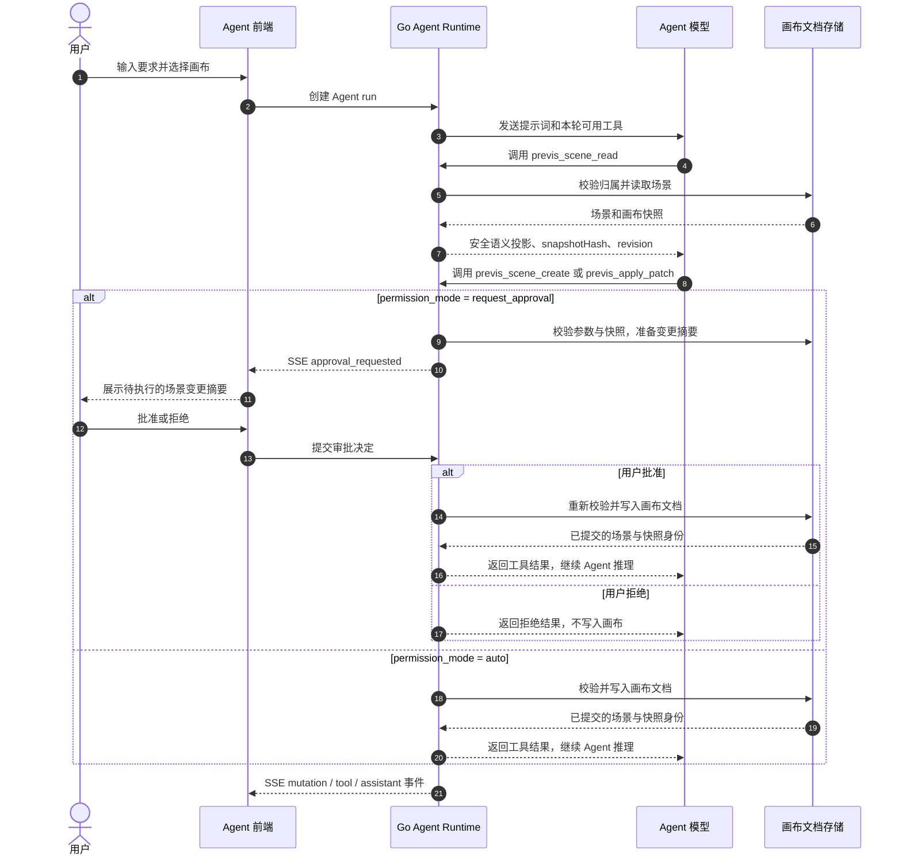
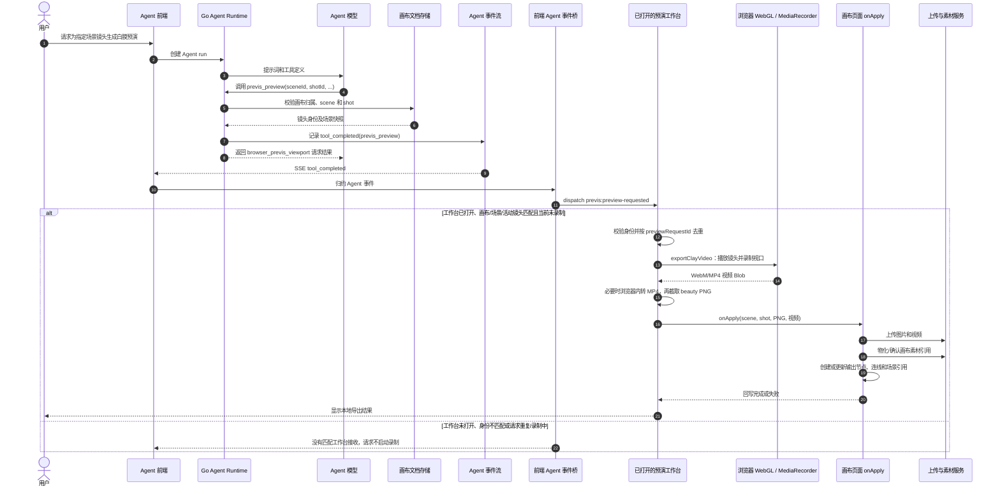

# 预演台与云端 Agent 依赖、执行机制和资源占用调研

> 本文是对[预演台系统深度调研报告](previs-workbench-deep-research.md)的专题补充，专门回答三个问题：预演台是否依赖云端 Agent、一次操作实际经过哪些执行层、资源主要消耗在哪里。
>
> 结论来自当前仓库源码、专项测试和已有预演台报告的交叉核对。源码存在不等于生产环境已经验收；本文把“当前实现”“由实现推断的风险”“面向新系统的建议”和“尚未验证”分开记录。本文没有启动真实模型生成，没有进行真实 GPU/显存压测，也没有完成完整 Agent 到浏览器录制的端到端验收。

## TL;DR

- **预演台核心不依赖云端 Agent。** 场景编辑、Three.js 渲染、静帧截取、白膜录制、浏览器内转码和本地保存都在用户浏览器中完成。
- **当前服务器不负责 3D 预演渲染。** `previs_preview` 只是 Go 后端校验请求并通知当前打开的浏览器工作台录制；服务器不会为这条路径分配 3D GPU，也不会在后端直接生成白膜视频。
- **服务器的主要压力来自媒体与数据链路。** 重点是 PNG/MP4 上传带宽、对象存储容量、画布/素材数据库写入、云端同步，以及 Agent 的运行事件和模型调用成本。
- **Agent 是可选控制面。** 它可以读取/创建/修改预演场景，也可以请求浏览器导出；图片转预演时还可能增加视觉模型调用。没有 Agent，用户仍可正常使用预演台的基本功能。
- **真正改变服务器资源模型的情况是未来增加服务端渲染。** 如果引入无头 Three.js/GPU worker 或服务端视频转码，就需要额外的任务队列、GPU/CPU 配额、超时、取消、幂等和临时文件清理。

从服务器资源类别看，当前实现可以先按下面的量级理解：

| 资源 | 当前预演台的主要来源 | 粗略判断 |
| --- | --- | --- |
| CPU / 内存 | Go API、JSON 校验、同步、Agent 控制；不是 3D 渲染 | 普通编辑低到中；Agent/并发保存增加 |
| GPU | 当前无服务端 3D 预演 GPU | 基础预演为无 |
| 数据库 | 画布 JSON、素材记录、Agent run/事件、版本和审批 | 单次不重，高并发或频繁保存需关注 |
| 网络 | 模型/场景资源下载、PNG/MP4 上传、Agent SSE/bridge | 媒体上传是主要峰值来源 |
| 存储 | 视频/图片对象、素材记录、失败重试产生的临时或孤儿对象 | 长期容量和清理策略是重点 |
| LLM / 视觉模型 | Agent 语义步骤和图片转预演 | 由调用次数、上下文和模型价格决定 |

## 1. 先给结论

### 1.1 预演台核心不依赖云端 Agent

当前预演台的核心编辑能力在浏览器内完成。用户打开画布中的预演台节点后，前端直接维护 `PrevisScene` 草稿，并通过 Three.js / React Three Fiber 渲染视口。添加演员、道具、摄影机和灯光，调整变换、骨骼、关键帧、镜头和视口，以及保存场景，都不要求先创建云端 Agent run。

`CanvasPrevisWorkbench` 的主要输入是场景、画布资源和 `onChange`/`onApply`/`onFlush` 等宿主回调，没有 Agent client 或 Agent session 参数。画布页通过节点 metadata 中的 `previsSceneId` 打开工作台；这条入口是普通画布状态和浏览器渲染路径。

因此，把“预演台”理解为“云端 Agent 的 3D 渲染器”是不准确的。当前实现更接近：

```text
画布中的结构化 PrevisScene
    -> 浏览器 Three.js 视口
    -> 用户编辑 / 本地录制
    -> 上传产物并回写画布
```

### 1.2 云端 Agent 是可选的语义控制面和浏览器录制编排器

云端 Agent 提供四类与预演台有关的工具：

- `previs_scene_read`：读取场景的安全语义投影；
- `previs_scene_create`：在画布文档中创建场景，并绑定可打开预演台的 video 工作站节点；
- `previs_apply_patch`：在审批和快照校验后应用受限语义补丁；
- `previs_preview`：请求当前浏览器中已打开且匹配的预演台录制白膜视频。

其中前三类属于 Agent 控制面或文档写入；`previs_preview` 不在 Go 服务端执行 Three.js，也不生成服务端视频文件，而是通过事件桥请求浏览器执行录制。

### 1.3 主要资源消耗发生在浏览器

对人工编辑和普通导出而言，主要资源是：

- 浏览器 JavaScript/React 状态和场景对象的 CPU、内存；
- WebGL framebuffer、几何、材质、纹理、骨骼和阴影的 GPU/显存；
- `preserveDrawingBuffer`、抗锯齿和最多 1.5 DPR 带来的 framebuffer 压力；
- MediaRecorder 产生的 WebM Blob；
- FFmpeg WASM 在浏览器内把 WebM 转成 MP4 时的 CPU、WASM 内存和临时文件空间；
- PNG/MP4 上传期间的网络带宽和浏览器 Blob 内存。

后端在基础预演渲染路径上只承担画布 API、用户数据同步和可选 Agent 控制面，不承担 3D 渲染 GPU。图片转预演等增强路径会额外消耗视觉模型或文本模型额度，但这不是打开预演台的必需成本。

### 1.4 当前最需要注意的执行边界

- `previs_preview` 完成只表示“浏览器录制请求已经发出”，不表示视频已经录制、转码、上传或回写成功。
- 没有打开匹配的工作台时，当前事件桥不会自动启动无头浏览器或服务端渲染。
- Agent 返回的 `duration`/`fps` 会进入浏览器事件，但当前 `exportClayVideo()` 仍使用活动镜头自身的 `duration`/`fps`；参数覆盖是否真正生效，需要视为当前待修正或待验收边界。
- 当前没有独立且持久的 `accepted -> recording -> transcoding -> uploading -> completed/failed` 预演任务状态合同。
- 输出回写经过上传、素材物化、节点/连线更新和场景引用更新多个阶段，不能当成一个天然原子的数据库事务。

## 2. 依赖矩阵：什么需要 Agent，什么不需要

| 能力 | 是否依赖云端 Agent | 当前执行位置 | 主要外部依赖 | 结果 |
| --- | --- | --- | --- | --- |
| 打开预演台 | 否 | 浏览器画布页 | React、画布节点和 `PrevisScene` | 工作台显示 |
| 添加/删除对象 | 否 | 浏览器工作台 | React 状态、Three.js | 草稿变更 |
| 变换、骨骼、关键帧和镜头编辑 | 否 | 浏览器工作台与视口 | Three.js、前端纯函数 | 草稿变更 |
| 保存预演场景到本地 | 否 | 浏览器 localStorage、localForage/IndexedDB | 用户 scope、本地存储 | 本地持久化或本地草稿 |
| 保存到云端画布 | 否，但需要登录云端同步 | 浏览器同步层 + 画布 API | Cookie/session、HTTP、后端 | 云端画布文档 |
| 静帧 PNG 截取 | 否 | 浏览器 WebGL renderer | `preserveDrawingBuffer`、Blob | 图片 Blob |
| 白膜 WebM 录制 | 否 | 浏览器 WebGL canvas + MediaRecorder | `captureStream`、MediaRecorder | WebM Blob |
| WebM 转 MP4 | 否 | 浏览器 FFmpeg WASM | WASM core、浏览器内存 | MP4 Blob |
| 输出上传和回写画布 | 否，但需要资源 API；云端会话可选 | 浏览器上传/素材同步 + 画布 store | 资源 API、IndexedDB、云端同步 | 图片/视频节点和场景输出引用 |
| Agent 读取场景 | 是 | Go Agent 控制面 | Agent run、数据库 | 安全语义投影 |
| Agent 创建场景 | 是 | Go Agent 控制面写入画布 JSON | 权限、快照 hash、审批策略 | 场景和工作站节点 |
| Agent 应用场景 patch | 是 | Go Agent 控制面写入画布 JSON | scene snapshot hash、审批、受限操作 | 更新后的场景 |
| Agent 请求预演录制 | 是 | Go 工具返回请求 + 浏览器事件桥执行 | Agent SSE、当前工作台、浏览器能力 | 请求浏览器导出白膜 |
| 图片复现为可编辑预演场景 | 是增强路径 | 视觉模型 + Agent 工具 + 浏览器工作台 | `canvas_inspect_image`、语义工具 | 可编辑场景草稿 |

“需要 Agent”只针对 Agent 驱动的路径。它不意味着同一场景的人工编辑、普通导出或保存必须经过 Agent。

## 3. 三条真实执行路径

### 3.1 路径 A：人工打开并编辑预演台

当前主链如下：

```text
画布镜头节点
  -> metadata.previsSceneId / previsShotId
  -> project.tsx 打开 CanvasPrevisWorkbench
  -> draftRef + 工作台状态 + 撤销/重做
  -> R3F Canvas / Three.js 渲染
  -> onChange 写回项目的 previsScenes
  -> 预演保存协调器
  -> 画布本地持久化
  -> 有远端会话时再同步云端
```

`use-canvas-previs.ts` 负责画布节点和场景的绑定。若存在孤儿节点但场景丢失，当前代码会创建空场景兜底，并保留镜头名称和提示词；它不会在用户没有选择时自动塞入默认演员。这是当前项目的修复语义，迁移到新系统时应明确写成产品规则或数据修复策略。

工作台内的 `draftRef` 是高频编辑状态，撤销栈最多保存 50 个快照。手势期间可以只改变 draft，提交时再通过 `usePrevisSaveCoordinator` 进入 canonical 保存路径。这个层次划分避免播放头、选择状态和拖拽中间值每一帧都触发云端写入。

### 3.2 路径 B：Agent 语义读写场景

读场景的 Go 工具只返回安全投影。它可以返回对象、相机、镜头和可选的精确空间布局，但不会返回模型 URL、`storageKey` 或其他敏感资源引用。返回值同时带有：

- `snapshotHash`：当前场景的内容快照；
- `canvasSnapshotHash`：包含场景的画布文档快照；
- `revision`：画布服务端版本。

写入路径使用受限语义操作，而不是任意 JSON path。`previs_scene_create` 要求调用方先提供 `canvasSnapshotHash`；`previs_apply_patch` 要求提供场景 `snapshotHash`。当前实现还限制了操作数、场景数、镜头数、对象数、摄影机数、灯光数和文档大小，并校验角色绑定、动画时间和枚举值。

在 `request_approval` 权限模式下，写入前会生成 approval preview 并等待用户决定；`auto` 模式则在工具获准后直接进入校验和写入。写入之后，后端把更新后的场景和画布 hash 返回，并记录 mutation event。因此，Agent 写场景是“受权限和快照保护的画布文档写入”，不是直接控制浏览器中的 Three.js 对象。

下图展示典型的“先读后写”流程。模型负责决定何时读取、创建或修改；Go runtime 执行工具、校验数据和权限，并把持久化结果回给模型。写工具在 `request_approval` 模式下先暂停等待用户批准；在 `auto` 模式下按授权直接执行。两种模式都不会让模型直接操作 Three.js。



`previs_scene_read` 返回的是供模型规划使用的安全投影，不包含浏览器模型 URL 或存储密钥。创建和 patch 最终写入服务端画布文档；此图不代表浏览器中的工作台会被 Agent 直接遥控，也不等于浏览器已重新载入或展示变更。

### 3.3 路径 C：Agent 请求当前浏览器录制

这条路径容易被误解。当前实现的真实链路是：

```text
Agent 调用 previs_preview
  -> Go 校验 scene/shot/duration/fps/output
  -> 返回 execution=browser_previs_viewport
  -> Agent SSE tool_completed
  -> 前端事件归约器识别 toolName=previs_preview
  -> dispatch CustomEvent("previs:preview-requested")
  -> 当前工作台校验 canvas/scene/active shot
  -> 去重 previewRequestId
  -> exportClayVideo()
  -> WebGL canvas.captureStream + MediaRecorder
  -> 浏览器 FFmpeg WASM 转 MP4
  -> capture beauty PNG
  -> 上传图片/视频并物化素材
  -> 创建或更新画布输出节点、连线和 scene output 引用
```

Go 端 `previs_preview` 只读取场景和镜头，校验参数，并返回请求身份、快照 hash、时长、帧率和 `browser_previs_viewport` 执行标识。它不持有 WebGL context，也不访问浏览器的 `canvas`。

事件桥只在收到 `tool_completed` 时派发浏览器事件。工作台再按画布、场景和活动镜头过滤请求，并以请求 ID 去重；录制期间到达的重复请求会先登记后丢弃，避免录制结束后再次执行。

这条路径有两个产品语义限制：

1. 当前工作台没有打开时，不会自动创建无头渲染会话；请求只是到达事件桥后被当前工作台消费。
2. `tool_completed` 不是完整预演任务完成事件；它只说明 Go 工具返回了请求结果。录制、转码、上传、回写仍在后续异步流程中发生。

下面的时序图展示录制链路中 Agent 真正能做什么：它只能提出一个带场景/镜头身份的请求。前端事件桥把成功的工具结果变成同窗口事件；只有已经打开且身份匹配的工作台才会开始本地录制。这不是 Agent 通过浏览器自动化模拟点击“生成白膜”按钮。录制、转码和回写结束后，目前没有反向完成回执发给 Agent run。



因此，`tool_completed` 只表示 Go 工具已校验并返回请求结果，不是视频任务完成通知。Agent run 与浏览器导出之间没有持久化 job、后台渲染器或完成回调；用户若需要确认最终结果，应看工作台的导出提示和画布上的输出节点/素材。虽然请求事件携带 `duration` / `fps`，当前 `exportClayVideo()` 实际使用工作台活动镜头的参数，详见本文第 6.2 节。

## 4. 保存、同步和输出回写的边界

### 4.1 本地草稿、画布本地存储和云端文档是三层

预演场景至少经过以下三层状态：

```text
工作台 draft
  -> localStorage 中的 previs-scene-draft:<sceneId>（恢复候选）
  -> 画布 store 的 localForage/IndexedDB 文档
  -> 云端用户数据中的画布文档
```

工作台保存协调器每次编辑会复制场景、增加本地 revision、写入 scoped localStorage 草稿，并在约 300ms 防抖后调用宿主 `flush`。`flush` 先把对应 scene 写回画布 store，再等待 `flushCanvasStorePersistence()` 完成本地持久化。

画布 store 进一步按用户 scope 串行化写入：同一 scope 维护 Promise tail；浏览器支持 Web Locks 时使用 `navigator.locks`，不支持时至少保留当前页面内串行队列；要求跨标签页锁的生成持久化路径在不支持时会停止，而不是假装完成。IndexedDB/localForage 保存大文档，localStorage journal 作为恢复收据；journal 超过约 450,000 bytes 时会回退完整保存。

这些机制解决的是本地持久化的顺序和恢复问题，不能被解释为云端版本冲突的通用无冲突合并。云端同步另有约 1.2 秒防抖、串行远端操作、可重试退避和三方重基线流程。

### 4.2 输出回写是多个可重试阶段

`applyPrevisOutput()` 的当前顺序是：

1. 记录开始时的项目、源节点和场景身份；
2. 并行上传构图 PNG 和可选白膜视频；
3. 上传后重新检查项目是否切换、源节点是否仍存在、场景和镜头是否仍存在；
4. 通过 `ensureCanvasNodeAsset()` 物化或复用素材记录；
5. 创建或更新构图图片节点和白膜视频节点；
6. 建立输出节点到预演工作站节点的连线；
7. 更新工作站节点中的输出节点引用和 prompt/camera metadata；
8. 调整节点尺寸，更新画布 React 状态；
9. 保存合并后的 `PrevisScene`。

`ensureCanvasNodeAsset()` 使用用户 scope、画布、节点和任务/资源身份组成的 pending key，避免相同资产并发重复写入。没有云端同步会话时，它仍可以完成本地素材闭环，登录后再同步；有域项目时才进一步建立项目素材关联。

该流程不是跨浏览器 Blob、素材记录、画布 JSON 和云端文档的单事务。设计新系统时，应把每个阶段做成可重试的幂等步骤，并持久化输出作业状态：

```text
captured -> transcoded -> uploaded -> asset_materialized -> nodes_committed -> scene_output_committed -> cloud_acknowledged
```

任一阶段失败都要能知道已有副作用，不能简单从头重跑而产生重复资产或重复节点。

### 4.3 资源身份不能混用

预演输出至少涉及以下身份：

- 节点 ID：画布中的逻辑节点；
- `assetId`：素材业务记录身份；
- `storageKey`：物理存储对象或本地缓存的资源键；
- `previsSceneId` / `previsShotId`：场景和镜头业务身份；
- `previewRequestId`：一次 Agent 浏览器预演请求身份；
- `snapshotHash`：场景内容快照；
- `canvasSnapshotHash`：画布内容快照。

URL 能够被加载只能证明浏览器当前拿到了可访问地址，不能单独证明素材记录、项目引用和物理对象已经完整物化。新实现应把这些身份分别建模，并为上传重试、重复回写、删除和替换设计明确的幂等键和引用检查。

## 5. 浏览器渲染和资源占用评估

### 5.1 渲染器的固定配置

当前视口使用：

```ts
<Canvas
  shadows
  frameloop="demand"
  dpr={[1, 1.5]}
  camera={{ position: [4.8, 2.7, 6.8], fov: 50, near: 0.05, far: 500 }}
  gl={{ antialias: true, preserveDrawingBuffer: true, alpha: false }}
/>
```

可作出的直接判断：

- `frameloop="demand"` 让静止场景不必持续按帧重绘；播放、动画和交互仍会触发连续更新；
- 阴影、抗锯齿和 `preserveDrawingBuffer` 都会增加渲染资源压力；
- DPR 上限 1.5 会使高分辨率屏幕的 framebuffer 大于 CSS 像素尺寸；
- `preserveDrawingBuffer` 为截图和录制提供条件，但会增加 framebuffer 保留成本；
- 当前代码没有根据设备显存自动选择对象数量、纹理分辨率或阴影质量。

因此不能用“节点数”单独估算性能。应该按视口像素、可见 mesh、三角形数、材质/纹理、骨骼、动画轨道、灯光和阴影联合测量。

可以先用数量级公式做容量预算，但不能把它当作浏览器实测值。以 1280×720 CSS 像素、DPR 1.5 为例，逻辑 framebuffer 像素数约为 `1280 × 720 × 1.5² = 2.07M`；仅按 RGBA8 颜色缓冲估算约 8.3 MB，再加深度/模板缓冲、抗锯齿的多重采样、保留绘制缓冲和驱动内部副本，实际显存会更高。纹理也按像素数增长：一张 4096×4096 的未压缩 RGBA8 纹理理论上约 64 MiB，mipmap、颜色格式转换和解码副本还会继续增加。这里的数值只是帮助新实现确定量测口径，当前源码没有报告这些实测占用。

### 5.2 模型、几何和纹理的 GPU/内存成本

模型通过 `GLTFLoader` 加载，使用 `resolveMediaUrl()` 解析资源，并通过 `SkeletonUtils.clone()` 创建实例。当前资源管理代码具有以下防护：

- 使用 generation/identity 区分当前加载与晚到加载；
- 未被采纳的加载结果会释放；
- 采纳失败会区分 clone 已建立和 source 尚未采纳两种清理路径；
- geometry、material、texture、mixer、SkeletonHelper 有显式释放；
- 共享资源用 Set 去重，避免同一资源重复 `dispose()`；
- WebGL context lost/restored 有监听和重新登记 capture context；
- 渲染子树有错误边界和重建入口，模型失败有独立重试。

这些是资源生命周期的实现防护，不是容量保证。实际占用取决于 GLB 的几何、纹理分辨率和压缩方式、材质数量、骨骼数量、动画 clip 数量以及同场景实例数。`SkeletonUtils.clone()` 能复用部分 GPU 资源语义，但每个实例仍会增加 Object3D 层级、骨骼更新、动画 mixer 和 CPU 侧矩阵计算；不能把 clone 当作零成本引用。

场景也不一定会触发外部模型下载：没有绑定外部模型的基础演员可以使用 `PrevisClayActor` 的程序化白膜几何。真正加载 GLB、环境全景或图片参考时，网络下载、解码和 GPU 上传才成为额外成本。

面向新系统应至少采集：

- 场景对象数、可见对象数、mesh 数和三角形数；
- texture 总像素、估算字节数和最大单纹理尺寸；
- skeleton/bone 数、动画 clip 数和每帧更新耗时；
- WebGL renderer info、context lost 次数和加载失败率；
- 录制时实际 FPS、视频 Blob 大小、转码耗时和峰值内存。

当前项目没有这些生产 telemetry，也没有固定的 GLB/纹理容量上限，故不能从源码推导一个可靠的“最多支持多少演员/多少 MB 显存”的数字。

### 5.3 CPU 和渲染循环

静止状态主要依靠 demand rendering。播放或动画期间，工作台通过 `requestAnimationFrame` 更新 playhead，视口通过 `useFrame` 应用模型动画、骨骼轨道和交互状态；相机、变换和模式变化会调用 `invalidate()`。

CPU 负载随以下因素上升：

- 对象和骨骼数量；
- 动画轨道与关键帧插值；
- 多个 mixer 的更新时间；
- Raycaster、TransformControls 和轨迹绘制；
- 阴影相机更新和场景重绘；
- 播放时持续的 React/Three 状态同步。

`frameloop="demand"` 只降低静止时的空转，不能为播放和录制提供性能保证。录制时如果渲染错误，当前代码会主动停止 MediaRecorder，避免产生看似成功但只有残缺帧的视频。

### 5.4 截帧、录制和转码的资源峰值

静帧通过当前 WebGL renderer 渲染后调用 `canvas.toBlob(..., "image/png")`。白膜视频的链路是：

1. 暂停显示材质覆盖并应用 clay material；
2. 使用 `canvas.captureStream(fps)`；
3. 选择 VP9、VP8 或通用 WebM MIME；
4. `MediaRecorder.start(250)` 收集 Blob chunks；
5. 目标时长结束后停止，探测 WebM 实际时长；
6. 要求实际时长至少达到目标时长的 50%；
7. 停止 stream tracks，恢复材质和 renderer 状态；
8. 对非 MP4 的 Blob 调用浏览器内 FFmpeg WASM 转 MP4。

因此导出期间可能同时存在：

```text
WebGL framebuffer
+ 场景 GPU 资源
+ MediaRecorder chunks / WebM Blob
+ FFmpeg 输入文件
+ FFmpeg 输出文件
+ MP4 Blob
+ 上传请求缓冲
```

FFmpeg 核心只在用户明确合并或转码时懒加载，并使用同源发布的 WASM 资源；这减少了首屏包体，却把转码 CPU、WASM 内存和临时文件消耗放到了用户浏览器。报告不能据此承诺移动端或低内存设备可稳定导出。

新系统更稳妥的设计是：根据预演时长、输出分辨率和预计 Blob 大小选择“浏览器导出”或“服务端转码”，并在进入录制前做能力检查和容量预估；同时把转码进度、取消、失败重试和产物清理纳入任务状态。

### 5.5 网络、存储和后端资源

#### 浏览器本地

- `localStorage`：保存 scope 草稿、预演恢复候选和小型 journal；不适合放大媒体；
- localForage/IndexedDB：保存带用户 scope 的画布文档和本地媒体缓存；
- Blob URL：预览和时长探测使用，完成后需要 revoke；
- WASM 文件系统：转码期间保存输入/输出临时文件，完成后删除。

#### 网络

- 加载 GLB、环境全景或远程图片会占用下载带宽；
- PNG/MP4 上传的峰值约等于产物大小，重复重试会放大流量；
- Agent 路径还包括 Agent SSE/HTTP 事件流；
- 云端同步在本地已保存后按约 1.2 秒防抖提交，并对可重试错误使用 2、4、8、16、30 秒退避窗口。

#### 后端

基础预演渲染不需要后端 GPU，也不调用视频生成模型。后端仍会承担：

- 画布文档读写和版本校验；
- 资源上传、素材记录和项目关联；
- 云端用户数据同步；
- Agent run、事件持久化、权限/审批和语义 patch；
- 图片转预演路径中的视觉模型或文本模型调用。

对 Agent 而言，成本主要是 LLM 上下文/输出 token、事件和运行状态存储、HTTP/SSE 连接以及可选视觉模型调用；`previs_preview` 本身没有服务端 3D 渲染费用。

## 6. 当前实现的不足和新系统应提前设计的边界

### 6.1 预演任务状态不完整

当前事件桥把 `tool_completed/previs_preview` 转成浏览器事件，工作台开始录制；但没有一套独立、可查询、可恢复的预演作业状态。用户或 Agent 只能从 UI 消息和工作台提示间接推断录制是否成功。

建议新系统定义独立的 `PrevisExportJob`：

```text
requested
  -> accepted
  -> recording
  -> recorded
  -> transcoding
  -> uploaded
  -> materialized
  -> committed
  -> completed
```

每个状态应记录 `jobId`、`canvasId`、`sceneId`、`shotId`、scene snapshot hash、请求时长/帧率、实际时长、产物键、错误码和重试次数。浏览器执行端通过 job ID 回报状态，Agent 工具返回的是作业确认，而不是把“请求已返回”伪装成“视频已完成”。

### 6.2 `duration` / `fps` 覆盖合同需要收紧

Go 工具会校验并返回可选的 `duration` 和 `fps`，事件桥也把它们放进 `previs:preview-requested` detail。但当前工作台的 `exportClayVideo()` 使用 `activeShot.duration` 和 `activeShot.fps` 调用 `recordVideo()`；事件 detail 的覆盖值没有在该调用处传入。

这至少形成一个静态可见的契约风险：调用方以为请求覆盖会生效，执行方可能仍按镜头默认值录制。新实现应选择并明确一种合同：

- 不支持覆盖：工具 schema 不接收覆盖值；
- 支持覆盖：工作台在录制时使用经过范围校验的请求值，并把实际值写入作业结果；
- 仅建议值：返回中同时给出 requested 与 effective，避免误读。

### 6.3 工作台必须打开的隐含前提

当前浏览器事件桥没有无头渲染后备路径。预演请求若没有命中当前打开的画布、场景和活动镜头，就不会触发导出。这是安全的身份过滤，但也是产品可用性边界。

新系统应在协议中明确：

- 浏览器执行是“当前会话能力”，需要用户打开页面；还是
- 服务端拥有独立渲染 worker，可以在无浏览器时生成；还是
- 两者并存，Agent 根据能力选择执行目标。

不能把浏览器事件桥和后端无头渲染混写成一个“预演服务”。

### 6.4 输出回写没有跨系统事务

当前输出先上传，再物化资产，再更新节点和场景引用。中间任何网络或存储错误都可能留下“已上传但未绑定”的对象，或“本地节点已更新但云端同步待重试”的暂态。

建议：

- 为上传对象设置可计算的内容指纹或稳定 effect key；
- 资源记录、节点引用、场景 output 引用分别幂等提交；
- 在服务端保存未完成回写作业和清理候选；
- 删除资产前检查画布节点、场景、任务和项目引用；
- 物理删除失败时保留素材记录，避免制造幽灵引用。

### 6.5 资源预算和降级策略尚未形成产品合同

当前实现有释放、context recovery、加载失败重试、录制时长检查和 renderer 配置隔离，但没有把性能阈值写成用户可见或服务可执行的合同。

新实现至少需要：

- 场景级对象/三角形/纹理/骨骼预算；
- 质量档位：阴影、抗锯齿、DPR、环境纹理和动画精度；
- 录制级时长、分辨率、帧率和 Blob 上限；
- 低端设备、移动端和 WebGL context loss 的降级行为；
- 指标采集和超限提示，而不是简单截断场景数组。

### 6.6 Agent 语义 patch 与浏览器草稿的并发

Agent 写入的是画布文档中的 `previsScenes`，浏览器工作台同时可能持有未确认 draft。当前系统依赖保存协调器、画布版本和同步层保护，但 Agent patch 与本地草稿的合并规则不能自动推导成任意 JSON 的无冲突合并。

新系统应提前决定：

- Agent patch 是否只能基于最新 scene hash；
- 浏览器存在 dirty draft 时是拒绝、排队还是三方合并；
- 对象、镜头、动画轨道和输出引用采用什么字段级冲突规则；
- 删除和重命名如何通过 tombstone 保留意图；
- Agent 回写是否产生可撤销 mutation event。

## 7. 面向新实现的分层建议

### 7.1 把“场景编辑”和“预演导出”拆成两个领域

场景编辑领域负责 `PrevisScene` 的结构、语义 patch、版本和冲突；导出领域负责把一个冻结的 scene/shot snapshot 转成 PNG/视频资产。导出不应直接读取可变 UI 状态，而应持有：

```text
ExportInput {
  jobId,
  canvasId,
  sceneId,
  shotId,
  sceneSnapshotHash,
  effectiveDuration,
  effectiveFps,
  renderMode,
  requestedBy,
}
```

这样可以判断录制结果是否仍属于请求的场景版本，也能在用户继续编辑时保留旧作业的可追溯性。

### 7.2 对 Agent 采用三层能力合同

明确区分：

1. **工具定义存在**：schema 和描述可被发现；
2. **运行时注册存在**：Agent registry 能返回工具；
3. **主执行链可调用**：当前入口实际能实例化并执行工具。

对预演再增加第四层：

4. **浏览器执行端已连接**：有匹配的工作台消费请求并回报作业状态。

只有第四层完成，才可以把 `previs_preview` 说成一次可执行的浏览器预演任务。

### 7.3 选择渲染位置时保留两个后端合同

当前项目的浏览器渲染适合交互式构图和低延迟白膜预览；服务端渲染 worker 更适合无人值守、批量、可复现和跨设备输出。新系统可以并存：

- `browser_previs_viewport`：依赖用户浏览器，低部署成本，受设备能力限制；
- `server_previs_worker`：依赖固定渲染环境和 GPU/容器资源，适合后台任务，但需要模型资产、字体、shader 和版本可复现。

两者应该共享冻结的 scene snapshot 和导出作业状态，不能各自定义一套场景事实源。

### 7.4 为资源完整性建立可观测账本

建议每次导出都记录：

- scene/shot snapshot hash；
- 输出节点 ID、asset ID、storage key；
- 原始 Blob 大小、转码输入/输出大小；
- 上传对象的内容指纹；
- 物化时间、节点提交时间、云端确认时间；
- 失败阶段和清理状态。

这份账本能区分“浏览器录制失败”“转码失败”“上传失败”“素材已上传但节点未绑定”和“云端保存待重试”，比单一的 `export failed` 更适合排障和重试。

## 8. 测试与验收建议

### 8.1 当前已有的静态/专项覆盖

已有测试覆盖的重点包括：

- 预演保存协调器、防抖、草稿恢复和关闭判定；
- 保存 wiring、场景会话身份、资源释放和 context recovery；
- 预演请求身份过滤和去重；
- 动画、变换、模板、模式、视图和 clay material 纯函数；
- 图片转预演 Agent prompt 中的工具链要求；
- Go 端 `previs_scene_read`、场景创建、语义 patch、快照 hash 区分、权限、审批、上限和撤销记录。

这些测试证明了相应函数和应用边界存在，不等于真实浏览器录制、真实对象存储、真实 Agent SSE 或生产 GPU 已通过验收。

### 8.2 建议补齐的准端到端测试

建议使用 HTTP client + 可控浏览器执行器，把 Agent 控制面和浏览器执行面分开测：

1. 通过 HTTP 创建画布、写入最小 `PrevisScene`、读取 scene/canvas hash；
2. 用旧 hash 提交 patch，确认得到冲突而不修改文档；
3. 用新 hash提交 patch，确认 mutation event、scene hash 和 canvas revision 同步推进；
4. 调用 `previs_preview`，确认返回 `browser_previs_viewport` 和稳定 job/request identity；
5. 浏览器执行器消费请求，回报 accepted/recording/recorded/transcoding/uploading/completed；
6. 重复发送同一 request，确认不会重复录制或重复创建节点；
7. 在录制期间编辑、切换项目、删除镜头，确认旧结果不会写入错误项目；
8. 模拟上传成功但节点提交失败，确认可重试且不会产生重复 asset；
9. 模拟云端不可用，确认本地保存状态与云端 pending 状态明确区分。

### 8.3 真实浏览器和性能验收

真实验收至少需要覆盖：

- Chromium 中 GLB 加载、骨骼、环境纹理、context loss/recovery；
- 不同 WebGL/MediaRecorder MIME 支持；
- 录制目标时长与实际时长；
- FFmpeg WASM 首次加载、转码耗时和峰值内存；
- 低端 CPU/GPU、移动端和高 DPR 屏幕；
- 多标签页同 scope 保存竞争；
- 真实登录、素材上传、项目关联、云端版本冲突；
- Agent run、审批、SSE 重连和浏览器执行器完整链路。

当前仓库已有测试和脚本不能替代这些验收，除非命令确实在目标环境中运行并记录结果。

## 9. 证据索引

| 主题 | 主要入口 | 当前可核对的事实 |
| --- | --- | --- |
| 预演工作台宿主 | [`web/src/pages/canvas/project.tsx`](../../web/src/pages/canvas/project.tsx) | 节点打开、`CanvasPrevisWorkbench` 参数和 `onFlush` 接线 |
| 画布预演编排 | [`web/src/pages/canvas/use-canvas-previs.ts`](../../web/src/pages/canvas/use-canvas-previs.ts) | 场景创建、孤儿修复、输出上传、节点/连线/资产回写 |
| 工作台保存 | [`web/src/components/canvas/previs/canvas-previs-workbench.tsx`](../../web/src/components/canvas/previs/canvas-previs-workbench.tsx)、[`use-previs-save-coordinator.ts`](../../web/src/components/canvas/previs/use-previs-save-coordinator.ts) | draft、撤销、预览请求消费和保存 flush |
| 保存协调器 | [`web/src/lib/canvas/previs/previs-save.ts`](../../web/src/lib/canvas/previs/previs-save.ts) | 300ms 防抖、revision、恢复候选和失败状态 |
| 画布本地持久化 | [`web/src/stores/canvas/use-canvas-store.ts`](../../web/src/stores/canvas/use-canvas-store.ts)、[`web/src/lib/localforage-storage.ts`](../../web/src/lib/localforage-storage.ts) | scope、Promise 队列、Web Locks、journal、rebase、IndexedDB |
| 云端同步 | [`web/src/services/user-data-sync.ts`](../../web/src/services/user-data-sync.ts) | 1.2s 防抖、串行远端操作、重试和冲突处理 |
| Three.js 视口 | [`web/src/components/canvas/previs/previs-viewport.tsx`](../../web/src/components/canvas/previs/previs-viewport.tsx) | renderer 配置、demand loop、模型加载、context recovery |
| 截帧和录制 | [`web/src/components/canvas/previs/previs-viewport-capture.ts`](../../web/src/components/canvas/previs/previs-viewport-capture.ts) | PNG、captureStream、MediaRecorder、时长探测 |
| 浏览器转码 | [`web/src/lib/canvas/canvas-video-merge.ts`](../../web/src/lib/canvas/canvas-video-merge.ts) | FFmpeg WASM 懒加载、WebM 到 MP4、临时文件清理 |
| 资源物化 | [`web/src/services/project-asset-sync.ts`](../../web/src/services/project-asset-sync.ts) | asset identity、幂等 pending key、本地闭环和项目关联 |
| Agent 工具 | [`backend/internal/app/cloud_agent_previs.go`](../../backend/internal/app/cloud_agent_previs.go)、[`cloud_agent_tools.go`](../../backend/internal/app/cloud_agent_tools.go) | 安全读取、预演请求、工具描述和参数校验 |
| Agent 语义写入 | [`backend/internal/app/cloud_agent_previs_mutation.go`](../../backend/internal/app/cloud_agent_previs_mutation.go) | 快照、受限 patch、审批、上限和画布 JSON 写入 |
| Agent 事件桥 | [`web/src/components/canvas/canvas-cloud-agent-events.ts`](../../web/src/components/canvas/canvas-cloud-agent-events.ts)、[`web/src/lib/canvas/previs/previs-preview.ts`](../../web/src/lib/canvas/previs/previs-preview.ts) | tool_completed 到 DOM 事件、身份过滤和去重 |
| Agent 图片复现 | [`web/src/lib/canvas/image-to-previs-agent.ts`](../../web/src/lib/canvas/image-to-previs-agent.ts) | 视觉模型和预演工具的增强路径 |
| 相关测试 | [`web/test/`](../../web/test/)、[`backend/internal/app/cloud_agent_previs_test.go`](../../backend/internal/app/cloud_agent_previs_test.go)、[`cloud_agent_previs_mutation_test.go`](../../backend/internal/app/cloud_agent_previs_mutation_test.go) | 保存、资源、请求、Agent 工具和语义 patch 边界 |

## 10. 当前验证记录和未验证范围

本轮完成了源码交叉核对，并实际运行了两组与本报告结论直接相关的专项测试：

```text
cd web && bun test test/director-save-coordinator.test.ts \
  test/director-save-wiring.test.ts \
  test/director-resources.test.ts \
  test/director-recovery.test.ts \
  test/previs-preview-request.test.ts \
  test/director-repro-runtime.test.ts
# 160 pass, 0 fail

cd backend && go test ./internal/app -run '^(TestCloudAgentPrevis|TestProjectPrevis)' -count=1
# ok yingce/backend/internal/app
```

这些结果支持保存协调器、资源释放、预演请求身份/去重以及 Go 端 Agent 预演语义边界的当前实现判断。它们不覆盖真实 WebGL renderer、MediaRecorder、FFmpeg WASM、对象存储或完整 Agent SSE 到浏览器录制链路。未把首页访问、静态阅读或 `git diff` 描述成运行验收。

本轮未完成以下真实验收：

- 未启动真实后端服务并执行完整预演 API 流程；
- 未执行真实视频模型或视觉模型生成；
- 未在真实 GPU 设备上测量显存、FPS、context loss recovery；
- 未真实录制并验证跨浏览器 MP4 质量和容器元数据；
- 未执行对象存储、素材物化和云端同步的故障注入；
- 未执行跨标签页真实锁竞争或跨设备同步；
- 未完成 Agent 审批、SSE 重连、事件桥和工作台录制的完整 E2E；
- 未做生产级容量和性能压测。

因此本文能支持“当前实现如何组织、资源风险在哪里、迁移时应设计什么合同”的判断，不能支持“所有设备、所有浏览器和所有生产规模都已稳定”的结论。

## 11. 推广条件

本文暂留在 `docs/drafts/`。正式发布或用于 Java/Spring Boot、独立 3D worker 设计时，应先确认：

- `previs_preview` 的 requested/effective duration/fps 合同；
- 浏览器导出作业状态和服务端 worker 是否并存；
- 资产物化、节点提交和场景输出引用的幂等协议；
- 真实浏览器矩阵和性能基准；
- Agent 工具在主执行链和浏览器执行器中的可调用性。

稳定结论可增量补入预演台开发文档、Agent 深度调研和迁移指引，但不要把本报告中的源码索引直接复制到面向最终用户的手册。
