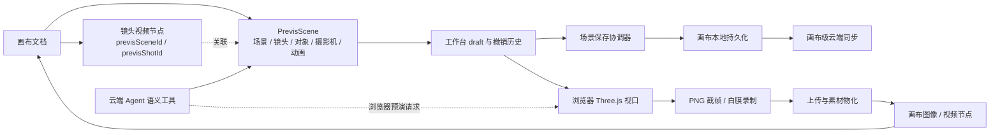

# 预演台系统深度调研报告

> 本文面向正在设计 AI 视频创作产品中 3D 预演能力的开发者。目标不是带你逐个打开当前项目文件，而是解释这套预演台如何建模场景、编辑动画、保存内容、渲染画面、回写画布，以及哪些做法值得重新评估后迁移到新技术栈。
>
> 本轮结论来自当前源码、测试和专题文档的静态核对，并运行了列出的前后端专项测试。没有启动真实业务环境，没有验收真实 WebGL 设备、模型录制转码、云端同步或 Agent 完整运行链路。文中“实现存在”不等于“真实生产环境已验收”。

如果重点是判断预演台是否依赖云端 Agent、浏览器录制请求如何落地，以及 GPU/CPU/内存、网络和后端资源分别消耗在哪里，请继续阅读[预演台与云端 Agent 依赖、执行机制和资源占用调研](previs-agent-dependency-resource-research.md)。

## 0. 范围与阅读方法

### 0.1 本文研究什么

本文中的“预演台”特指画布内的 3D Previs 工作台：它以 `PrevisScene` 保存演员、道具、摄影机、灯光、镜头与动画；用浏览器 Three.js 视口检查构图；再把静帧或白膜视频产物交还画布，供后续 AI 创作使用。

它不是整张二维画布，也不是剪辑工作台。画布系统的同步、资源、节点和 Agent 通用边界可继续读[画布系统深度调研报告](canvas-deep-research.md)；本报告只在这些共用边界与预演台发生交叉的地方展开。

项目功能文档仍使用“导演台 3D-BOX”“快速镜头”等产品描述，而当前源码的工作模式是“摆场、姿态、动画、摄影机”，Agent 工具当前命名为 `previs_*`。这些名称代表不同层次的产品叙述和实现标识，不能直接当作相同页面或同一版本的验收证据。本文以当前代码和专项测试为准，并把文档与实现的命名差异列为待整理项。

### 0.2 结论的证据等级

- **当前实现**：能从源码追到调用路径；必要时有针对性测试支持，但不自动代表真实浏览器或生产服务验收。
- **测试覆盖**：指定测试实际运行并通过。测试边界以测试代码断言为准，不外推为端到端保证。
- **可迁移经验**：从已核实实现抽象出的设计原则，换技术栈时仍需按产品约束复核。
- **项目特定选择**：当前产品做出的取舍，例如把场景放在画布文档内或在浏览器本地录制。
- **待验证 / 风险**：从实现边界看需要进一步设计或验收的问题，不代表已有生产故障。

## 1. 核心结论

预演台不是一套独立的“3D 页面”，而是画布文档中的结构化场景、一个短生命周期编辑会话、浏览器渲染器和画布输出节点之间的协作协议。

| 主题 | 当前项目的事实 | 对新实现的启发 |
| --- | --- | --- |
| 场景身份 | `PrevisScene` 有场景、镜头、对象、摄影机等稳定 ID；场景数组属于 `CanvasProject` | 场景实体可以独立寻址，但身份独立不意味着存储和并发边界独立 |
| 编辑状态 | 编辑草稿、撤销栈、播放头、选择、工作模式分开管理 | 不要把视口和选择等高频 UI 状态混入服务端事实源 |
| 持久化 | 预演保存协调器提交到画布 store 并等待本地持久化 flush；云端同步由画布级机制负责 | UI 要区分“本地已落盘”和“云端已确认” |
| 动画 | 纯函数处理时间吸附、关键帧插值、编辑增量与骨骼旋转 | 将求值和编辑语义从组件中抽出来，作为可单测的领域核心 |
| 渲染 | 浏览器 Three.js/R3F 负责实际预览、PNG 截帧和 MediaRecorder 白膜视频 | 预演渲染不是上游 AI 生成；GPU 生命周期和导出能力属于客户端环境约束 |
| 画布回写 | 输出经上传、素材物化、节点与连线更新，再更新场景中的输出引用 | 跨存储系统的回写要按可重试阶段设计，不能假设整个流程天然原子 |
| Agent | 后端读写语义场景；预演请求由当前浏览器工作台执行 | 工具调用结果、浏览器事件和实际录制是不同阶段，需有清晰的任务确认合同 |

### 1.1 端到端形状

图中最重要的边界是：场景、画布节点、GPU 资源、素材记录和 Agent 运行并不是同一份状态。连接它们的 ID 只提供关联，不会自动提供事务、并发控制或资源存活保证。

## 2. 场景模型与持久化边界

### 2.1 预演场景是有 schema 的领域对象

`PrevisScene` 当前包含：

- 场景级 `id`、`version`、名称、背景、环境强度、环境贴图、网格开关和更新时间；
- `objects[]`：基础几何、模型、演员或 billboard，带变换、可见性、颜色、阴影、角色绑定、姿势、动作片段、骨骼覆盖/轨道、关键帧和运动路径；
- `cameras[]`：变换、目标点、焦距、视场角、光圈、焦距距离、裁剪面和关键帧；
- `lights[]`：方向光、点光、聚光或环境光及其颜色、强度、阴影设置；
- `shots[]`：镜头 ID、摄影机绑定、时长、帧率、画幅、景别、运镜和提示词；
- `activeShotId`：当前镜头身份。

这是明确的产品域 schema，不只是 3D renderer 的临时对象树。Three.js 对象是在渲染过程中从场景数据投影出来的运行时对象；不要把 WebGL 对象引用序列化进持久层。

当前场景 schema 的 `version: 1` 是数据格式版本，不是并发 revision。`createdAt` / `updatedAt` 表达场景生命周期和本地恢复比较，不代替画布服务端版本。

### 2.2 场景身份不等于独立事实源

浏览器的 `CanvasProject` 包含 `previsScenes: PrevisScene[]`。后端 `CanvasProject` 表保存 `PayloadJSON` 和画布级 `Revision`；没有发现单独的 Previs 场景表或供画布 UI 使用的独立场景 CRUD API。云端 Agent 有受限的场景语义读写工具，但其数据仍来自/写回画布文档。预演工作台通过 `workflowKind: "shot"` 的画布视频节点进入，节点 metadata 以 `previsSceneId`、`previsShotId` 等字段关联预演场景和输出节点。

这带来一个务实的收益：画布和场景可以随同一个画布文档保存、导入、备份与恢复，Agent 创建预演场景时也能同时绑定可打开工作台的视频节点。相应成本是：

- 场景级局部 revision 不能提供独立的服务端 CAS；服务端冲突边界仍是整张画布。
- 一个大型场景会增加画布 JSON 的读取、写入与同步成本。
- 场景自身没有独立的服务端权限、协作成员、快照保留和生命周期 API。
- 画布节点引用场景、场景引用模型资源、镜头引用输出节点，数据完整性需要多边检查。

对新系统而言，是否把场景拆成独立聚合，应由协作规模、场景体积、权限和版本保留需求决定。若场景只服务一张小型画布，把它嵌入画布可能更简单；若它要被多张画布共享、多人同时编辑或独立恢复，应给场景自己的持久化身份、revision、授权与资源保留规则。

### 2.3 不要混用的身份

| 身份 | 用途 | 不代表什么 |
| --- | --- | --- |
| `scene.id` | 预演场景身份 | 不是服务端 revision |
| `shot.id` | 场景内镜头身份 | 不是生成任务 ID |
| `object.id` / `camera.id` / `light.id` | 场景内部实体身份 | 不保证实体引用永远有效，读取仍需校验 |
| 画布 `node.id` | 画布节点身份 | 不等于场景或镜头身份 |
| `previsSceneId` / `previsShotId` | 节点到场景/镜头的绑定 | 只是引用字段，不是外键约束 |
| `storageKey` | 物理对象存储定位依据 | 不是业务素材身份或可访问 URL |
| `assetId` / 角色 `characterAssetId` | 素材或角色业务身份 | 不证明底层字节当前可读 |
| 保存协调器 `revision` | 当前编辑会话的本地递增序号 | 不是画布 revision、ETag 或 Agent snapshot hash |
| Agent 场景 `snapshotHash` | 语义 patch 的场景版本前提 | 不代表整张画布版本 |
| Agent `canvasSnapshotHash` | 创建场景前的画布快照前提 | 不代表单个场景或内容文件身份 |

当前对象类型可能同时携带 `url`、`storageKey`、`assetId` 和 `sourceNodeId`。新实现应把业务身份、物理存储、临时访问地址和来源关系建模为不同概念，避免 URL 过期导致业务身份丢失，也避免把客户端可编辑的 URL 当成可信资源证明。

## 3. 工作台运行时：场景内容与编辑视角

### 3.1 两组正交状态

当前实现把一级**工作模式**与二级**视口取景模式**分开：

| 工作模式 | 能力重点 | 视口可选渲染 |
| --- | --- | --- |
| 摆场 `layout` | 添加和摆放对象、演员与灯光 | beauty、clay |
| 姿态 `pose` | 姿势与骨骼编辑 | beauty、clay、pose |
| 动画 `animate` | 时间轴、Auto Key、对象/骨骼/摄影机关键帧 | beauty、clay、pose |
| 摄影机 `camera` | 摄影机、镜头构图、对齐与运镜 | beauty、clay、depth、normal |

取景模式则是 `free`、`camera`、`top`、`front`、`back`、`left`、`right`。它回答“从哪里看”，不回答“当前允许改什么”。例如 `camera` 工作模式与 `camera` 取景模式含义不同：前者突出机位编辑，后者让视口相机跟随当前镜头机位并锁定环绕。

工作模式切换会执行能力收敛：离开动画模式时停止播放、关闭 Auto Key，并把不再允许的渲染视图切回 beauty。把此类约束放在 store 的状态转换函数里，可覆盖多个 UI 操作入口，减少只在按钮层隐藏能力造成的漏洞。

### 3.2 编辑会话不是持久化场景

打开工作台时，组件从父级传入的场景克隆出 `draft`。撤销/重做在工作台维护独立的场景快照历史，普通 `commit` 最多保留最近 50 个历史快照；取消或尚未提交的暂存手势则恢复其起始快照。选择对象、骨骼、灯光、播放头、播放状态、变换工具、取景模式和渲染视图保存在工作台 Zustand store 中，不属于 `PrevisScene` 内容，也没有在该 store 中配置持久化中间件。

因此，下列动作语义不同：

- 修改演员位置、关键帧或镜头参数：场景内容修改，会进入保存协调器。
- 改变选择对象、3D/CAM 视角或面板展开状态：工作台 UI 状态，不应触发场景保存。
- 拖动数值控件时的暂存预览：工作台 draft 的临时状态；取消不发布，提交才形成一次内容编辑。
- 本地撤销/重做：工作台编辑历史，不等于画布跨会话版本历史，也不保证刷新后可恢复。

新实现适合将场景内容、renderer 状态、交互手势和撤销历史分开建模。若产品需要跨设备撤销或版本比较，应显式增加服务端操作日志/快照，而不是持久化 GPU 或组件状态。

## 4. 动画语义：先定义值如何被编辑

### 4.1 时间、帧率与关键帧

场景中的关键帧 `time` 是数值时间；镜头单独配置 `fps`，关键帧写入时按当前镜头帧率吸附。播放头按镜头时长循环。变换关键帧保存完整 transform；骨骼轨道以骨骼名分组、关键帧保存四元数旋转。镜头摄影机、对象变换和对象骨骼是三类不同的轨道。

这是当前产品选择，不是唯一时间模型。新实现应在 schema 中明确时间单位（秒或帧）、镜头帧率变更后关键帧如何解释、时间边界如何处理、浮点容差和导出采样规则。仅用浮点数排序而不定义吸附与近似重复行为，会让“同一帧”出现多个难以删除的关键帧。

### 4.2 Auto Key 开关改变写入含义

当前对象变换编辑的规则是：

- Auto Key 开启：只在吸附后的播放头写入/更新关键帧，基础 transform 和其它关键帧保持不变。
- Auto Key 关闭且没有关键帧：直接修改基础 transform。
- Auto Key 关闭且已有关键帧：计算“渲染值到编辑值”的 delta，再把 delta 同步作用于基础 transform 和所有已有关键帧，让编辑在当前播放头可见，同时整体搬移既有动作。

骨骼旋转按“动作或静置姿势 → 静态覆盖 → 骨骼关键帧”的优先级求值。摄影机生成运镜只更新首尾关键帧，保留用户手动添加的中间帧。以上都是可迁移性很强的例子：动画系统要明确“静态值、程序动作、关键帧、手势编辑”之间的覆盖关系，不能把每种编辑都简化为直接改基础 transform。

当前测试主要验证纯函数的变换 delta、时间吸附、关键帧记录、相机对齐和求值边界；没有证明任意 GLTF 骨架都能正确映射，也没有实机验证不同模型的动画片段兼容性。

### 4.3 手势事务与历史边界

Three.js 视口把拖动变换视为一次手势事务：开始时保留起始场景，移动期间预览变化，commit 只生成一次内容提交，cancel 恢复快照。事务的终态必须释放 `transforming`，否则 OrbitControls 可能一直被禁用。高频 pointermove 适合写入 ref 或 renderer 临时对象；不要每个像素移动都推动整份场景 JSON、触发 autosave 和撤销快照。

建议把场景修改统一表达为领域命令或事务边界，并为“预览、提交、取消”定义一致状态机。需要多人实时协作时，再评估操作变换或 CRDT；单人工作台不应仅为了抽象而引入协作协议。

## 5. 保存、恢复与同步：三个“已保存”不是一回事

### 5.1 当前保存路径

工作台的 canonical 提交先交给 `PrevisSaveCoordinator`，再把场景镜像回父级 `CanvasProject.previsScenes`。协调器按 `scene.id` 固定一个实例，内容编辑增加局部 revision；改动写入当前用户 scope 下的 localStorage 草稿，再以约 300ms 防抖触发 flush。并发触发的 flush 复用同一个 Promise，正在保存时出现的新编辑由 drain 循环继续提交最新 revision。

父级传给工作台的 `onFlush` 是 `flushCanvasStorePersistence()`。因此协调器的 confirmed revision 表示：场景已写回画布 store，且画布 store 的本地持久化队列已 flush。它**不代表**本次已等待云端接口确认。云端同步由 `user-data-sync` 的画布级机制负责；画布 store 的同步状态与预演台局部保存状态是不同维度。

这是值得明确借鉴的 UI 合同：至少区分“编辑器 draft”“本地持久化完成”“服务端接受”“服务端内容与本机一致”。若产品界面只显示一个绿色“已保存”，它必须定义指向哪一层。

### 5.2 本地草稿恢复边界

恢复信封包含 `schemaVersion`、`sceneId`、`baseUpdatedAt`、场景内容、本地 revision 和保存时间，并按用户 scope 隔离。读取时会校验结构、schema 和 scene ID。恢复提示还要求候选场景的基线时间严格匹配当前权威场景的 `updatedAt`，且候选内容更新；若基线已落后，说明权威场景已经改变，旧草稿不会被静默套用。

保存失败时只有在 localStorage 确实写入合法候选的情况下，UI 才承诺“本地草稿已保留”；localStorage 不可用时明确报告没有恢复保障。关闭和 pagehide 会尝试 flush；关闭路径可提示保留草稿后离开或阻止退出。

这份草稿不是云端副本，不是同步 journal，也不是撤销历史。它由浏览器 profile 和用户 scope 限定，可能随浏览器数据清理而消失。新系统应分别定义崩溃恢复、云端冲突、版本回滚和撤销，不要让一份 localStorage JSON 承担所有恢复目标。

### 5.3 并发粒度的限制

当前预演协调器有场景内递增计数，但没有独立服务端 scene revision 或 scene CAS。多个标签页/设备最终仍通过嵌入式画布文档的同步合同协调；预演台局部 revision 不能解决同一场景的远端竞争，也不能提供字段级合并。

如果新系统把多个编辑会话放在同一聚合中，需要在第一版确定冲突策略：

1. 以整份画布为 CAS 单位，冲突时保留本地草稿并显式 rebase/重载。
2. 把 `PrevisScene` 拆为独立文档，以 scene revision 做 CAS，画布只保留引用。
3. 若要多人同时改同一场景，再引入实体/属性级操作日志或协作协议，并处理删除、重命名和轨道依赖。

不要把 local revision、画布 revision、内容 hash、更新时间或 Agent snapshot hash 中任意一个替代其它身份。

## 6. Three.js 渲染和媒体导出

### 6.1 数据驱动的浏览器视口

当前使用 React Three Fiber、Three.js、Drei、GLTFLoader 和 SkeletonUtils。场景内容驱动 Three 对象树，视口维护 free 与摄影机视角；CAM 视图依据活动镜头摄影机及播放头求值，非法透视参数或无效场景会安全回落到 free 视角。正交轴向取景用包围盒求解，不借用场景摄影机。

模型异步加载与编辑场景分离：加载状态上报到 DOM 提示层；失败支持逐对象重试；模型换 URL/重试时屏蔽旧代资源；清理 GLTF 克隆、骨骼、材质、纹理、helper 和 mixer。WebGL context 丢失期间 capture 被标记为不可用，恢复时重建可用上下文。它们是客户端资源生命周期，不应让它们成为服务端场景模型的一部分。

目前视口设置抗锯齿、preserveDrawingBuffer，DPR 上限为 1.5。代码中有模型加载与 GPU 资源清理策略，但本轮没有实测大型场景的帧率、显存、移动设备表现或截图质量。

### 6.2 截帧与录制的真实含义

- 静帧通过当前 WebGL canvas `toBlob` 导出 PNG；渲染前可临时应用 clay、depth、normal 或 pose 材质覆盖，结束后恢复材质并重绘。
- 白膜视频通过 `canvas.captureStream(fps)` 与浏览器 `MediaRecorder` 录制。当前会优先选 WebM 编码，再将结果转码为 MP4；录制结束还会探测视频时长，拒绝明显不完整的输出。
- 录制失败、渲染循环报错、上下文丢失或浏览器不支持 captureStream/MediaRecorder 都可能导致导出失败，需要真实浏览器验证。

“生成白膜视频”在这条主路径里是客户端 3D 视口录制，不是调用外部视频生成模型。静帧回写和白膜录制的入口共用画布回写，但不是同一种媒体生成任务。

需要注意字段语义：显式“应用到画布”和白膜视频导出会捕获 beauty 帧；关闭工作台时的异步缩略图路径则捕获 clay 帧，并仍以 `beauty` 字段交给相同回写函数。因此 `PrevisSceneOutput.beauty` 在该缩略图路径上并不总是严格的 beauty 通道。新实现宜区分“用户输出帧”和“预览缩略图”，避免同一个字段承担两种质量/材质语义。

类型中声明 `PrevisSceneOutput.depth` 和 `normal`，渲染器也支持相应捕获模式；但当前主要的“应用到画布”和白膜导出路径构造并回写的是 beauty PNG，视频导出另带 clay video。`applyPrevisOutput` 会清理旧 depth/normal 输出绑定，当前没有看到这两种通道在该主链被物化为画布节点。不能因类型字段存在就宣称完整通道导出已交付。

### 6.3 性能应从可见工作集设计

预演场景与二维画布节点不是同一个渲染问题。二维画布的空间索引或节点预算不能直接证明 Three 场景有相同能力。新实现至少应按场景复杂度测量：模型数量、蒙皮角色数、材质/纹理数、阴影灯数量、关键帧轨道数、录制分辨率和输出帧率。

建议从稳定的资产加载缓存、资源释放、DPR/分辨率预算、阴影预算、实例化重复几何、模型 LOD、动画更新范围和导出专用质量档开始。交互时优先保证当前操纵对象和摄影机取景；后台导出使用独立的采样/质量合同。当前项目没有提供真实生产压测数据，不能把这些建议写成已测得的容量指标。

## 7. 从预演输出回写画布

### 7.1 当前回写顺序

预演输出回写大致经过以下步骤：

1. 开始时校验当前画布项目、来源镜头节点和 `previsSceneId`。
2. 并行上传 beauty PNG 与可选 clay video。
3. 上传完成后重新从最新画布状态读取项目、来源节点、场景和 shot，避免旧输出写入已切换或删除的目标。
4. 用最新场景合并该 shot 的 preview node 引用，不拿录制开始时的整份场景覆盖并发编辑。
5. 创建或替换画布 image/video 节点，写入媒体 metadata 与编译后的预演提示词。
6. 建立输出节点到来源镜头节点的连接，更新 reference node 列表，并通过 `ensureCanvasNodeAsset` 建立素材引用。
7. 将最终节点、连接和 scene 引用写回画布 store。

回写过程保留输出节点既有位置或提供默认位置；图像尺寸按实际图片比例计算。上传后重新校验项目和 shot 身份、按最新场景最小合并，这些都是应保留的并发保护。

### 7.2 回写不是跨服务原子事务

上述流程跨过浏览器 blob、文件上传、素材记录和画布 JSON。若上传成功后素材同步或画布更新失败，代码中没有一个覆盖对象存储、素材库和画布文档的共同事务。因此新实现应设计可重试阶段和补偿：上传结果可复用、素材创建幂等、节点绑定可重复提交、孤儿对象可回收；不能先假设所有副作用一次性一起成功。

素材一致性仍遵守画布共用规则：`storageKey` 是物理对象存储定位依据，`assetId` 是业务素材身份；URL 仅能帮助访问，不证明文件已经物化。删除/替换要先检查其它项目、画布、任务和素材引用。预演对象引用模型资产或画布图片时，同样需要验证业务引用与物理字节两者都有效。

### 7.3 输出内容与后续 AI 创作

预演图/视频节点会成为画布上的真实媒体节点，并通过连线与引用 ID 给后续流程使用；来源镜头节点保存 `previsSceneId`、`previsShotId`、预览节点 ID、白膜节点 ID 和编译提示词等关联。连线提供可见关系，reference ID 提供工作流语义，两个结构需要同步维护，不能假设只写一边就足够。

提示词由预演场景和镜头数据编译。它是后续生成的输入材料，不是当前截图/录制的生成模型请求。若新系统以后把 AI 模型生成加入这一段，应创建独立任务 ID、输入快照、费用/授权记录和幂等回写，不能把本地 capture 假装成远端生成任务。

## 8. Agent 接入：语义读写与浏览器执行分层

### 8.1 三类工具及其服务端边界

当前运行时会实际分派以下工具：

| 工具 | 用途 | 关键边界 |
| --- | --- | --- |
| `previs_scene_read` | 读取预演场景目录或聚焦读取场景/镜头/对象 | 返回安全语义投影；默认不暴露模型 URL 或 `storageKey`；可选返回空间变换 |
| `previs_scene_create` | 创建模板场景并绑定画布工作站节点 | 需传目录读取得到的 `canvasSnapshotHash`，创建前检查画布内容未变化 |
| `previs_apply_patch` | 对现有场景做有限语义操作 | 使用场景 `snapshotHash`；字段 schema、操作数、绑定和动画边界校验；走共享审批与写入门控 |
| `previs_preview` | 请求浏览器工作台录制白膜预演 | 后端验证场景/shot，并返回浏览器执行请求；它自身不调用模型或浏览器 renderer |

Agent 场景 `snapshotHash` 和整张画布 `canvasSnapshotHash` 的用途不同。安全投影和封闭语义 patch 比允许 Agent 写任意场景 JSON 更容易验证，但它们仍需要运行时权限、对象归属与审批；工具 schema 本身不是授权。

### 8.2 Agent 预演不是后端渲染

后端 `previs_preview` 返回 `canvasId`、`sceneId`、`shotId`、时长、帧率、`previewRequestId` 等结果。前端 Agent 事件桥接在收到 `tool_completed` 后派发 `previs:preview-requested` 浏览器事件。工作台只有在自身处于打开状态且画布、场景和活动镜头身份匹配时才处理请求，并对 request ID 去重，然后复用本地 `exportClayVideo` 路径。

因此当前 Agent 预演依赖：

- 正确画布中的预演工作台已挂载并打开；
- 目标 scene 与 shot 正好匹配工作台当前场景和活动镜头；
- 浏览器 WebGL、MediaRecorder、视频转码和上传能力可用；
- 前端事件链路仍然存活。

工具完成事件返回不等于视频已完成物化。若工作台未打开或请求与当前镜头不匹配，事件不会在后台自动创建另一个浏览器渲染器。

### 8.3 已发现的合同差异

工具定义和后端响应允许请求覆盖 `duration` 与 `fps`，并将其带到前端事件；当前工作台事件监听器校验身份后调用无参数的 `exportClayVideo()`，实际录制使用活动镜头自己的 `duration` 和 `fps`。静态路径因此显示请求覆盖值尚未影响浏览器录制，除非这是刻意不支持的字段。若产品合同要支持覆盖，应将本次请求参数传到录制函数并定义时长上限；否则应从工具 schema 去掉或明确其只是回显信息。

另外，后端返回 `snapshotHash`，前端事件合同目前不携带该哈希，也不校验事件到达时场景内容是否仍是读取时的快照。浏览器主要按画布/场景/活动镜头 ID 匹配，因此它保证的是目标身份匹配和去重，不是内容快照固定。若预演必须严格对应 Agent 读取时的内容，应将内容 hash/version 穿过事件桥接，并在执行前校验。

当前功能文档仍提及 `director_scene_read` / `director_preview`，与源码中 `previs_scene_read` / `previs_preview` 不一致。新版本手册或架构文档应以实际暴露的工具名为准，并同步修订产品文档。

## 9. 架构得失与可迁移建议

### 9.1 值得借鉴

1. **领域 schema 独立于 renderer。** `PrevisScene` 能在不运行 Three.js 的情况下校验、合并、版本化和做 Agent 语义读写。
2. **内容和 UI 状态分离。** 模式、选择、播放头、取景模式不污染共享场景文档。
3. **动画编辑语义纯函数化。** delta、时间吸附、关键帧求值、视角解算等可以单独测试，不依赖 React 或 WebGL。
4. **保存状态明确记录本地草稿。** 失败时不虚报恢复保障，关闭前也有明确决策。
5. **输出回写后重新校验身份。** 上传耗时期间重新读取最新项目状态，再把输出引用合并到仍然有效的 shot。
6. **Agent 使用安全投影和语义 patch。** 模型读到足够的场景语义，但不需要拿到任意资源 URL 或整份写权限。
7. **渲染资源有所有权和 dispose 路径。** 异步模型加载、替换和重试时处理 stale resource 与 GPU 清理。

### 9.2 属于当前产品取舍

- 把场景嵌入画布 JSON，简化单用户画布工作流，但放大了同步冲突单位。
- 把 PNG 和白膜视频在浏览器生成，减少渲染服务和队列建设，却依赖用户浏览器性能、能力和页面生命周期。
- 使用当前的角色 archetype、姿势集合、相机/灯光参数和模板，属于产品范围；不能当作完整 DCC、动画引擎或影视级渲染标准。
- 编辑历史保存在当前工作台内存，不提供跨设备版本回滚。
- Agent 的预演通过事件驱动已打开的浏览器工作台，适合交互式助手，不等同于无头后台批量渲染服务。

### 9.3 当前实现暴露出的限制

- 局部场景 revision 只服务浏览器保存协调器，服务端并发仍以画布文档为边界。
- localStorage 草稿可帮助浏览器崩溃恢复，但不能等同于云端已保存，也没有多标签页 scene lock。
- 输出物化横跨上传、素材库、画布节点和场景引用，没有共同分布式事务。
- 预演主路径没有物化 depth/normal 输出，即使类型和视口捕获支持这些模式。
- Agent 预演请求和本地执行依赖一个当前已打开的工作台；工具事件被接受不代表媒体已完成。
- Agent 预览参数与执行路径对时长/帧率的处理存在静态可见的差异；内容 snapshot hash 也没有穿到浏览器校验。
- 当前测试是确定性单元/后端应用测试；没有真实模型资产覆盖率、不同浏览器编码兼容和生产性能数据。

## 10. 面向新实现的分阶段路线

### 阶段一：定义场景文档合同

先确定 `Scene / Shot / Object / Camera / Light / Track / AssetRef` schema、ID 作用域、单位、坐标系、时间单位、schema 迁移和未知字段策略。把对象业务身份、存储定位与 renderer 对象彻底分开。为每类实体定义创建、删除、引用完整性规则。

### 阶段二：实现不依赖 UI 的领域核心

先实现有效性校验、scene/shot 选择、关键帧排序与重复帧策略、插值、Auto Key、手势事务和局部 patch。为边界值、非法数字、删除实体后残留轨道、shot 时长变化和引用断裂编写纯函数测试。

### 阶段三：定义写入与保存状态机

将编辑 draft、撤销、浏览器本地恢复、服务端 CAS 与跨标签页写入分别定义。选定嵌入画布还是独立 Scene API，并据此确定 revision/ETag、冲突提示、恢复条件和远端确认状态。保存按钮和状态指示要准确说出落在哪一层。

### 阶段四：接入渲染器与捕获

将 schema 投影成 renderer 场景，先实现对象生命周期、异步加载失效、错误恢复、相机取景、捕获前后的材质/renderer 恢复。静帧和视频导出应单独验证 MIME、时长、分辨率、帧率、音视频需求和浏览器兼容矩阵。

### 阶段五：把导出写回产品资源

定义明确的输出任务状态：准备、渲染、上传、素材登记、画布绑定、完成/失败。每阶段使用幂等 key 或可复用上传结果；失败后可以从最后成功阶段重试或补偿。物理资源回收与业务引用检查必须先于删除素材记录。

### 阶段六：再接 Agent

先做只读安全投影，再添加有快照前提的语义 patch 和审批。浏览器预演请求要有会话/场景/镜头/内容版本身份，返回明确的 accepted、running、completed、failed 状态；不要用一个 tool_completed 文案代表录制已完成。参数 schema 和实际浏览器执行必须使用同一个解析结果。

### 阶段七：扩容和协作

用真实场景基准确定模型数量、蒙皮角色、灯光、纹理和导出预算。若需求涉及团队协作或无头任务，再考虑服务端渲染 worker、资产缓存、场景级授权、操作日志和更细粒度协同协议。不要仅凭小样本画布测试就承诺生产容量。

## 11. 测试地图与验证边界

### 11.1 当前可运行测试

本轮实际执行并通过：

| 命令 | 结果 | 覆盖边界 |
| --- | --- | --- |
| `web/` 工作目录：`bun test test/director-save-coordinator.test.ts test/director-save-wiring.test.ts test/director-transform-semantics.test.ts test/previs-preview-request.test.ts test/director-recovery.test.ts test/director-resources.test.ts test/director-modes.test.ts test/director-view-modes.test.ts` | 8 个文件，247 项通过 | 保存协调器、草稿恢复规则、模式/取景能力、动画纯函数、预演请求身份与资源恢复逻辑 |
| `backend/` 工作目录：`go test ./internal/app -run '^(TestCloudAgentPrevis|TestProjectPrevis)'` | 通过 | Agent 安全投影、快照区分、场景创建/patch、权限、审批和参数边界等后端应用逻辑 |

前端测试在这些文件中的覆盖不等于测试了真实 WebGL renderer；后端应用测试也不等于真实 Agent 模型已选择并调用工具。

### 11.2 本轮未做真实验收

- 未在真实浏览器中打开预演台并操作场景。
- 未在真实 GPU 上验证 WebGL 上下文丢失恢复、模型加载兼容或显存释放。
- 未实际录制 MP4、验证转码质量、容器元数据和不同浏览器 MIME 支持。
- 未真实上传输出并验证对象存储、素材库、节点与场景引用在故障下的一致性。
- 未验证跨标签页或跨设备修改同一预演场景时的冲突体验。
- 未执行 `web/scripts/previs-p0-chrome-e2e.mjs`；该脚本存在不等于本轮验收通过。
- 未运行真实云端 Agent 端到端预演，也未验证 Agent 请求时长/帧率是否符合预期产品语义。
- 未进行生产场景性能压测或移动设备性能测试。

## 12. 证据索引

以下路径用于把文中的架构结论追溯到实现；读者无需按文件顺序浏览。

| 主题 | 主要入口 | 用途 |
| --- | --- | --- |
| 场景 schema | [`web/src/types/previs.ts`](../../web/src/types/previs.ts) | 场景、镜头、对象、摄影机、灯光、动画和输出类型 |
| 场景工厂与关键帧函数 | [`web/src/lib/canvas/previs/previs-scene.ts`](../../web/src/lib/canvas/previs/previs-scene.ts) | 默认场景、对象构造、关键帧增删与插值 |
| 动画编辑语义 | [`web/src/lib/canvas/previs/previs-animation-semantics.ts`](../../web/src/lib/canvas/previs/previs-animation-semantics.ts) | Auto Key、delta、骨骼求值、相机对齐与手势状态 |
| 工作/取景模式 | [`previs-modes.ts`](../../web/src/lib/canvas/previs/previs-modes.ts)、[`previs-view-modes.ts`](../../web/src/lib/canvas/previs/previs-view-modes.ts) | 能力矩阵和视口取景求解 |
| 预演会话、保存与恢复 | [`canvas-previs-workbench.tsx`](../../web/src/components/canvas/previs/canvas-previs-workbench.tsx)、[`previs-save.ts`](../../web/src/lib/canvas/previs/previs-save.ts)、[`use-previs-save-coordinator.ts`](../../web/src/components/canvas/previs/use-previs-save-coordinator.ts) | draft、历史、提交、防抖、本地恢复和关闭决策 |
| 保存状态和恢复判定 | [`previs-save-wiring.ts`](../../web/src/lib/canvas/previs/previs-save-wiring.ts) | UI 状态、localStorage 不可用和 stale draft 拒绝规则 |
| 画布场景创建/回写 | [`use-canvas-previs.ts`](../../web/src/pages/canvas/use-canvas-previs.ts)、[`use-canvas-store.ts`](../../web/src/stores/canvas/use-canvas-store.ts) | 视频工作站节点、场景绑定、图片/视频资源和 store 持久化 |
| 视口与捕获 | [`previs-viewport.tsx`](../../web/src/components/canvas/previs/previs-viewport.tsx)、[`previs-viewport-capture.ts`](../../web/src/components/canvas/previs/previs-viewport-capture.ts) | Three renderer、模型生命周期、context 恢复、PNG 和 MediaRecorder |
| Agent 读取和预演请求 | [`cloud_agent_previs.go`](../../backend/internal/app/cloud_agent_previs.go)、[`cloud_agent_tools.go`](../../backend/internal/app/cloud_agent_tools.go) | 安全投影、工具定义与浏览器预演请求 |
| Agent 写入与事件桥 | [`cloud_agent_previs_mutation.go`](../../backend/internal/app/cloud_agent_previs_mutation.go)、[`cloud_agent_runtime_tools.go`](../../backend/internal/app/cloud_agent_runtime_tools.go)、[`canvas-cloud-agent-events.ts`](../../web/src/components/canvas/canvas-cloud-agent-events.ts) | 语义 patch、审批/执行分派、tool_completed 到 DOM 事件 |
| 主要测试 | [`web/test/`](../../web/test/)、[`cloud_agent_previs_test.go`](../../backend/internal/app/cloud_agent_previs_test.go)、[`cloud_agent_previs_mutation_test.go`](../../backend/internal/app/cloud_agent_previs_mutation_test.go) | 保存、动画、模式、资源与 Agent 边界的专项测试 |

## 13. 推广条件

本文先作为 `docs/drafts/` 中的架构研究草稿维护。正式发布前应确认预演台产品术语、Agent 工具命名、时长/帧率覆盖合同和深度/法线输出范围，并完成真实浏览器、模型资产、录制、上传与同步验收。稳定结论可分别推广到画布架构专题、Agent 使用文档和面向用户的预演台手册；不要把整篇源码证据索引复制进用户手册。
